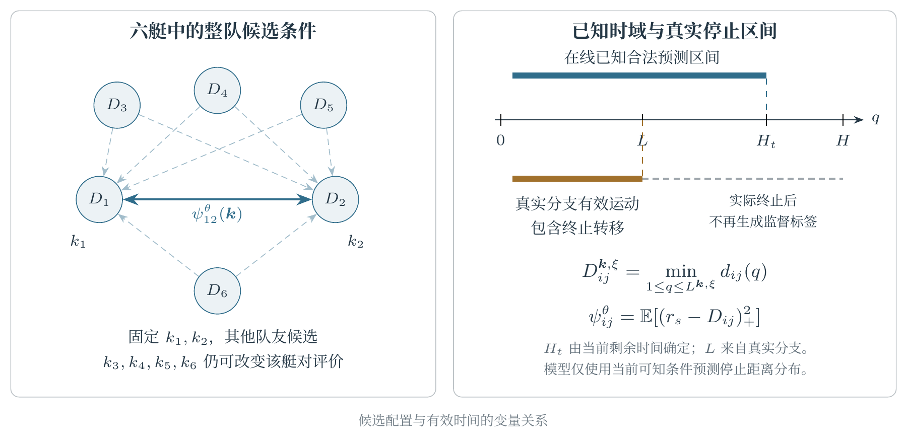

# 基于候选交互Transformer的多无人艇协同目标防御方法

Candidate-Interaction Transformer Fusion for Cooperative Multi-USV Target Defense

作者与单位　**待补**

## 摘要

针对多无人艇协同目标防御中局部融合选择与共同运动相互依赖的问题，提出候选交互Transformer融合方法CITF。以各艇左右推进器的学习控制与规则控制融合系数构成当前整队配置，在名义物理预测的基础上，通过候选关系注意力表示不同配置共同执行时的短时运动联系。采用共享历史编码与对称艇对读出，结合已知剩余任务时间，直接估计任务停止区间内同步最小间距的条件分布，并将期望接近代价用于联合融合选择。利用实际反馈分支构造运动、距离似然、几何风险与配置选择监督，使预测学习与当前控制评价保持一致。数值试验以六艇防御为主任务，通过独立训练、主要算法比较及候选信息和学习目标消融评价方法，并在不同攻击者机动性、艇队规模、学习型对手及Gazebo VRX环境中检验适用性。防御成功率、相对主要对照的效应量和高保真结果分别为**待补**。

**关键词**　多无人艇　协同目标防御　候选交互　Transformer　联合融合　短时运动预测

# I　引言

多无人艇目标防御要求艇队在攻击者进入保护区域之前形成有效拦截，并在共同机动中保持必要的艇间分离。攻击者具有较强的加速和转向能力时，防御艇需要持续调整接近方向和交会位置。多个局部机动可能同时指向有限的拦截空间，其组合效果取决于队友同期采用的控制及随后反馈。对于同时使用学习策略与群体规则的防御系统，各艇控制来源的参与程度需要与共同运动相协调，才能兼顾目标接近、区域防守和艇间分离。

基于动力学的控制与群体规则为无人艇协同运动提供了物理基础和可计算先验[3,4]。强化学习从环境交互中获取动作反馈，支持复杂态势下的连续控制[5]。残差强化学习将已有控制器与学习动作结合，以利用先验并补充复杂情境下的机动能力[6]。ARBoids通过状态相关的融合系数和Adapter训练调节学习控制与Boids控制的参与程度，并利用队友状态及群体规则形成协同防御[1]。多无人艇围捕研究还通过任务相关的状态、动作与奖励设计组织共享策略学习[2]。这些研究表明，控制来源的组合和团队信息的利用是协同防御的重要环节。

多智能体学习采用集中式评价、参数共享和注意力处理队友信息[7,8]。MAPPO利用集中训练与局部策略执行学习合作行为[9]，共享特征映射和集合聚合支持不同数量的智能体[10]。协调图通过个体项与成对关系表达联合动作评价，为组合决策提供计算结构[11]。对于推进器级的混合控制，融合系数作用于当前学习指令与规则指令，其控制效果还随整队同时采用的组合而变化。除状态关系之外，待执行的候选控制及其共同运动需要作为联合选择的条件。

Transformer通过注意力建模时间与实体之间的条件关系[12]，图注意力和归纳式图表示支持变化的交互结构[13,14]。MTR++利用对称场景表示和引导意图查询开展多主体运动预测[15]，GameFormer将交互推理用于行为预测与规划[16]。海事研究中的OR-LSTM利用轨迹预测支持多无人艇协同围捕[17]，DSTGT-Net通过动态时空图和因果注意力学习多船运动[18]。动作条件多智能体模型进一步将待执行控制与未来表示联系起来[19]，状态、动作与预测监督也被用于控制表征学习[20]。这些工作为候选条件下的共同运动估计提供了基础，仍需围绕具体控制变量建立预测结果与联合选择之间的对应关系。

本文研究多无人艇目标防御中的候选融合控制。每个候选不仅改变本艇推进和转向，还会通过后续相对态势影响队友的反馈动作。即使被评价艇对自身的候选保持不变，其他防御艇的不同选择也可能改变该艇对的接近过程。因此，艇对运动评价需要以当前整队配置为条件。同一配置在不同扰动下还具有不同的最小间距，均值运动上的一次距离计算难以充分描述短时接近代价的期望。预测条件中的已知剩余时间与实际分支停止区间也需一致组织，以保证所估计几何量具有明确的时间范围。

针对上述问题，本文提出候选交互Transformer融合方法CITF。该方法将双推进器候选生成、整队条件预测和联合配置求解组织为完整控制器。以已知运动模型构造名义响应，通过候选关系注意力估计不同配置共同执行时的短时几何分布，并将其期望接近代价与局部融合偏好共同用于当前控制选择。轨迹预测和停止区间距离分布共享候选表示，实际反馈分支提供运动、概率估计和配置选择的训练信息[21]。

本文的主要贡献如下。首先，提出面向多无人艇目标防御的候选交互Transformer协同融合控制方法，将学习控制与规则控制的双通道融合选择建模为当前整队配置，并以完整配置条件下的期望接近代价协调各艇控制。其次，设计候选关系Transformer及其控制相关训练机制，结合运动历史、候选控制、名义响应和已知剩余时域，学习停止区间内同步最小间距的条件分布，使真实短时交互监督直接作用于联合融合评价。最后，采用公开方法比较、本文机制对照和独立学习评价完整控制器，并通过机动性变化、未见艇数、学习型对手与高保真试验检验其适用能力。

# II　问题建模

## A　无人艇动力学与控制约束

第\(i\)艘艇的位姿为\(\eta_i=[x_i,y_i,\psi_i]^\top\)，艇体速度为\(\nu_i=[v_{i,x}^{b},v_{i,y}^{b},r_i]^\top\)，左右推进器推力为\(\boldsymbol u_i=[u_{i,L},u_{i,R}]^\top\)。采用平面三自由度模型

\[
\dot\eta_i=R(\psi_i)\nu_i,\qquad
M\dot\nu_i+C(\nu_i)\nu_i+D(\nu_i)\nu_i=B\boldsymbol u_i+w_i.
\]

其中，\(M\)、\(C\)与\(D\)分别表示质量及附加质量、科氏与离心项和阻尼项，\(w_i\)描述扰动，\(R\)完成艇体坐标与地固坐标间的转换[3]。推进器间距为\(b\)时，纵向合力与艏摇力矩分别为\(u_{i,L}+u_{i,R}\)及\(b(u_{i,L}-u_{i,R})/2\)。两通道均满足\(u_{\min}\leq u_{i,a}\leq u_{\max}\)。

数值环境采用WAM-V平面运动参数，控制间隔为\(\Delta t=0.2\) s，积分间隔为0.05 s。名义预测由当前可测位置、航向和地固速度初始化，未来扰动的名义值取零；地固速度经坐标变换后参与艇体动力学积分。攻击者机动性\(L_{\mathrm{agi}}\)定义为其推力上下界相对于防御艇的共同倍率。

## B　目标防御与停止区间

保护区域为以原点为中心、半径\(r_T\)的圆域，防御艇集合为\(\mathcal D=\{1,\ldots,n\}\)，攻击艇记为\(A\)。捕获满足\(\min_i\|p_i-p_A\|<r_c\)，艇间碰撞满足\(\min_{i<j}\|p_i-p_j\|<r_{\mathrm{col}}\)，物理突破满足\(\|p_A\|<r_T\)。本文的共同数值协议还设置径向失守条件

\[
\mathcal E_{\mathrm{rad}}=
\left\{\|p_A\|<\min_{i\in\mathcal D}\|p_i\|\right\}.
\]

终止判定依次检查物理突破或径向失守、艇间碰撞、捕获和任务时限。捕获及守至时限计为防御成功，其余终止计为失败。主任务时限为\(T_{\max}=80\) s，物理突破、径向失守和独立碰撞几何事件分别统计。

给定当前物理时间\(t\)，已知剩余时限为\(T_{\mathrm{rem}}=\max(0,T_{\max}-t)\)。预测上限为\(H\)个控制步，可用预测长度定义为

\[
H_t=\min\!\left(H,\left\lceil T_{\mathrm{rem}}/\Delta t\right\rceil\right).
\]

对某一候选配置\(\boldsymbol k\)和随机未来\(\xi\)，设\(Q_{\mathrm{term}}^{\boldsymbol k,\xi}\)为该分支进入实际终止的控制步，则标签区间终点为

\[
L^{\boldsymbol k,\xi}=\min(H_t,Q_{\mathrm{term}}^{\boldsymbol k,\xi}),\qquad
D_{ij}^{\boldsymbol k,\xi}=\min_{1\leq q\leq L^{\boldsymbol k,\xi}}
\|p_{i,q}^{\boldsymbol k,\xi}-p_{j,q}^{\boldsymbol k,\xi}\|.
\]

进入终止事件的转移保留在区间中。\(H_t\)由当前已知时间确定，\(L^{\boldsymbol k,\xi}\)由实际短分支提供标签。在线预测的条件由历史、当前候选及\(T_{\mathrm{rem}}\)组成。所有控制方法在同一任务协议下比较。

## C　当前联合融合配置

学习控制与规则控制分别输出\(\boldsymbol u_i^L(s)\)和\(\boldsymbol u_i^B(s)\)。当前双通道融合为

\[
\boldsymbol u_i(s,\boldsymbol g_i)
=\boldsymbol g_i\odot\boldsymbol u_i^L(s)
+(\boldsymbol 1-\boldsymbol g_i)\odot\boldsymbol u_i^B(s),
\qquad\boldsymbol g_i\in[0,1]^2.
\]

整队配置为\(G=(\boldsymbol g_1,\ldots,\boldsymbol g_n)\)。两类控制处于相同推力界限时，融合结果位于逐通道端点凸包中。固定当前源指令，融合变化满足

\[
\delta\boldsymbol u_i
=\operatorname{diag}(\boldsymbol u_i^L-\boldsymbol u_i^B)
\delta\boldsymbol g_i,\qquad
\delta\boldsymbol\tau_i=B\,\delta\boldsymbol u_i.
\]

因此，系数相同的变化在不同控制端点下具有不同的推进与转向效果。本文以当前配置作为联合选择对象，以短时共同运动评价其交互，实际执行一个控制周期后重新选择。控制器集中获取艇队观测及源指令，各艇执行对应的推进器输入。图1给出六艇主任务及其几何关系。

# III　候选交互Transformer协同融合方法

## A　整队候选条件化的控制模型

本文将两类控制来源、候选交互预测和联合配置求解构成CITF控制器。每个控制周期由源策略生成学习动作、规则动作和局部融合偏好，据此构建各艇候选；预测器以整队当前候选为条件评价共同运动，联合求解后输出实际推进器指令。局部融合偏好通过采用自适应融合结构的源策略预训练得到[1]，候选条件预测及其配置选择构成本方法的控制决策环节。

源融合网络输出\(a_i\in[0,1]\)，候选中心采用固定映射

\[
\bar g_{i,L}=\bar g_{i,R}=\operatorname{sigmoid}(3.84a_i-1.92).
\]

\(\bar{\boldsymbol g}_i\)表示本艇的局部融合偏好。每艇候选集合为

\[
\mathcal G_i=\{0,\bar g_{i,L},1\}\times\{0,\bar g_{i,R},1\}.
\]

用\(k_i\)标记有效候选，重复端点合并后每艇至多具有9种选择。记\(\boldsymbol k=(k_1,\ldots,k_n)\)，局部偏好代价为

\[
\phi_i(k_i)=\frac12\sum_{a\in\{L,R\}}
\left(\frac{g_{i,a}^{k_i}-\bar g_{i,a}}{s_g}\right)^2.
\]

将历史与已知时域记为\(\mathcal I_t=(\mathcal H_t,T_{\mathrm{rem}},H_t)\)。模型估计停止区间最小间距的条件分布\(P_\theta(D_{ij}\mid\mathcal I_t,\boldsymbol k)\)，据此构造期望接近代价

\[
\psi_{ij}^{\theta}(\mathcal I_t,\boldsymbol k)
=\mathbb E_\theta\!\left[(r_s-D_{ij})_+^2
\mid\mathcal I_t,\boldsymbol k\right].
\]

当前完整配置的评价为

\[
E_\theta(\mathcal I_t,\boldsymbol k)
=\sum_{i=1}^n\phi_i(k_i)
+\lambda_c\sum_{i<j}\psi_{ij}^{\theta}(\mathcal I_t,\boldsymbol k),
\qquad
\boldsymbol k_t^\star=\arg\min_{\boldsymbol k\in\mathcal C_t}
E_\theta(\mathcal I_t,\boldsymbol k).
\]

\(\mathcal C_t\)为该周期已评价的有限配置集合。\(\lambda_c\)承担几何量纲与局部偏好之间的尺度转换。虽然目标按艇对求和，每个艇对项均以整队配置为条件。固定\(k_i,k_j\)时，被评价艇对之外其他防御艇的候选变化仍可进入该项的交互表示。对于六艇系统，模型同时处理15个无序防御艇对。源偏好提供任务机动倾向，学习风险描述当前配置的短时接近程度。

## B　控制策略与预训练

学习控制采用SAC连续动作策略[5]。观测包含保护区域及攻击艇的相对距离与方位、可测对手速度、Boids作用和队友相对信息。队友特征经共享映射和均值聚合形成固定维表示[10]。学习动作头与局部融合网络采用自适应融合结构共同预训练[1]，预测学习阶段固定其参数。

Boids控制由分离、对齐、聚合和目标吸引组成。分离项作用于15 m邻域，对齐项采用艇队平均速度，聚合项指向艇队质心，吸引项指向攻击艇。四项系数依次为10、0.1、0.1和0.5。合成向量在艇体坐标中映射为左右推进器指令，并施加推力约束；网络输入采用归一化推力\(\tilde u=(u-250)/750\)，候选评分与实际执行采用物理推力。

基础策略的训练奖励由任务终止项和非终止阶段的编队项组成。编队奖励为\(2[0.5\hat d_{TA}^{\top}\hat d_{DA}/\|\hat d_{DA}\|-\|\hat d_{DA}\|/n]\)，其中\(\hat d_{DA}\)为各防御艇指向攻击者的单位向量之和，零范数采用数值下限。失守奖励为−100；碰撞艇按违规邻艇数获得−100的惩罚；成功终止时，距攻击艇15 m和5 m以内分别获得50的奖励。课程平均机动性由2.0开始，每25万环境步增加0.25，回合机动性在均值上下0.25内均匀采样。CITF及其直接消融共享同一基础策略训练设置。

## C　物理名义响应与有效时间输入

每个控制周期首先对各艇候选进行低成本物理积分。名义过程保持当前融合推力，得到\(\bar p_i^{k_i}(q)\)；攻击艇按当前可测地速延续。各艇候选轨迹按\(\boldsymbol k\)组合为名义整队响应\(\bar X^{\boldsymbol k}\)。不同完整配置复用相同的单艇积分结果。

实际监督分支保持当前融合系数，源指令则按每条分支的实际状态更新

\[
\boldsymbol u_{i,q}^{\boldsymbol k}
=\boldsymbol g_i^{k_i}\odot\pi^L(o_i(X_q^{\boldsymbol k}))
+(\boldsymbol1-\boldsymbol g_i^{k_i})\odot\pi^B(o_i(X_q^{\boldsymbol k})).
\]

所有防御艇共同执行候选，攻击者依据自身策略反馈。名义保持推力与实际源反馈的差异，为学习模型提供需要辨识的短时运动变化。在线控制在下一周期重新选择配置，训练分支则始终采用上述固定系数、反馈更新源指令的条件语义。

全部历史位置和速度转换到以当前目标方位确定的同一坐标系。每个实体的历史包含位置、地固速度、航向正余弦、艏摇率和角色标识，攻击艇作为独立实体。另加入已知时间上下文

\[
 c_t=\left[T_{\mathrm{rem}}/T_{\max},\ H_t/H\right].
\]

候选特征采用\(q\leq H_t\)的名义未来位移，其他未来时间槽由有效掩码屏蔽。历史编码使用实际已有的观测。图2给出当前配置决策与短分支监督的关系。

## D　候选关系Transformer

共享时间编码器处理每个实体的历史，时间注意力采用因果掩码。历史实体注意力融合共同态势，与时间上下文嵌入相加形成\(h_i\)。同一控制周期只计算一次历史表示，全部候选批次复用该表示。候选节点为

\[
 z_i^{\boldsymbol k}=h_i+
 f_c\!\left[
 \boldsymbol g_i^{k_i},\tilde{\boldsymbol u}_i^L,
 \tilde{\boldsymbol u}_i^B,\tilde{\boldsymbol u}_i(\boldsymbol k),
 \left\{\frac{\bar p_i^{k_i}(q)-p_i}{s_p}\right\}_{q=1}^{H_t}
 \right].
\]

当前攻击艇没有己方融合候选，其源控制特征采用角色一致的空值。对同一完整配置中的实体，构造关系特征

\[
 e_{ij}^{\boldsymbol k}
 =\left[
 \frac{p_j-p_i}{s_x},\
 \frac{\bar d_{ij,\min}^{\boldsymbol k}}{s_d},\
 \frac{\bar d_{ij}^{\boldsymbol k}(H_t)-d_{ij,0}}{s_d},\
 \frac{\bar q_{ij,\min}^{\boldsymbol k}}{H}
 \right].
\]

名义最小距离和对应时刻均在已知有效区间内计算。第\(h\)个注意力头采用

\[
 a_{ij}^{\boldsymbol k,h}
 =\operatorname{softmax}_{j}
 \left[
 \frac{(W_Q^h z_i^{\boldsymbol k})^\top(W_K^h z_j^{\boldsymbol k})}
 {\sqrt{d_h}}+\beta_\theta^h(e_{ij}^{\boldsymbol k})
 \right].
\]

加权消息、残差连接与前馈变换共同更新节点。不同配置位于互不通信的批次中，实体注意力仅在同一实际候选组合内进行。两层关系更新使被评价艇对能够利用其他防御艇当前候选提供的交互条件。节点参数共享，实体掩码限定有效艇队规模。

运动头从更新后的节点生成同步位置修正

\[
 \widehat p_i^{\boldsymbol k}(q)
 =\bar p_i^{k_i}(q)+a_\Delta(q)
 \tanh\!\left(f_{p,\theta}(z_i^{\boldsymbol k})_q\right),
 \qquad a_\Delta(1)=0.
\]

首个控制区间沿用名义响应，后续修正随预测时间获得更大的表达范围。其监督由实际仍有观测的随机分支构成，具体对应\(q\leq L^{\boldsymbol k,\xi}\)条件下的运动均值。分支终止后的时间槽不再参与运动拟合。

## E　停止区间距离分布与几何评分

距离头共享候选节点表示，直接估计\(D_{ij}^{\boldsymbol k}\)的条件分布。定义对称节点组合\(z_{ij}=[z_i+z_j,|z_i-z_j|]\)，有向几何特征\(q_{ij}\)包含相对位置、有效区间名义最小间距和融合系数差。共享读出为

\[
 s_{ij}=\frac12\left\{
 f_e[z_{ij},q_{ij}]+f_e[z_{ij},q_{ji}]
 \right\},
 \qquad
 \mu_{ij}^{\boldsymbol k}=\bar d_{ij,\min}^{\boldsymbol k}(H_t)+s_{ij,1},
 \qquad
 \sigma_{ij}^{\boldsymbol k}=\operatorname{clip}
 (\operatorname{softplus}(s_{ij,2})+\sigma_{\min},\sigma_{\min},\sigma_{\max}).
\]

这里\(\bar d_{ij,\min}(H_t)\)表示名义有效区间内的最小间距。位置参数\(\mu\)可取实数，实际距离分布定义为

\[
 Z_{ij}\sim\mathcal N(\mu_{ij},\sigma_{ij}^{2}),
 \qquad D_{ij}=\max(0,Z_{ij}).
\]

轨迹头与距离头共享候选表示，分别学习有效运动响应和停止区间距离分布。距离读出以当前历史、候选控制及已知有效区间的名义几何为条件，任务停止引起的区间变化包含在分布标签中。图3展示六艇配置中的艇对关系与停止区间。

令\(r=r_s\)、\(b=r-\mu\)、\(z=b/\sigma\)、\(z_0=-\mu/\sigma\)，标准正态密度与分布函数为\(\varphi\)和\(\Phi\)，期望接近代价为

\[
\begin{aligned}
\rho_r(\mu,\sigma)
={}&(b^2+\sigma^2)\Phi(z)+b\sigma\varphi(z)\\
&+(r^2-b^2-\sigma^2)\Phi(z_0)
-\sigma(2b+\mu)\varphi(z_0).
\end{aligned}
\]

该式对\(D=0\)的概率质量与正距离密度同时积分，满足\(0\leq\rho_r\leq r_s^2\)。CITF采用\(\psi_{ij}^{\theta}=\rho_{r_s}(\mu_{ij},\sigma_{ij})\)。尺度表示重复未来条件中的距离离散程度，概率覆盖率及接近事件校准由独立分支评价。各艇对的期望相加使用期望的线性性。确定性分布对照采用实际非负距离均值

\[
\mathbb E[D]=\mu\Phi(\mu/\sigma)+\sigma\varphi(\mu/\sigma),
\]

并据此计算平方接近代价。

## F　面向联合选择的预测学习

训练、验证与测试按初始物理布局划分。每个根历史包含\(C\)组完整配置，每组在\(R\)个随机未来中执行短时反馈。各候选共享对应编号的外生随机序列，并保留自身反馈响应。根时刻预先采样，分支标签包含截至实际终止的有效转移及其长度，覆盖提前失败和提前捕获。

设\(m_{c,r,q}\)表示第\(c\)个候选、第\(r\)个未来在时刻\(q\)仍具有真实转移，辅助运动目标为

\[
 \overline p_{i,q}^{c}
 =\frac{\sum_r m_{c,r,q}p_{i,q}^{c,r}}
 {\sum_r m_{c,r,q}},
 \qquad
 \mathcal L_p=\frac{1}{N_p}\sum_{c,i,q}
 \widetilde m_{c,i,q}\,
 \ell_{\mathrm H}(\widehat p_{i,q}^{c}-\overline p_{i,q}^{c}).
\]

仅当分母非零时计算相应目标，\(\widetilde m\)还包含实体与候选有效掩码。距离分布以每条分支的实际停止区间距离监督

\[
 \mathcal L_d=-\frac1{N_d}\sum_{c,r,i<j}
 \log p_\theta(d_{ij}^{c,r}\mid\mathcal I_t,\boldsymbol k^c).
\]

正距离样本使用高斯密度，零距离样本使用概率质量\(\Phi(-\mu/\sigma)\)。似然在给定采样分布下求平均[21]；采样分布发生变化时，采用已知采样概率进行校正。

实测风险先对单条分支计算，再对重复未来平均

\[
 \overline\psi_{ij}^{c}=
 \frac1R\sum_r(r_s-d_{ij}^{c,r})_+^2,
 \qquad
 \mathcal L_r=\frac1{N_r}\sum_{c,i<j}
 \left(\frac{\psi_{ij}^{\theta,c}-\overline\psi_{ij}^{c}}{r_s^2}\right)^2.
\]

由相同局部偏好和实测风险构造\(E_c^{\mathrm{obs}}\)，由模型风险构造\(\widehat E_c\)。对根状态内的有效候选，定义

\[
 q_c=\frac{\exp(-E_c^{\mathrm{obs}}/T_E)}
 {\sum_a\exp(-E_a^{\mathrm{obs}}/T_E)},\qquad
 p_{\theta,c}=\frac{\exp(-\widehat E_c/T_E)}
 {\sum_a\exp(-\widehat E_a/T_E)},\qquad
 \mathcal L_s=-\sum_cq_c\log p_{\theta,c}.
\]

最终预测目标为

\[
 \mathcal L_{\mathrm{CITF}}
 =\mathcal L_p+\beta_d\mathcal L_d
 +\beta_r\mathcal L_r+\beta_s\mathcal L_s.
\]

\(\mathcal L_p\)和\(\mathcal L_d\)约束物理响应与距离分布，\(\mathcal L_r\)和\(\mathcal L_s\)优化联合控制的评价量。配置选择项对预测能量的梯度为\((q_c-p_{\theta,c})/T_E\)，使预测偏好趋向实测候选代价形成的分布。梯度经可微风险函数更新预测器，联合求解据此产生当前融合配置。

预测训练采用两阶段行为采样。第一阶段使用本文构造的物理预测替代版本CITF-Phys获得覆盖轨迹，该版本在相同控制来源、候选域和搜索规则下，以名义同步间距代替学习分布进行配置评价；第二阶段使用冻结的中期CITF采集其实际访问的根状态。普通预测训练与完整训练共享同一数据并集、源策略和候选库，区别集中于风险及选择监督。验证检查点依照预先固定的实测候选后悔值与风险误差组合选择，完整防御表现用于独立闭环评价。

## G　联合求解与选择误差

以源中心对应的完整配置为\(\boldsymbol k^0\)，在\(K_0\)个初始候选名额中保留该配置，其余名额由名义束搜索按代价次序补齐，重合配置只保留一次。初始集合满足

\[
\boldsymbol k^0\in\mathcal C_t^{(0)},\qquad
|\mathcal C_t^{(0)}|\leq\min(K_0,B).
\]

学习模型对初始配置批量评分，并在当前较优配置的单艇候选邻域中扩展。每个新配置重新计算整队条件预测，重复配置使用当前周期缓存。在预算上限\(B\)内返回全部已评分配置中代价最低的结果。历史编码在同一观测周期内复用，下一观测到来时重新计算。共同源中心的保留与候选去重同样用于匹配物理对照。

每艇至多9个候选、12个初始配置与单轮单艇邻域对应六艇每周期至多\(12+6(9-1)=60\)个唯一配置。评分预算上限为96，重复配置经去重后计数，实际评价量为\(M_t=|\mathcal C_t|\)。

对于完整允许空间\(\mathcal G\)和实际已评分集合\(\mathcal C_t\)，设真实期望几何能量为\(E\)，且

\[
\sup_{\boldsymbol k\in\mathcal C_t}|E_\theta(\boldsymbol k)-E(\boldsymbol k)|\leq\epsilon_E,
\qquad
E_\theta(\widehat{\boldsymbol k})-\min_{\boldsymbol k\in\mathcal C_t}E_\theta(\boldsymbol k)
\leq\epsilon_{\mathrm{opt}}.
\]

则

\[
\begin{aligned}
E(\widehat{\boldsymbol k})-\min_{\boldsymbol k\in\mathcal G}E(\boldsymbol k)
\leq{}&2\epsilon_E+\epsilon_{\mathrm{opt}}+\epsilon_{\mathrm{cover}},\\
\epsilon_{\mathrm{cover}}={}&
\min_{\boldsymbol k\in\mathcal C_t}E(\boldsymbol k)
-\min_{\boldsymbol k\in\mathcal G}E(\boldsymbol k).
\end{aligned}
\]

当前求解器对已评分集合精确取最小值，因此该集合内的\(\epsilon_{\mathrm{opt}}\)为零。有限搜索预算主要影响候选覆盖，模型学习主要影响已评价候选的能量误差。风险函数在非负距离上为\(2r_s\)-Lipschitz，故距离分布的一阶Wasserstein误差还满足

\[
|\mathbb E_P(r_s-D)_+^2-\mathbb E_Q(r_s-D)_+^2|
\leq2r_sW_1(P,Q).
\]

上述界将几何目标的选择误差分解为分布预测误差、集合内求解误差与候选覆盖误差。

# IV　实验与分析

## A　实验设置

主实验采用六艘防御艇，攻击者机动性为2.0和2.5，两组等权汇总。各方法使用相同动力学、80 s时限、终止优先级和初始布局。设置5次完整独立学习，每次均包含独立初始化的基础策略预训练、分支采样及预测学习；每个机动性条件采用100个测试布局。

**表1　任务与方法设置**

| 类别 | 参数 | 设置 |
|---|---|---|
| 任务 | 防御艇数量与机动性 | 6；2.0、2.5 |
| 任务 | 时限、控制周期、积分周期 | 80 s；0.2 s；0.05 s |
| 几何 | 保护、捕获、碰撞尺度 | 15 m；5 m；5 m |
| 输入 | 单推进器推力 | −500至1000 N |
| 预测 | 历史、最大预测步数 | 8；16 |
| 时域 | 公共上下文 | 剩余时间比例、已知有效长度比例 |
| 交互 | 接近尺度与代价权重 | 7 m；32 |
| 偏好 | 源中心映射与偏离尺度 | sigmoid(3.84a−1.92)；0.4 |
| 网络 | 隐藏维数、注意力头 | 56；4 |
| 网络 | 时间层、历史实体层、候选关系层 | 2；1；2 |
| 搜索 | 初始候选、评分上限、邻域轮数 | 12，含源中心；96；1 |
| 预测训练 | AdamW学习率与权重衰减 | \(3\times10^{-4}\)；\(10^{-4}\) |
| 预测训练 | 根状态批量与梯度裁剪 | 6；5 |
| 源训练 | 环境步数、学习率、批量 | \(10^6\)；\(10^{-4}\)；4096 |
| 独立学习 | 完整运行数 | 5 |
| 实测记录 | 最终数据量、选定更新数、实际评分数量 | **待补** |
| 模型规模 | 候选图预测器可训练参数量 | 151354 |
| 计算环境 | 硬件、软件及单实例运行设置 | **待补** |

主指标为防御成功率。辅助指标包括捕获率、主终止碰撞率、独立物理碰撞、物理突破、径向失守和守至时限。未捕获封顶耗时定义为

\[
T_e^{\mathrm{cap}}=
\begin{cases}
t_e^{\mathrm{capture}},&\text{完成捕获},\\
T_{\max},&\text{其他终止结果}.
\end{cases}
\]

该指标与捕获率共同描述时效。模型评价包括有效运动误差、停止区间最小间距误差、风险误差、分布覆盖及真实分支代价后悔值。完整分支与提前停止分支分别统计，另分析时限截断样本。

各方法按训练运行与物理布局配对，计算总体及机动性分组结果与运行间区间[22]，同一布局下的随机未来保留为同簇。基础策略训练、行为采集、短分支采样和预测更新分别计量。图5分别采用环境步和网络更新数表示基础策略与预测学习进程，并单列预测阶段的真实分支转移量。

## B　高保真闭环防御

高保真试验在Gazebo VRX的WAM-V环境中执行[23]。CITF、物理预测替代版本CITF-Phys与ARBoids采用100个共同初始场景，六艇主条件的攻击者机动性为2.5。控制器使用相同单位的状态与推进指令，任务判定与数值试验对应。高保真采用的训练运行在数值正式测试之前确定，按五个最终CITF控制器在共同验证集上的成功率排序取中位运行，相同成功率按训练编号排序；配对基线采用对应运行编号。物理仿真持续推进，每0.2 s发布一次有效控制；计算超期时保持上一已生效指令，并记录传感器、计算完成及指令生效时间。

图4采用批量任务中的接近、交会调整和捕获阶段，结合真实轨迹、艇间距离、融合系数及推进器指令分析联合机动。场景编号和所用控制器在轨迹与汇总结果中保持一致。高保真定量结果列于表2。

**图4　待补　六艇CITF在VRX中的关键时刻、同步轨迹与融合控制记录。**

**表2　100组共同高保真场景结果**

| 方法 | 成功／捕获 | 碰撞／突破 | 封顶耗时／s | 控制p95时延／ms | 超期比例 |
|---|---|---|---|---|---|
| CITF | **待补** | **待补** | **待补** | **待补** | **待补** |
| CITF-Phys | **待补** | **待补** | **待补** | **待补** | **待补** |
| ARBoids | **待补** | **待补** | **待补** | **待补** | **待补** |

## C　算法比较与学习机制

### 1　完整控制性能

比较算法包括ARBoids、RP、SAC、Boids和MAPPO[1,4–6,9]。ARBoids采用状态相关的自适应融合，RP采用加性残差控制，SAC独立学习连续动作，Boids使用共同规则参数，MAPPO采用参数共享、集中训练及分散执行。各方法按照自身定义训练，并在共同六艇任务上评价。

表3报告两个机动等级及总体表现，用于比较完整CITF与公开控制方法。本文构造的物理预测替代、学习机制消融和独立选择对照统一在后续机制分析中定义。执行信息和在线计算条件同时报告，集中预测对照使用与CITF一致的艇队信息、控制来源和计算预算。

**表3　完整CITF与公开方法的主要任务表现**

| 方法 | 2.0成功率 | 2.5成功率 | 总体成功率 | 捕获率 | 碰撞率 | 封顶耗时／s |
|---|---|---|---|---|---|---|
| CITF | **待补** | **待补** | **待补** | **待补** | **待补** | **待补** |
| ARBoids | **待补** | **待补** | **待补** | **待补** | **待补** | **待补** |
| RP | **待补** | **待补** | **待补** | **待补** | **待补** | **待补** |
| SAC | **待补** | **待补** | **待补** | **待补** | **待补** | **待补** |
| Boids | **待补** | **待补** | **待补** | **待补** | **待补** | **待补** |
| MAPPO | **待补** | **待补** | **待补** | **待补** | **待补** | **待补** |

### 2　学习过程与关键消融

为检验学习交互评价的作用，本文构造CITF-Phys物理预测替代版本。该版本保留完整CITF的源控制、局部偏好、候选生成、源中心保留和联合搜索，以已知有效区间内的名义同步最小间距计算几何代价

\[
\psi_{ij}^{\mathrm{Phys}}(\mathcal I_t,\boldsymbol k)
=\left[r_s-\min_{1\le q\le H_t}
\|\bar p_i^{k_i}(q)-\bar p_j^{k_j}(q)\|\right]_+^2.
\]

CITF-Phys在各控制周期采用相同的候选入口与联合搜索规则。闭环比较评价完整控制效果，共同固定候选库上的比较分析预测评分与搜索覆盖的作用。

图5同时展示完整控制器的学习进度、主要基线和两项关键学习消融。源策略阶段以环境步数为横轴，预测阶段分别记录已采样物理转移与预测更新数，检查点在固定验证任务上执行完整防御。各曲线来自5次独立运行，并标明运行间离散程度。预测阶段分别保存0、400、1200、2400、6000和12000次更新时的当前参数，在同一验证任务库中执行完整控制器；阶段曲线采用对应时点的模型，终点主比较另按统一验证准则选模。

去整队候选上下文的版本保留全部历史、当前被评价艇对的自身候选和同一分布读出，取消候选节点之间的关系传播并重新训练。该消融评价完整候选传播模块的作用。为辨析当前其他队友候选的信息作用，另在同一个已训练完整模型中保持被评价艇对和历史不变，将其余候选替换为共同源中心，进行同结构诊断。替换后的名义轨迹同步重算，输入仍对应一个合法配置。

普通预测训练保留相同模型、全部实际分支、运动监督与距离似然，只移除风险和配置选择监督。两种训练方式采用相同验证规则。预测器对提前停止、完整区间与时限截断分支的拟合分别报告，以检验停止区间的估计是否一致。

**图5　待补　完整算法、主要基线及两项学习消融的独立训练曲线与终点效应量。**

### 3　预测与联合选择的对应

机制比较在共同根状态和相同完整候选库上开展。除上述两项主要消融外，保留输入与容量合理匹配的GRU及动作条件Perceiver。物理反馈预测只使用与CITF相同的当前信息，完全已知攻击策略的物理推演另列为诊断上限。候选排序和后悔值由真实短分支的停止区间代价计算。

独立选择采用预先确定的共同源中心配置。各艇只改变自身候选，在相同参考背景下独立选优，然后将各艇选择合并执行。该配置与联合求解共享预测器、候选和评分定义，同时记录实际评分数量。小规模可枚举候选用于分别分析覆盖误差与已评分集合内的选择误差。

**表4　交互预测与配置选择的机制结果**

| 比较 | 间距误差差值 | 风险误差差值 | 实测选择后悔值差值 | 防御成功率差值 |
|---|---|---|---|---|
| CITF与物理预测替代CITF-Phys | **待补** | **待补** | **待补** | **待补** |
| 完整模型与去候选传播 | **待补** | **待补** | **待补** | **待补** |
| 完整训练与普通预测训练 | **待补** | **待补** | **待补** | **待补** |
| 完整模型与匹配GRU | **待补** | **待补** | **待补** | **待补** |
| 完整模型与动作条件Perceiver | **待补** | **待补** | **待补** | **待补** |
| 学习预测与信息匹配物理反馈 | **待补** | **待补** | **待补** | **待补** |
| 联合选择与共同参考独立选择 | **待补** | **待补** | **待补** | **待补** |

同结构候选替换诊断与提前停止分组结果列于补充材料。性能分析依据真实任务中配置改变、接近过程和结局之间的联系展开，并同时记录失败转成功与成功转失败的配对任务数。

### 4　参数和计算开销

交互权重\(\lambda_c\)取0、8、32和64，使用同一预测器并保持运动、观测和停止距离定义。选择监督权重\(\beta_s\)取0、0.025、0.05和0.1，固定其他损失及选模规则并分别重训。两项单因素分析在验证集完成，正式测试采用选定参数。候选覆盖与评分误差分别分析，各模型报告实际配置评价数、可训练参数量和单实例时延。

单实例控制计时覆盖状态处理、源控制、名义积分、历史编码、候选预测与搜索。报告均值、p95、p99以及超过0.2 s的比例。数值同步仿真的计算统计与VRX持续物理时钟分别给出。参数与时间结果为**待补**。

## D　攻击者机动性变化

固定六艇完整控制器，将攻击者机动性由1.5变化至3.0，间隔0.25。各等级采用相同初始几何家族和对应随机序列，方法参数不随测试等级改变。图6(a)比较成功、捕获与碰撞，并通过物理突破和径向失守构成分析防御困难的变化。预测距离和风险误差按同一机动性分组，与实际配置选择共同检验适用性。各等级效应量和运行间区间为**待补**。

## E　跨艇数泛化

源策略和预测器在六艇条件完成训练后，冻结全部权重、交互系数和求解参数，直接评价3、4、5、7、8艇。共享状态映射、实体掩码和对称艇对读出按实际艇数调用，分别产生3、6、10、21和28个防御艇对。图6(b)报告完整控制器的成功率、碰撞及计算开销，同时记录候选评价数量和局部偏好与交互项总量。相应跨规模结果为**待补**。

**图6　待补　六艇机动性变化与完整冻结控制器的跨艇数表现。**

## F　学习型攻击者与适应

采用共同训练的攻击策略集合检验对手变化。选定开发阶段冻结的CITF-Phys作为共同参考防御器，训练攻击策略并保留阶段检查点，再对所有防御方法执行相同攻击者的冻结评价。随后固定相应对手，为各学习方法提供等量真实环境采样预算。当前对手在行为轨迹和每条监督分支中均依据该分支可见状态生成动作，其权重与观测定义保持一致。CITF利用新对手下的短时运动更新预测器，并按真实转移数量混合等量原规则对手数据。最终回测原攻击策略，记录新对手适应与原任务保持。

图7按攻击者更新、冻结评价、防御学习和原任务回测组织实际阶段，报告成功、碰撞、采样资源和学习进度。CITF适应阶段固定源控制，更新短时几何预测。攻击者采用SAC，以目标径向推进及协议终止为奖励；物理突破和径向提前失守同计攻击成功，捕获和防守至时限计攻击失败，防御艇碰撞的额外终止奖励取零。各阶段结果及对应任务行为为**待补**。

**图7　待补　共同学习型攻击者下的冻结迁移、预测学习与原任务保持。**

# V　结论

本文提出候选交互Transformer融合方法，将多无人艇当前融合配置作为短时交互预测的条件，通过候选关系注意力与对称艇对读出学习共同执行后的接近分布。已知剩余任务时间限定在线预测区间，真实分支停止限定监督范围；直接的距离分布读出与有效轨迹监督共享候选表示。期望接近代价和源策略局部偏好共同决定整队当前融合，真实运动、距离似然、风险和配置选择构成相应训练反馈。

六艇主任务中，完整方法的防御成功率为**待补**，相对主要公开算法的效应量为**待补**。学习交互评价相对物理预测替代的增量为**待补**，候选条件与控制相关监督的增量分别为**待补**，高保真任务完成率为**待补**。跨艇数与机动性试验的有效范围为**待补**。后续研究将进一步考察复杂海况下的短时运动分布、通信条件变化及更大艇群中的候选搜索。

# 参考文献

[1] Tao J, Shen T, Zhao D, Zhang F. ARBoids: Adaptive Residual Reinforcement Learning With Boids Model for Cooperative Multi-USV Target Defense. IEEE Robotics and Automation Letters, 2026, 11(3): 3637–3644. DOI 10.1109/LRA.2026.3662620.

[2] 夏家伟, 朱旭芳, 张建强, 罗亚松, 刘忠. 基于多智能体强化学习的无人艇协同围捕方法. 控制与决策, 2023, 38(5): 1438–1447. DOI 10.13195/j.kzyjc.2022.0564.

[3] Fossen T I. Handbook of Marine Craft Hydrodynamics and Motion Control. 2nd ed. Wiley, 2021. DOI 10.1002/9781119575016.

[4] Reynolds C W. Flocks, Herds and Schools: A Distributed Behavioral Model. Computer Graphics, 1987, 21(4): 25–34. DOI 10.1145/37402.37406.

[5] Haarnoja T, Zhou A, Abbeel P, Levine S. Soft Actor-Critic: Off-Policy Maximum Entropy Deep Reinforcement Learning with a Stochastic Actor. Proceedings of Machine Learning Research, 2018, 80: 1861–1870.

[6] Johannink T, Bahl S, Nair A, et al. Residual Reinforcement Learning for Robot Control. IEEE International Conference on Robotics and Automation, 2019: 6023–6029. DOI 10.1109/ICRA.2019.8794127.

[7] Lowe R, Wu Y, Tamar A, Harb J, Abbeel P, Mordatch I. Multi-Agent Actor-Critic for Mixed Cooperative-Competitive Environments. Advances in Neural Information Processing Systems, 2017, 30.

[8] Iqbal S, Sha F. Actor-Attention-Critic for Multi-Agent Reinforcement Learning. Proceedings of Machine Learning Research, 2019, 97: 2961–2970.

[9] Yu C, Velu A, Vinitsky E, et al. The Surprising Effectiveness of PPO in Cooperative Multi-Agent Games. Advances in Neural Information Processing Systems, 2022, 35.

[10] Hüttenrauch M, Šošić A, Neumann G. Deep Reinforcement Learning for Swarm Systems. Journal of Machine Learning Research, 2019, 20(54): 1–31.

[11] Boehmer W, Kurin V, Whiteson S. Deep Coordination Graphs. Proceedings of Machine Learning Research, 2020, 119: 980–991.

[12] Vaswani A, Shazeer N, Parmar N, et al. Attention Is All You Need. Advances in Neural Information Processing Systems, 2017, 30.

[13] Veličković P, Cucurull G, Casanova A, Romero A, Liò P, Bengio Y. Graph Attention Networks. International Conference on Learning Representations, 2018.

[14] Hamilton W L, Ying R, Leskovec J. Inductive Representation Learning on Large Graphs. Advances in Neural Information Processing Systems, 2017, 30.

[15] Shi S, Jiang L, Dai D, Schiele B. MTR++: Multi-Agent Motion Prediction With Symmetric Scene Modeling and Guided Intention Querying. IEEE Transactions on Pattern Analysis and Machine Intelligence, 2024, 46(5): 3955–3971. DOI 10.1109/TPAMI.2024.3352811.

[16] Huang Z, Liu H, Lv C. GameFormer: Game-Theoretic Modeling and Learning of Transformer-Based Interactive Prediction and Planning for Autonomous Driving. IEEE/CVF International Conference on Computer Vision, 2023: 3903–3913.

[17] Yu J, Chen Z, Zhao Z, et al. A Cooperative Hunting Method for Multi-USVs Based on Trajectory Prediction by OR-LSTM. IEEE Transactions on Vehicular Technology, 2024, 73(12): 18087–18101. DOI 10.1109/TVT.2024.3432739.

[18] Li J, Sun J, Cao L, Liu T, Li R. DSTGT-Net: Inductive Dynamic Spatio-Temporal Graph Transformer for Multi-Vessel Long-Term Trajectory Prediction in High-Density Congested Waterways. Ocean Engineering, 2026, 363: 126534. DOI 10.1016/j.oceaneng.2026.126534.

[19] Kich V A, Yamamori S, de Jesus J C, Morimoto J. Action-Conditioned Transformers for Decentralized Multi-Agent World Models. Transactions on Machine Learning Research, 2026.

[20] 刘民颂, 朱圆恒, 赵冬斌. 基于Transformer的状态−动作−奖赏预测表征学习. 自动化学报, 2025, 51(1): 117–132. DOI 10.16383/j.aas.c240230.

[21] Gneiting T, Raftery A E. Strictly Proper Scoring Rules, Prediction, and Estimation. Journal of the American Statistical Association, 2007, 102(477): 359–378. DOI 10.1198/016214506000001437.

[22] Agarwal R, Schwarzer M, Castro P S, Courville A C, Bellemare M G. Deep Reinforcement Learning at the Edge of the Statistical Precipice. Advances in Neural Information Processing Systems, 2021, 34.

[23] Bingham B, Aguero C, McCarrin M, et al. Toward Maritime Robotic Simulation in Gazebo. OCEANS 2019 MTS/IEEE Seattle, 2019: 1–10. DOI 10.23919/OCEANS40490.2019.8962724.
