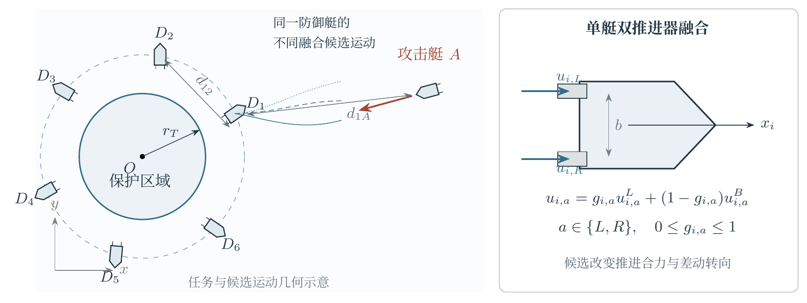
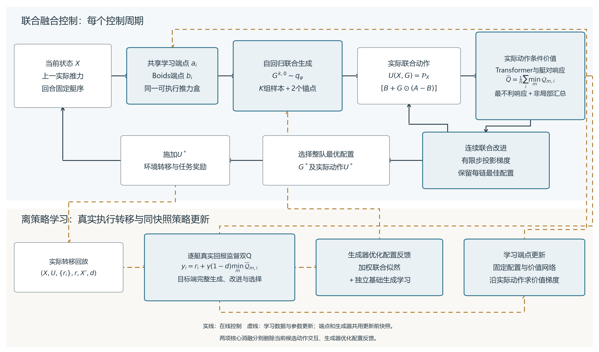

# 基于候选交互Transformer的多无人艇协同融合防御方法

实施状态：当前方法候选已实现，开发训练及机制比较进行中，正式实验结果待填。

## 摘要

针对多无人艇目标防御中规则控制与学习控制的融合选择相互耦合的问题，提出候选交互Transformer融合防御方法CITF。将各艇控制参与比例表示为整队连续配置，通过自回归条件生成形成联合候选，以实际执行动作为条件建立团队价值，在融合空间内同步改进并选择整队配置。设计与完整控制过程一致的离策略学习机制，利用实际任务转移更新交互价值，将优化配置反馈至联合生成分布，并沿融合控制关系更新学习控制端点。推力幅值与相邻周期增量约束统一进入候选评价、配置改进和价值学习。通过基准方法比较、两项核心消融、高保真闭环、攻击者机动性、未见艇数及学习型攻击者实验评价方法性能。【实测结果待填。】

关键词　多无人艇；目标防御；联合融合控制；Transformer；强化学习

# I　引言

多无人艇目标防御要求防御团队在攻击艇进入保护区域之前实施协同拦截，并维持艇间安全间距。攻击者具有较高机动性时，防御艇需要在追捕、封堵与避让之间协调控制行为。单艇动作的有效性取决于队友的运动方向与可用机动空间，多艇控制的共同作用因而成为形成有效防御的重要条件[1]。

Boids利用分离、对齐和聚合规则组织群体运动，为多艇协同提供结构明确的控制先验[2]。深度强化学习通过任务交互优化连续控制行为，Soft Actor-Critic采用熵正则策略学习与离策略价值更新处理连续动作决策[3]。ARBoids通过状态相关Adapter调节学习动作与Boids动作的参与比例，并结合编队奖励和机动性课程进行协同防御学习[1]。该方法建立了规则与学习控制之间的自适应融合关系。

多智能体联合决策进一步涉及动作之间的条件依赖。Deep Coordination Graphs通过个体与成对价值表示协同行为[6]，Multi-Agent Transformer将联合策略表示为条件动作序列[7]。MPO采用价值引导的策略改进与分布拟合[10]，PA-RL结合候选动作评价、局部优化与策略回归进行策略学习[11]。这些研究为联合策略表示和价值引导的动作改进提供了基础。

在多艇融合防御中，同一艘艇采用不同规则与学习控制比例时，其动作对团队的影响随队友配置而变化。融合系数的实际控制作用还取决于两个控制端点的差异以及当前推力约束。候选生成、联合配置求解和控制端点学习需要共同利用这种动作条件关系，使当前配置的改进能够进入后续融合策略的学习过程。

本文提出候选交互Transformer融合防御方法CITF。联合生成器依据当前态势、控制端点和前序融合选择形成整队候选；交互价值网络基于实际执行推力评价团队回报，并引导连续融合配置改进；优化配置反馈与端点价值梯度共同更新后续控制策略。主要贡献如下。

提出面向多无人艇目标防御的联合融合控制方法，以整队连续配置表示规则控制与学习控制的参与比例，在统一执行约束下联合生成、评价和改进各艇控制动作。

设计候选交互Transformer Adapter及其离策略训练机制，以实际联合动作表示融合选择的条件依赖，通过团队价值引导配置改进，并将优化配置反馈至联合生成分布，协同更新候选策略与学习控制端点。

在数值与Gazebo VRX环境中设置完整方法比较、候选动作交互与配置反馈消融，以及机动性、未见艇数和学习型对手实验，评价方法的防御性能与泛化表现。【实测结论待填。】

# II　问题建模

## A　无人艇动力学

第\(i\)艘艇的平面位姿为\(\eta_i=[x_i,y_i,\psi_i]^\top\)，艇体速度为\(\nu_i=[v_{i,x}^b,v_{i,y}^b,r_i]^\top\)。艇体纵轴向前、横轴向左，航向逆时针为正；双推进器推力按右舷、左舷顺序记为\(\mathbf u_i=[u_{i,R},u_{i,L}]^\top\)。数值训练采用水平面三自由度模型[8]

\[
\dot\eta_i=R(\psi_i)\nu_i,\qquad
M\dot\nu_i+C(\nu_i)\nu_i+D(\nu_i)\nu_i=B\mathbf u_i.
\tag{1}
\]

其中\(M,C,D\)分别表示惯性、科氏与离心项及水动力阻尼，\(R\)为坐标变换矩阵，\(B=[(1,0,\ell)^\top,(1,0,-\ell)^\top]\)将双推进器推力映射为纵向合力与艏摇力矩，\(\ell\)为推进器半间距。高保真验证采用Gazebo VRX中的WAM-V模型[9]。攻击艇与防御艇采用相同动力学结构，以推力上下界的共同倍率\(L_{\mathrm{agi}}\)定义攻击者机动性。

数值积分先用当前航向将世界速度转换至艇体坐标，再按式(1)更新艇体速度与航向，最后用更新后的航向形成下一步世界速度；位置使用当前世界速度更新。所有方法采用相同的0.05 s积分步长。

## B　目标防御任务与控制约束

保护区域为\(\mathcal T=\{p:\|p\|\le r_T\}\)，防御艇集合为\(\mathcal D=\{1,\ldots,n\}\)，攻击艇记为\(A\)。攻击艇进入保护区域时发生突破；防御艇间距离不大于\(r_{\mathrm{col}}\)时发生碰撞；防御艇与攻击艇距离小于\(r_c\)时发生捕获。捕获或持续至时限\(T\)且未突破、未碰撞，判为防御成功。每个积分子步检测事件，并发事件依次按突破、碰撞、捕获、到时处理。

以\(t\)表示控制周期序号，\(\Delta t\)表示控制周期，\(\delta_u>0\)表示相邻周期允许的最大推力增量。记成功事件为\(\mathcal S\)，控制目标为

\[
\max_\pi\Pr_\pi(\mathcal S),\qquad
\mathbf u_{i,t}\in[u_{\min},u_{\max}]^2,\qquad
\|\mathbf u_{i,t}-\mathbf u_{i,t-1}\|_\infty\le\delta_u,
\tag{2}
\]

并满足式(1)。训练采用团队折扣回报，成功率按真实终局统计。增量约束作用于施加至动力学模型的推力命令，所有比较方法使用相同约束。

## C　状态与执行信息

物理状态\(s_t\)包含全部艇的位置、航向、平面速度、艏摇率与剩余时间比例\(\rho_t=1-t\Delta t/T\)。航向采用正余弦表示。将上一周期实际推力\(U_{t-1}\)与当前回合的生成顺序\(\sigma\)纳入控制状态，记为\(X_t=(s_t,U_{t-1},\sigma)\)。回合开始时初始化\(U_{-1}=0\)，对防御艇实体随机排列一次形成\(\sigma\)，并在整个回合内保持该映射。

共享学习控制器根据当前实体状态产生各艇控制端点，集中Adapter确定整队融合配置。网络不使用艇的永久编号嵌入；序列位置按\(\sigma\)对应实体，生成后恢复原艇映射。回放保存该顺序，目标动作计算使用相同回合上下文。在线输入限于当前观测与自身控制记录。

# III　候选交互融合防御方法

## A　约束下的整队融合控制

第\(i\)艘艇的规则动作与学习动作分别为\(\mathbf b_i(X)\)和\(\mathbf a_i=\mu_\phi(o_i)\)。每艇一个标量系数\(g_i\in[0,1]\)同时作用于左右推进器，约束内的融合动作为

\[
\widetilde{\mathbf u}_i(X,g_i)
=\mathbf b_i+g_i(\mathbf a_i-\mathbf b_i).
\tag{3}
\]

在当前状态下定义可执行推力域及执行映射

\[
\begin{aligned}
\ell_i(X)&=\max(u_{\min}\mathbf1,\mathbf u_{i,t-1}-\delta_u\mathbf1),\\
h_i(X)&=\min(u_{\max}\mathbf1,\mathbf u_{i,t-1}+\delta_u\mathbf1),\\
\mathcal U_i(X)&=[\ell_i(X),h_i(X)],\\
\mathbf u_i(X,g_i)&=\mathcal P_{i,X}\bigl(\widetilde{\mathbf u}_i(X,g_i)\bigr)
=\Pi_{\mathcal U_i(X)}\bigl(\widetilde{\mathbf u}_i(X,g_i)\bigr).
\end{aligned}
\tag{4}
\]

最大值、最小值及投影均逐分量计算。令名义Boids指令为\(\mathbf b_i^{\mathrm{nom}}\)，两类端点采用

\[
\mathbf b_i=\mathcal P_{i,X}(\mathbf b_i^{\mathrm{nom}}),\qquad
\mathbf a_i=\frac{\ell_i+h_i}{2}
+\frac{h_i-\ell_i}{2}\odot\tanh f_\phi(o_i).
\]

上一周期推力属于该集合，故\(\mathcal U_i(X)\)非空。两端点均在同一可执行盒内，其凸组合直接满足式(2)；式(4)仍作为共同执行映射参与评分、搜索及实际命令形成。

记\(G=(g_1,\ldots,g_n)\)，\(U_\phi(X,G)=\operatorname{col}_i\{\mathbf u_i(X,g_i)\}\)。联合生成与有限步改进形成候选池\(\mathcal C_+(X;\xi)\)，完整控制策略为

\[
G^*(X;\xi)=\arg\max_{G\in\mathcal C_+(X;\xi)}
\widehat Q_\omega(X,U_\phi(X,G)),\qquad
\pi(X;\xi)=U_\phi(X,G^*).
\tag{5}
\]

\(\xi\)为候选生成随机流。全部防御艇在同一控制周期执行对应推力，下一周期根据实际新状态重新决策。

## B　团队价值学习

团队价值表示当前联合推力执行后继续采用式(5)的期望累计回报

\[
Q^\pi(X,U)=\mathbb E\left[
\sum_{j=0}^{\tau-t-1}\gamma^j r_{t+j}
\mid X_t=X,U_t=U,\pi\right],
\tag{6}
\]

其中\(\tau\)为真实终止周期，期望包含环境扰动与后续候选采样。采用两个独立Critic、目标网络与延迟策略更新[4]。

令\(\mathcal Q_{\omega_m,i}\)表示第\(m\)个Critic对第\(i\)艇回报的估计。采用\(\widehat Q_\omega(X,U)=n^{-1}\sum_i\min_{m=1,2}\mathcal Q_{\omega_m,i}(X,U)\)统一指导选择与学习。回放同时保存各艇真实奖励\(r_i\)及其团队均值\(r\)，其中\(U\)为真正施加的推力，下一状态中的前一动作即为\(U\)。目标参数下调用相同的生成、执行映射、连续改进与选择过程，并逐艇取两个目标Critic的较小估计：

\[
\begin{aligned}
\overline U^*&=\pi_{\bar\phi,\bar\psi,\bar\omega}(X';\xi'),\\
y_i&=r_i+\gamma(1-d)\min_{m=1,2}\mathcal Q_{\bar\omega_m,i}(X',\overline U^*).
\end{aligned}
\tag{7}
\]

各艇目标均值为\(r+\gamma(1-d)\widehat Q_{\bar\omega}(X',\overline U^*)\)，与部署评分保持一致。分别拟合实际奖励分量，使碰撞参与者、捕获者及协助艇的信用信息进入学习。两个Critic最小化

\[
\mathcal L_Q=\mathbb E_{\zeta\sim p_V}\left[\frac{w_V(\zeta)}n\sum_{m=1}^{2}\sum_{i=1}^n
\left[\mathcal Q_{\omega_m,i}(X,U)-\operatorname{sg}(y_i)\right]^2\right].
\tag{8}
\]

价值批量一半从完整回放均匀采样，另一半在已出现的终局类型间尽量等分、类内均匀采样。若\(N_D\)为回放大小、\(N_e\)为终局类型样本数、\(\nu_0,\nu_e\)为实际采样比例，则\(p_V(\zeta)=\nu_0/N_D+\nu_{e(\zeta)}/N_{e(\zeta)}\)，非终止转移第二项为零。取\(w_V=(\nu_0/(N_Dp_V))^{1/2}\)缓和终局过采样；无终局时均匀采样并取单位权重。上述比例按实际批量取整及已出现终局类别计算，形成保留终局强调的部分校正加权TD目标。端点与生成器使用另外均匀抽取的状态。三种CITF版本共用此训练配方。

目标控制保持相同候选数量、优化步数、生成顺序和执行约束。捕获、突破、碰撞与任务到时均停止自举；采样器截断与任务终止分别处理。

## C　规则控制

采用分离、对齐、聚合及攻击者吸引构成规则控制[1,2]。设\(\mathcal N_i\)为邻域内其他防御艇，虚拟力为

\[
\begin{aligned}
F_{i,\mathrm{sep}}&=k_s\sum_{j\in\mathcal N_i}
\frac{p_i-p_j}{\max(\|p_i-p_j\|,\epsilon)},\\
F_{i,\mathrm{ali}}&=k_a\left(\frac1{|\mathcal N_i|}\sum_{j\in\mathcal N_i}v_j-v_i\right),\\
F_{i,\mathrm{coh}}&=k_c\left(\frac1{|\mathcal N_i|}\sum_{j\in\mathcal N_i}p_j-p_i\right),\\
F_{i,\mathrm{att}}&=k_t(p_A-p_i).
\end{aligned}
\tag{9}
\]

空邻域时前三项取零。总虚拟力的单位方向转入艇体坐标后，记纵向分量为\(a_i^B\)，方向角为\(\varphi_i^B\)，规则端点为

\[
\mathbf b_i^{\mathrm{nom}}=\operatorname{clip}\left(
\tau_D^{\max}
\begin{bmatrix}a_i^B+0.75\varphi_i^B\\a_i^B-0.75\varphi_i^B\end{bmatrix},
\tau_D^{\min},\tau_D^{\max}\right).
\tag{10}
\]

零合力对应零推力。规则邻域半径为15 m，四项增益依次为10、0.1、0.1、0.5。共享学习控制器读取本艇、攻击艇运动信息及原始Boids指令，并以共享MLP编码距离最近的至多两艘队友的当前相对运动，取均值与逐维最大值汇聚后产生可执行学习端点。候选生成、配置改进与端点训练始终使用同一周期的两端点。

## D　实体表示与联合候选生成

实体特征采用各艇自身艇体坐标，编码目标及攻击艇相对位置、自身及攻击艇相对速度、艏摇率、防御方前一实际推力、剩余时间、角色和距离，并按固定物理尺度归一化。实体Transformer另外读取相应控制端点[5]。艇间相对位置、相对速度、距离、径向相对速度和航向差正余弦组成关系特征，通过可学习注意力偏置及值映射参与状态编码与因果解码。生成器与Critic另读取当前回合生成位置\(j/(n-1)\)，攻击艇记为\(-1\)，以保留后续自回归控制的顺序条件；该位置不作为永久艇身份。按照回合固定顺序\(\sigma\)，联合融合分布写为

\[
q_\psi(G\mid X,A_\phi,B)
=\prod_{j=1}^{n}
q_\psi\left(g_{\sigma_j}\mid
X,A_\phi,B,g_{\sigma_1},\ldots,g_{\sigma_{j-1}}\right).
\tag{11}
\]

记本艇以外距离最近的至多两艘防御艇为\(\mathcal K_i(X)\)。状态和动作注意力中，防御艇读取本艇、攻击艇及\(\mathcal K_i(X)\)，攻击艇token读取自身及距离最近的至多三艘防御艇。多层编码在该空间图上传递信息，以保持不同艇数下的局部汇聚规模；整队的全部融合系数仍在同一完整配置中生成、评分和选择。

前序系数及其经式(4)得到的实际动作与所属艇的状态共同形成前缀token。当前艇从已经生成的前序艇中重新选取最近至多两艇进行交叉注意力，几何边连接实际对应的两艇；当前与未来动作保持掩蔽，首艇使用可学习空前缀token。训练回合之间随机化实体排列，回合内部不随几何方位变化重排。变艇数时按实际艇数构造实体序列，同一批次采用相同艇数，不引入填充艇。

每个条件分布由两个端点原子和连续内部成分组成

\[
q_\psi(g_i\mid\cdot)
=p_i^B\delta_0(g_i)+p_i^L\delta_1(g_i)
+p_i^M\operatorname{Beta}(g_i;\alpha_i,\beta_i).
\tag{12}
\]

三类概率由softmax产生，Beta形状参数为正。\(K\)个联合样本与全规则、全学习两个固定配置构成初始池\(\mathcal C_0\)。两个固定配置同样经过执行约束并接受团队价值评价。训练行为的额外均匀探索独立于候选生成随机流；正式评价取消额外探索。

## E　候选交互Adapter及反馈学习

### 1　实际动作条件团队价值

状态编码得到\(z_i^s=E_\omega(X)_i\)。保留仅以本艇当前动作为动作条件的局部价值路径，动作Transformer在同一完整配置内形成交互修正。定义

\[
\begin{aligned}
e_i&=E_u([z_i^s,\mathbf u_i]),\quad Z^U=T_\omega^U(\{e_i\}_{i=1}^{n},e_A),\\
\boldsymbol\rho_{\omega,ij}&=H_\omega([z_i^U,\Phi_\omega(e_{ij}^U)]),\quad
\Delta\mathbf u_j^B=\frac{\mathbf u_j-\mathbf b_j}{c_u},\\
v_{\omega,ij}&=\boldsymbol\rho_{\omega,ij}^{\mathsf T}\Delta\mathbf u_j^B,\\
q_{\omega,i}^{\mathrm{int}}(X,U)&=\frac1{|\mathcal K_i(X)|}
\sum_{j\in\mathcal K_i(X)}\max(v_{\omega,ij},0)
+\min\!\left(\{0\}\cup\{v_{\omega,ij}:j\in\mathcal K_i(X)\}\right),\\
\mathcal R_i(X)&=\{1,\ldots,n\}\setminus(\{i\}\cup\mathcal K_i(X)),\\
c_{\omega,i}(X,U)&=\min\!\left(\{0\}\cup\{q_{\omega,j}^{\mathrm{int}}(X,U):j\in\mathcal R_i(X)\}\right),\\
\mathcal Q_{\omega,i}(X,U)&=v_\omega(z_i^s)+q_\omega^{\mathrm{loc}}(z_i^s,\mathbf u_i)
+q_{\omega,i}^{\mathrm{int}}(X,U)+c_{\omega,i}(X,U),\\
Q_\omega(X,U)&=\frac1n\sum_i\mathcal Q_{\omega,i}(X,U).
\end{aligned}
\tag{13}
\]

\(\Phi_\omega\)以共享12→64→64网络编码当前艇对几何与推力作用；动作Transformer提供接收艇的候选配置上下文。\(H_\omega\)将两类表示拼接，通过LayerNorm及192→64→2网络产生有向艇对响应。该响应与队友相对可执行规则端点的双推力变化做内积；\(c_u=1000\) N用于量纲归一化。融合配置下，\(\Delta\mathbf u_j^B=g_j(\mathbf a_j-\mathbf b_j)/c_u\)，将队友的融合参与比例及实际动作作用直接联系起来。

正响应采用近邻均值，负响应保留最不利一项，以免其他队友的有利动作稀释可能导致整队终止的交互。零响应使用非负侧导数：实现先计算负部，再由原响应减去负部得到正部；零点不重复激活两侧梯度。该汇总没有新增网络参数或搜索步骤。

任意防御艇碰撞都会结束整队任务，局部邻域外的动作也可能影响本艇后续回报。为传递这类非局部影响，式中将自身及近邻之外的非正最小交互响应汇入本艇价值。该汇总直接使用已有响应，不新增网络参数；当近邻覆盖其余全部防御艇时，集合\(\mathcal R_i\)为空，\(c_{\omega,i}=0\)。

全队均保持规则动作时，局部响应与非局部汇总均为零，价值由共同局部路径给出；本艇保持规则而队友改变动作时，交互项仍可改变本艇回报估计。响应同时依赖本艇及队友候选动作，使各艇系数进入同一个配置的交互评价。响应末层零初始化，全部价值项共同使用实际逐艇任务回报的TD目标训练。

动作交互层在当前几何关系上加入实际候选推力的作用特征：艇间纵向输入加速度差在接收艇坐标中的两维分量，以及两艇各自的输入艏摇加速度。按式(1)，两类输入分量分别由推力和除以纵向惯性、推力差乘推进器半间距后除以艏摇惯性得到。关系映射同时进入注意力分数和值汇聚，形成对双方候选动作的依赖。攻击艇token编码其当前状态，其防御方受控输入置零。所有关系只使用当前状态与候选推力，不展开未来状态。不同候选配置分别评价，一个配置的价值不依赖其他备选配置的数量与排列。在线改进、选择、端点与生成器更新均使用\(\widehat Q_\omega\)，目标回归使用对应的逐艇双Q较小值。

### 2　连续联合配置改进与控制作用

记\(f(X,G)=\widehat Q_\omega(X,U_\phi(X,G))\)。固定状态、控制端点和网络参数，从各初始配置出发同步更新全部融合系数

\[
G^{k,l+1}=\Pi_{[0,1]^n}\left[
G^{k,l}+\eta
\frac{\nabla_G f(X,G^{k,l})}
{\|\nabla_G f(X,G^{k,l})\|_\infty+\epsilon_g}\right],
\quad l=0,\ldots,L-1.
\tag{14}
\]

初始与中间配置共同组成最终池

\[
\mathcal C_+=\bigcup_{l=0}^{L}\mathcal C_l,\qquad
f(X,G^*)\ge\max_{G\in\mathcal C_0}f(X,G).
\tag{15}
\]

该关系来自同一冻结评分下的候选包含。\(\eta\)限制单次搜索中的系数位移，\(\delta_u\)限制相邻控制周期的实际推力增量。

定义\(\Delta\mathbf a_i=\mathbf a_i-\mathbf b_i\)。对系数内部的可微位置，融合方向与跨艇条件关系为

\[
\begin{aligned}
\frac{\partial f}{\partial g_i}
&=\Delta\mathbf a_i^\top
\frac{\partial \widehat Q_\omega}{\partial\mathbf u_i},\\
\frac{\partial^2 f}{\partial g_i\partial g_j}
&=\Delta\mathbf a_i^\top
\frac{\partial^2 \widehat Q_\omega}
{\partial\mathbf u_i\partial\mathbf u_j}
\Delta\mathbf a_j,\qquad i\ne j.
\end{aligned}
\tag{16}
\]

式(13)的交互修正使本艇的融合改进方向随队友当前候选动作而变化。对于同一状态下的初始与改进配置，两端点已经可执行，因此

\[
\Delta\mathbf u_i=(g_i^+-g_i^0)\Delta\mathbf a_i,\qquad
\|\Delta\mathbf u_i\|_2=|g_i^+-g_i^0|\,\|\Delta\mathbf a_i\|_2.
\tag{17}
\]

该关系把系数调整直接对应到双推进器的控制变化；控制端点相同时，相应系数不改变动作。

### 3　学习控制端点更新

每条改进链保留其最高分配置，去除重复配置后形成\(\mathcal R_+=\{G_k^+\}_{k=1}^{M}\)。记\(f_k^+=f(X,G_k^+)\)，构造价值权重及端点学习目标

\[
\begin{aligned}
w_k^+&=\frac{\exp[(f_k^+-\max_j f_j^+)/\tau_Q]}
{\sum_j\exp[(f_j^+-\max_j f_j^+)/\tau_Q]},\\
\mathcal L_\phi&=-\mathbb E_X\sum_k\operatorname{sg}(w_k^+)
\frac{\widehat Q_\omega(X,U_\phi(X,\operatorname{sg}(G_k^+)))}{c_Q}.
\end{aligned}
\tag{18}
\]

\(\tau_Q\)为回报量纲的温度，\(c_Q>0\)为固定损失尺度。固定配置与Critic参数，保留通过实际执行映射的动作梯度

\[
\nabla_\phi \widehat Q_\omega
=\sum_i g_i
\left(\frac{\partial\mathbf a_i}{\partial\phi}\right)^\top
\frac{\partial \widehat Q_\omega}{\partial\mathbf u_i}.
\tag{19}
\]

### 4　联合分布学习与优化配置反馈

生成器以实际动作价值进行基础学习

\[
\mathcal L_{\psi,\mathrm{base}}
=-\mathbb E_{X,G\sim q_\psi(\cdot\mid X)}[f(X,G)/c_Q].
\tag{20}
\]

优化配置进一步构成联合分布的反馈目标

\[
\mathcal L_{\psi,\mathrm{fb}}
=-\mathbb E_X\sum_k\operatorname{sg}(w_k^+)
\log q_\psi(\operatorname{sg}(G_k^+)\mid X),\qquad
\mathcal L_\psi=\mathcal L_{\psi,\mathrm{base}}
+\lambda\mathcal L_{\psi,\mathrm{fb}}.
\tag{21}
\]

简写\(q_\psi(G\mid X)\)仍包含当前控制端点条件。反馈使用优化配置的真实前缀进行teacher forcing，端点、配置与权重均停止梯度。端点0与1分别使用\(\log p^B\)和\(\log p^L\)，内部样本使用\(\log p^M+\log\operatorname{Beta}(g;\alpha,\beta)\)。

混合分布基础目标采用得分函数梯度

\[
\nabla_\psi\mathcal L_{\psi,\mathrm{base}}
=-\mathbb E\left[
(f/c_Q-b(X))\nabla_\psi\log q_\psi(G\mid X)\right].
\tag{22}
\]

\(b(X)\)由同状态其他独立生成样本分数的留一均值构造并停止梯度。候选供给、配置反馈与端点更新采用同一参数快照计算，再执行相应参数更新。

**算法1　候选交互融合控制与离策略学习**

1. 初始化学习端点、联合生成器、两个Critic及目标网络；每回合确定实体顺序并初始化前一推力。
2. 根据\(X_t\)计算控制端点，按式(11)—(12)形成初始候选。
3. 由式(4)、(13)—(15)评价并改进配置，选择整队推力并同时执行。
4. 保存实际转移\((X_t,U_t,r_t,X_{t+1},d_t)\)。
5. 从回放采样，调用完整目标控制算子，按式(7)—(8)更新Critic。
6. 按延迟间隔构造当前优化配置，由式(18)及式(20)—(22)更新端点与生成器，随后软更新目标网络。
7. 部署阶段冻结网络参数，重复执行步骤2—3。

在线链路为联合候选生成、约束执行映射、动作交互评价、连续联合改进与整队推力执行；训练链路为实际转移价值回归、优化配置反馈与控制端点更新。

## F　团队奖励

奖励包含任务事件、编队几何与艇间碰撞项[1]，团队回报为

\[
r=\frac1n\sum_i
(r_{i,\mathrm{main}}+r_{\mathrm{form}}+r_{i,\mathrm{col}}).
\tag{23}
\]

捕获艇奖励100，距攻击艇15 m内的协助艇奖励50；突破时各艇奖励−100，参与碰撞的艇惩罚−50，到时终止奖励0。非终止步采用编队项。定义由防御艇指向攻击艇的单位向量\(\widehat d_{iA}\)、由目标指向攻击艇的单位向量\(\widehat d_{TA}\)及\(m=\sum_i\widehat d_{iA}\)，则

\[
r_{\mathrm{form}}
=0.5\widehat d_{TA}^{\top}\frac{m}{\max(\|m\|,\epsilon)}
-\frac{\|m\|}{n}.
\tag{24}
\]

奖励按共同终局优先级计算。完整方法与两项消融使用相同团队奖励。

## G　机动性课程

将训练划分为四个等长阶段，平均攻击机动性依次为2.0、2.25、2.5和2.75。每回合按

\[
L_{\mathrm{agi}}\sim
\mathcal U(\overline L_{\mathrm{agi}}-0.5,
\overline L_{\mathrm{agi}}+0.5)
\tag{25}
\]

采样。各学习方法采用共同课程与环境转移预算。

# IV　实验与分析

## A　实验设置

主任务包含三艘防御艇与一艘攻击艇，时限60 s，控制周期0.2 s。保护区域半径15 m，捕获与碰撞距离均为5 m，防御艇单推进器推力范围为[-500,1000] N[1]。本文采用统一的指令增量上限\(\delta_u=300\) N/周期。攻击艇的推力幅值及增量上限同时按机动性倍率缩放。各方法从训练开始使用该执行条件。

攻击艇初始半径在[60,65] m内均匀采样，方位均匀采样并朝向目标。防御艇位于随机旋转的等角环，各艇半径在[7,8] m内采样，共同航向在\([-\pi,\pi)\)采样后叠加各自\([-\pi/3,\pi/3]\)扰动，初始速度为零。默认攻击者采用15 m感知范围的APF

\[
F_A=0.1(p_T-p_A)+
\sum_{0<d_i<15}3000\left(\frac1{d_i}-\frac1{15}\right)
\frac{p_A-p_i}{d_i^3}+\zeta,
\qquad\zeta\sim\mathcal N(0,0.3^2I).
\tag{26}
\]

距离设置正下限，扰动每个控制周期采样一次，方向跟踪采用式(10)的映射后进入共同执行约束。

训练、验证和测试场景相互独立。CITF、ARBoids、RP、SAC和两项消融各采用五个独立训练种子，Boids直接评价。主训练预算为\(10^6\)次整队转移，每5000步在固定验证集评价学习过程，主表采用固定训练终点模型。主条件为\(L_{\mathrm{agi}}=2.0\)，每次独立训练的模型在100个共同测试布局与扰动种子上评价，报告五次运行的均值与标准差。

涉及Boids的各方法使用相同规则名义指令；全部方法共享奖励事件数值、任务终止协议与指令约束。ARBoids、RP和SAC采用作者网络与方法结构在共同任务中从头训练，保留各自的策略及价值学习组织；逐艇观测增加本艇上一周期实际推力及剩余时间，并采用固定物理尺度归一化。CITF及两项消融按逐艇真实回报学习，以逐艇双Q较小值的均值形成团队评分，共享集中状态与同一生成预算。完整方法与公开基线的比较评价整套控制系统，两项消融评价共同信息条件下的具体机制。

任务耗时分别记录全部回合的平均终止时间，以及捕获回合的条件平均时间。后者同时报告捕获数量和捕获率；零捕获时记为空。指标直接从既有逐回合记录计算。

**表I　任务与学习设置**

| 项目 | 设置 |
|---|---|
| 训练规模、主评价机动性 | 3艘防御艇、1艘攻击艇；2.0 |
| 时限、控制周期、数值积分步长 | 60 s；0.2 s；0.05 s |
| 保护、捕获、碰撞距离 | 15 m；5 m；5 m |
| 单推进器幅值、相邻周期增量 | [-500,1000] N；300 N |
| 主实验训练重复、每模型测试场景 | 5；100 |
| 联合样本、固定配置、改进步数 | 4；2；2 |
| 融合优化步长 | 0.1 |
| Transformer宽度、头数、层数 | 128；4；2；dropout为0 |
| 空间/前缀队友数 | 最近至多2艘；防御艇另读取本艇和攻击艇，攻击艇token读取最近至多3艘防御艇 |
| Critic学习率、回放批量 | \(10^{-4}\)；512个整队转移 |
| Critic采样、校正指数 | 1/2均匀回放与1/2终局分层；0.5；策略状态均匀采样 |
| 端点与生成器学习率 | 前50万转移为\(10^{-4}\)，其后50万线性降至\(2.5\times10^{-5}\)，此后保持 |
| 折扣、目标软更新、策略更新间隔 | 0.99；0.02；每2次Critic更新 |
| CITF并行采样与价值更新 | 64个环境，每轮采样后4次Critic更新 |
| 最大反馈权重、策略损失尺度 | 1/300；100 |
| 反馈权重日程 | 前5万转移为0，5万至10万线性升至1/300，其后保持 |
| Q权重温度 | 前10万转移由1线性降至0.05，其后固定 |
| 行为端点探索 | 各候选共用受扰端点；高斯标准差200 N于前10万转移降至50 N；评价及目标控制关闭 |
| 公开基线网络与热身 | 作者512隐藏宽度；4096逐艇批量；5万转移均匀动作热身；按有效整队转移累计一次完整优化；1M预算共950001次更新 |
| 公开基线学习率、折扣、目标更新 | \(10^{-4}\)；0.99；0.005；每次均更新Actor、Critic、温度与目标网络 |
| 公开基线温度目标 | 作者alpha-space目标；ARBoids −3，RP/SAC −2 |
| 有效惯量、线性与二次阻尼 | (380,400,1430)；(100,100,980)；(150,150,950)；推进器半间距1.25 m |
| 代码与计算硬件 | 上述配方待主体机制及范围开发比较后冻结；正式源码与硬件记录【待填】 |

## B　高保真闭环防御

在Gazebo VRX中设置三艇防御与机动性2.25的攻击者，采用预登记训练种子的CITF和ARBoids终点模型，在100个共同场景中评价。控制计算期间物理仿真继续推进；计算超期时保持上一合法命令，丢弃过期输出。完整推理时延包含生成、评价、梯度改进及动作就绪至命令提交；超期率覆盖全部应执行控制周期，终局取消另行记录。任务终局按0.05 s仿真时间顺序检查并锁存首次事件，同刻沿用突破、碰撞、捕获、到时的优先级，跨时限状态截到60 s。

**图3　高保真闭环过程与轨迹。**【图待补】展示同一次试验的连续场景、运动轨迹与事件时刻。

CITF的防御成功率为【待填】，捕获与到时成功分别为【待填】和【待填】，碰撞与突破分别为【待填】和【待填】。ARBoids的对应结果为【待填】。同一硬件上的平均控制时延、95百分位时延与超期率为【待填】。

## C　基准方法比较与核心消融

采用Boids、标准残差策略RP、纯强化学习SAC与ARBoids作为基准[1,3]。设置两项单机制退化对照。第一项删除式(13)的跨艇当前动作交互，保留共同局部动作价值路径，并加宽其逐token前馈层，使参数量近似相同

\[
Q^{\mathrm{add}}(X,U)
=\frac1n\sum_i\min_{m=1,2}\left[v_{\omega_m}(z_{m,i}^s(X))+q^{\mathrm{loc}}_{\omega_m}(z_{m,i}^s(X),\mathbf u_i)\right],
\tag{27}
\]

其中\(z_{m,i}^s\)保留相同状态编码及近邻关系。删除完整动作交互分支后，将原局部动作路径两层LocalBlock的前馈隐藏层由512加宽至1072；原有512单元和输出偏置保持初始化，新输入列随机初始化、新输出列置零，初始局部价值函数保持。其他艇的当前候选动作不进入该路径。完整与去交互每个Critic分别为857044和856810个参数，相差234个（0.0273%）。归一化按token执行，自回归生成、连续改进、反馈和执行约束保持。固定\(X\)时，评分仍是逐艇动作函数之和；自回归生成器保留其条件依赖。

第二项令式(21)的\(\lambda=0\)，保留式(20)、(22)的基础生成学习、连续联合改进与端点更新，考察优化配置对生成器的反馈作用。两项消融均从头独立训练，与完整方法使用相同参数设置、训练预算、随机种子集合和评价场景。

机制比较同时使用固定预算终点和图4的完整学习曲线。将每个种子在5000至\(10^6\)次整队转移、共200个等间隔验证节点的成功率取均值，汇总全程学习表现；随后按训练种子报告均值、标准差及完整方法相对两项消融的配对差值。该汇总直接使用已有学习曲线，反映整个训练预算内取得实际控制收益的效率。

**表II　主任务比较与消融结果**

| 方法 | 防御成功率 | 捕获／到时防守 | 碰撞／突破 |
|---|---|---|---|
| CITF | 【待填】 | 【待填】 | 【待填】 |
| ARBoids | 【待填】 | 【待填】 | 【待填】 |
| RP | 【待填】 | 【待填】 | 【待填】 |
| SAC | 【待填】 | 【待填】 | 【待填】 |
| Boids | 【待填】 | 【待填】 | 【待填】 |
| 去候选动作交互 | 【待填】 | 【待填】 | 【待填】 |
| 去生成器优化配置反馈 | 【待填】 | 【待填】 | 【待填】 |

**图4　成功率学习曲线。**【图待补】完整方法、学习基线与两项消融采用相同横轴和评价间隔，阴影表示五次独立运行的标准差。

【实测结果与分析待填。】

## D　攻击者机动性

冻结主训练终点模型，在三艇条件下评价\(L_{\mathrm{agi}}\in\{1.5,1.75,2.0,2.25,2.5,2.75,3.0\}\)。CITF与四项基准采用共同测试场景，比较各机动性下的防御成功率。

**图5(a)　不同攻击者机动性下的防御成功率。**【实测图与分析待填】

## E　未见艇数

冻结三艇训练模型，在机动性2.0下评价\(n\in\{2,3,4,5,6,7\}\)。每个测试回合确定一次生成顺序，候选数量与改进步数保持不变。CITF与四项基准按相同任务初始化规则评价。

**图5(b)　不同防御艇数量下的防御成功率。**【实测图与分析待填】

## F　学习型攻击者

采用Def—Att—Def—Att—Def五阶段交替训练，每阶段\(5\times10^5\)次整队转移。使用预登记种子，第一阶段复用该CITF主训练运行前\(5\times10^5\)步的轨迹与检查点，之后交替更新一方并冻结另一方。攻击者使用SAC，以双推进器推力为动作；突破奖励100，被捕或到时奖励−100，非终止步采用目标距离减少量除以保护区半径作为过程奖励，防御艇碰撞终止的攻击奖励为0。第一阶段复用主训练课程，自第二阶段起机动性固定2.0，各阶段均在2.0下评价。

更换对手时保留活动侧网络和优化器，清空其回放并同步目标网络。防御阶段完整继承主训练配方，温度、反馈、探索和策略学习率依累计防御转移延续，阶段预算分别计数；新回放达到热身阈值后恢复更新。防御累计超过100万转移后策略学习率保持末值，至第三个防御阶段结束累计150万转移。各阶段从正常任务起点评价防御成功、攻击突破与防御艇碰撞。最终防御者在原APF的共同场景上回测，并与同一训练链的初始防御者比较。

**图6　五阶段攻防交替学习。**【实测图与分析待填】展示阶段成功率及最终APF回测。

# V　结论

本文提出候选交互Transformer融合防御方法，将规则与学习控制的参与比例表示为整队连续配置。实际动作条件团队价值统一支持候选评价、连续配置改进与控制端点学习，优化配置反馈更新联合候选分布。回合固定生成顺序与显式推力增量约束构成一致的控制执行接口。

【根据表II及图3—6补入防御性能、机制消融和泛化结论。】

# 参考文献

[1] Tao J, Shen T, Zhao D, Zhang F. ARBoids: Adaptive Residual Reinforcement Learning With Boids Model for Cooperative Multi-USV Target Defense. IEEE Robotics and Automation Letters, 2026, 11(3): 3637–3644. DOI: 10.1109/LRA.2026.3662620. 作者公开全文 arXiv:2502.18549v3.

[2] Reynolds C W. Flocks, Herds, and Schools: A Distributed Behavioral Model. Computer Graphics, 1987, 21(4): 25–34. DOI: 10.1145/37401.37406.

[3] Haarnoja T, Zhou A, Abbeel P, Levine S. Soft Actor-Critic: Off-Policy Maximum Entropy Deep Reinforcement Learning with a Stochastic Actor. Proceedings of the 35th International Conference on Machine Learning, 2018, 80: 1861–1870.

[4] Fujimoto S, van Hoof H, Meger D. Addressing Function Approximation Error in Actor-Critic Methods. Proceedings of the 35th International Conference on Machine Learning, 2018, 80: 1587–1596.

[5] Vaswani A, Shazeer N, Parmar N, et al. Attention Is All You Need. Advances in Neural Information Processing Systems, 2017, 30.

[6] Boehmer W, Kurin V, Whiteson S. Deep Coordination Graphs. Proceedings of the 37th International Conference on Machine Learning, 2020, 119: 980–991.

[7] Wen M, Kuba J G, Lin R, et al. Multi-Agent Reinforcement Learning Is a Sequence Modeling Problem. Advances in Neural Information Processing Systems, 2022, 35: 16509–16521.

[8] Fossen T I. Handbook of Marine Craft Hydrodynamics and Motion Control. Wiley, 2011.

[9] Bingham B, Agüero C, McCarrin M, et al. Toward Maritime Robotic Simulation in Gazebo. OCEANS 2019 MTS/IEEE SEATTLE, 2019. DOI: 10.23919/OCEANS40490.2019.8962724.

[10] Abdolmaleki A, Springenberg J T, Tassa Y, et al. Maximum a Posteriori Policy Optimisation. International Conference on Learning Representations, 2018. arXiv:1806.06920.

[11] Mark M S, Gao T, Sampaio G G, et al. Policy Agnostic RL: Offline RL and Online RL Fine-Tuning of Any Class and Backbone. arXiv:2412.06685, 2024.
