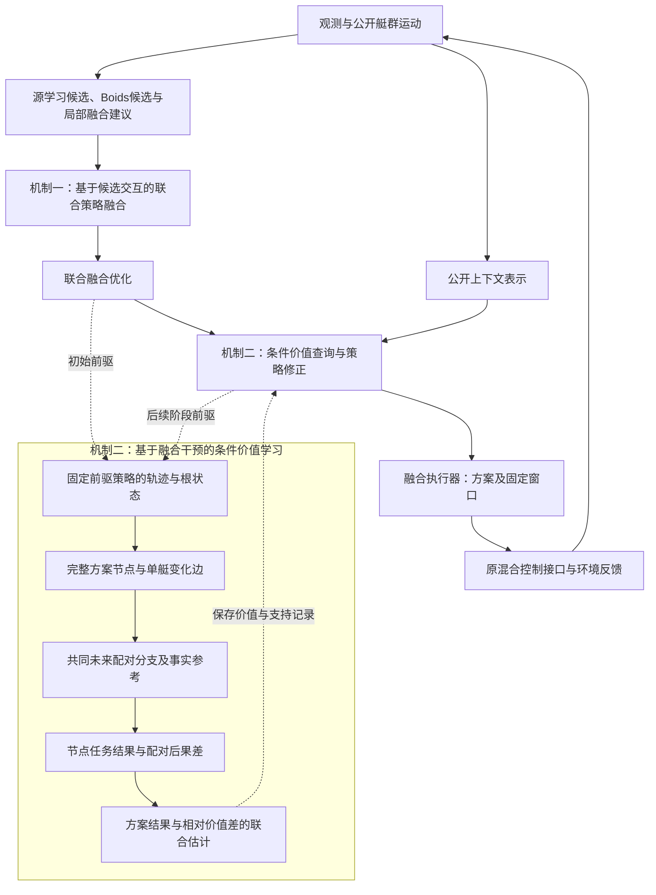

# 基于候选交互的联合策略融合与基于融合干预的条件价值学习：论文证据方案

本方案以开发成功率96.09%的`joint-supported-credit-128`为唯一方法基础，保留其源检查点、六艇主任务与现有开发集作为固定开发参照。两项机制分别建立任务收益、重训消融、替代方法、学习重复性、适用范围与VRX行为的完整证据；正式五次独立运行按同一配方分别训练共同源策略及剩余学习模块。

## 1. 研究问题与方法贡献

ARBoids通过状态相关的融合权重调节学习策略与Boids策略的参与程度，并通过队友观测及Boids特征利用群体信息。本文进一步研究融合系数的联合决策，以及融合变化对团队任务结果的条件影响。[ARBoids原文，III-A与III-E](../paper/2026_ARBoids_Adaptive_Residual_Reinforcement_Learning_With_Boids_Model_for_Cooperative_Multi-USV_Target_Defense.pdf)

**贡献一：基于候选交互的联合策略融合（Joint Policy Blending Based on Candidate Interactions）。** 提出基于候选交互的联合策略融合方法，将源策略的局部融合建议与候选机动之间的艇对交互关系纳入统一优化，使各艇对规则策略和学习策略的选择由局部偏好调节扩展为联合融合决策。

**贡献二：基于融合干预的条件价值学习（Conditional Value Learning Based on Blending Interventions）。** 在固定前驱策略下，构造仅具有单艇融合差异的联合方案，利用配对闭环后果刻画局部融合变化的条件任务影响，并将完整方案结果与相对价值差共同纳入估计目标，学习不同融合选择之间的条件价值关系，据此修正融合决策。

前者联合确定各艇如何融合两类策略，后者学习融合变化在当前条件下的任务价值。下文分别记为机制一、机制二，各自由独立使用、共同使用及专属替代实验支持。

## 2. 基于候选交互的联合策略融合

为协调规则策略与学习策略在多艇系统中的联合使用，该方法将各艇的融合系数作为联合决策变量，以源策略的融合建议构造正则项，并根据不同融合候选产生的预测运动响应建立艇对交互代价。联合优化使局部策略选择同时考虑源策略偏好与队友候选机动的相容性。

### 2.1 融合系数与源策略建议

设当前可用状态及运动信息为\(\chi\)，第\(i\)艘艇的学习候选和规则候选分别为\(a_i^L\)、\(a_i^B\)。两类策略按融合系数生成控制输入：

\[
u_i=\theta_i a_i^L+(1-\theta_i)a_i^B,\qquad
\boldsymbol\Theta=(\theta_1,\ldots,\theta_n)\in\mathcal G^n.
\tag{1}
\]

\(\mathcal G\subset[0,1]\)为融合候选集合。各候选对应两类策略的一种融合比例。

源Adapter给出状态相关的融合系数，经确定映射得到\(b_i(\chi)\)。定义

\[
\phi_i(g;\chi)=\left(\frac{g-b_i(\chi)}{\sigma_\theta}\right)^2.
\]

\(\phi_i\)是**源策略局部融合建议的偏离代价**。该项约束融合系数相对局部建议的偏离，使源策略信息参与联合选择。候选的任务价值由第3节定义的学习目标刻画。

### 2.2 候选运动响应与艇对交互代价

给定融合候选\(g\)，由名义反馈预测生成路径\(\hat p_i^g(s)\)。艇对交互代价定义为

\[
\psi_{ij}(g,h;\chi)=
\left[r_s-\min_{s\in\mathcal T_H}
\|\hat p_i^g(s)-\hat p_j^h(s)\|\right]_+^2.
\]

其中，\(\mathcal T_H\)为预测时域内的离散时刻，\(r_s\)为接近风险尺度。交互代价依赖双方的融合候选，满足\(\psi_{ji}(h,g;\chi)=\psi_{ij}(g,h;\chi)\)。

候选路径分别生成，反馈观测中的邻艇运动采用公开速度的名义匀速近似，再对候选路径进行两两评价。这一预测过程近似表达候选的共同运动关系；完整环境终局分支用于第3节的价值学习。

### 2.3 融合系数的联合优化

整组融合系数由源策略融合建议与候选运动风险共同决定：

\[
\boxed{
\boldsymbol\Theta^{(0)}(\chi)\in
\arg\min_{\boldsymbol\Theta\in\mathcal G^n}
E(\boldsymbol\Theta;\chi),\qquad
E=\sum_i\phi_i(\theta_i;\chi)
+\lambda_c\sum_{i<j}\psi_{ij}(\theta_i,\theta_j;\chi).
}
\tag{2}
\]

该模型在规则策略与学习策略的融合空间中协调各艇选择。\(\psi_{ij}\)以有限权重进入目标，是**软运动风险惩罚**；最优候选仍可能具有非零风险代价。模型直接刻画融合建议与运动相容性的折中，捕获、突破和团队防御效果由闭环任务评价。

固定队友配置，第\(i\)艘艇从\(g\)调整到\(g'\)时，目标变化为

\[
\begin{aligned}
\Delta E_i={}&\phi_i(g';\chi)-\phi_i(g;\chi)\\
&+\lambda_c\sum_{j\ne i}
[\psi_{ij}(g',\theta_j;\chi)-\psi_{ij}(g,\theta_j;\chi)].
\end{aligned}
\tag{3}
\]

第二项随队友融合变化。因此，同一局部调整在不同团队配置中可以具有不同优劣，协同作用体现为明确的条件决策关系。令\(\lambda_c=0\)时，目标分解为各艇在\(\mathcal G\)中独立选择最接近融合建议的候选；这一退化形式仍使用离散候选集合，与原连续Adapter的直接输出有所区别。

## 3. 基于融合干预的条件价值学习

### 3.1 完整方案与条件任务价值

以完整融合方案

\[
q=(q_1,\ldots,q_n),\qquad q_i\in\{\bot\}\cup\mathcal G
\]

作为价值对象。\(q_i=\bot\)表示该艇继续反馈生成融合系数，其他值表示在规定窗口内保持相应融合系数。两类候选动作仍随观测更新，因此保持融合系数不等于保持推进器推力。

在第\(r\)个学习阶段，固定前驱策略\(\pi^{r-1}\)及干预窗口\(\tau_r\)。以终局任务成功指示\(Y\)为效用，定义

\[
\begin{aligned}
V_r(q\mid\chi)&=\mathbb E[Y^{q,\tau_r;\pi^{r-1}}\mid\chi],\\
V_r^{\mathrm{ref}}(\chi)&=\mathbb E[Y^{\pi^{r-1}}\mid\chi],\\
\Delta_r(q\mid\chi)&=V_r(q\mid\chi)-V_r^{\mathrm{ref}}(\chi).
\end{aligned}
\tag{4}
\]

干预分支先执行方案与窗口，随后恢复同一前驱策略；各分支根据自身到达的状态继续反馈。事实参考从当前时刻起完整执行前驱策略，包括其当前决策窗口和未来继续干预的能力。参考行为并非永久关闭后续干预。

\(Y\)采用任务成功指示，而非SAC熵正则回报。对仅在一艘艇融合系数上不同的方案\(q_a,q_b\)，条件后果差为

\[
\Delta V_{ab}^{(r)}(\chi)=V_r(q_b\mid\chi)-V_r(q_a\mid\chi).
\]

该差值在相同上下文、相同干预窗口及固定前驱策略下定义，刻画给定其余艇融合选择时，一次局部变化对完整方案价值的影响。其配对样本估计记为\(\bar d_{ab}\)。机制二既学习完整方案的任务价值，也显式学习局部融合变化所对应的相对后果。

### 3.2 局部干预关系与配对闭环采样

在根上下文\(\chi_k\)处构造干预图\(\mathscr G_k=(\mathcal P_k,\mathcal E_k)\)。节点\(\mathcal P_k\)对应实际采样的完整方案；有向边\((a,b)\in\mathcal E_k\)对应只改变一艘艇融合系数的有效对比。边的两个端点保持相同窗口、其他融合系数和后续决策时钟。涉及时钟改变的对比不作为单艇干预边，完整事实分支单独提供参考。

图用于表达已采样方案之间的局部比较关系，待估计变量是各方案的条件价值；节点与边由采样方案及单艇差异规则确定。

同一根状态的分支使用共同未来随机条件，前驱策略参数保持固定，终局结果形成节点均值\(\bar y_p\)和配对差\(\bar d_{ab}\)。价值变量仍对应完整方案，不施加\(V(q)=\sum_iV_i(q_i)\)的可加分解。

### 3.3 方案结果与相对价值差的联合估计

采用两种对应不同含义的节点标签：成功值标签为\(Y^q\)，改善值标签为同未来下的\(Y^q-Y^{\mathrm{ref}}\)。成功值估计的事实基准\(b_k\)为参考成功值；改善值估计取\(b_k=0\)。两类标签均使用端点后果差作为边监督。

令\(B_k\)为有向边关联矩阵，使\((B_k\boldsymbol v)_{ab}=v_b-v_a\)；令\(W_k\)为非负边权对角矩阵。将方案结果、事实参考与相对价值差共同纳入估计目标：

\[
\boxed{
\hat{\boldsymbol v}_k=\arg\min_{\boldsymbol v}
\left[
\|\boldsymbol v-\bar{\boldsymbol y}\|^2
+\beta\|\boldsymbol v-b_k\boldsymbol1\|^2
+\|B_k\boldsymbol v-\bar{\boldsymbol d}\|_{W_k}^{2}
\right].
}
\tag{5}
\]

节点项拟合完整方案的任务结果，基准项关联前驱策略的事实参考，差值项使方案间价值差贴合局部融合变化的观测后果。差值项作为软正则项允许估计残差，不施加等式约束\(B_k\boldsymbol v=\bar{\boldsymbol d}\)。

与促使邻接节点值接近的普通图平滑相比，该项要求\(v_b-v_a\)接近观测差\(\bar d_{ab}\)。当局部干预产生显著任务变化时，估计保留相应价值差异。

式（5）等价于求解

\[
\boxed{
[(1+\beta)I+B_k^\top W_kB_k]\hat{\boldsymbol v}_k
=\bar{\boldsymbol y}+\beta b_k\boldsymbol1
+B_k^\top W_k\bar{\boldsymbol d}.
}
\tag{6}
\]

对\(\beta\ge0\)、\(W_k\succeq0\)及任意非零\(\boldsymbol x\)，有

\[
\boldsymbol x^\top[(1+\beta)I+B_k^\top W_kB_k]\boldsymbol x
=(1+\beta)\|\boldsymbol x\|^2+\|B_k\boldsymbol x\|_{W_k}^2>0.
\]

因此，该无约束二次估计问题具有唯一解。实现中先求解式（6），再进行值域截断；唯一性结论对应截断前的估计问题，估计准确性及控制收益由独立实验评价。

节点与边可能由同一批结果构造。当\(\bar d_{ab}=\bar y_b-\bar y_a\)时，边项组织的是已有结果的相对关系，并不增加独立观测。方法的学习作用在于联合使用节点结果、参考基准和干预差值，形成面向融合决策的价值估计。

### 3.4 配对估计的方差性质

若有\(m\)组相互独立的配对未来样本，且两条分支保持各自正确的边际分布，则

\[
\operatorname{Var}(\bar d_{ab})
=\frac1m\left[
\operatorname{Var}(Y_b)+\operatorname{Var}(Y_a)
-2\operatorname{Cov}(Y_b,Y_a)
\right].
\tag{7}
\]

正协方差时，相对于相同边际分布的独立采样，配对采样降低差值估计方差。该性质依赖上述采样条件，不提供对失败回溯选根后样本代表性的保证。实验中按根状态及未来样本的实际依赖关系组织统计。

## 4. 条件价值驱动的融合决策

条件价值学习通过本节的决策规则作用于融合控制，构成机制二的执行环节。

### 4.1 融合方案评价

根据当前上下文查询学习所得的方案价值\(\hat v_r(q\mid\chi)\)。设\(M_q\)为方案的数据支持质量，\(s_r(q,\chi)=\min(M_q,1)\)，\(B_r(\chi)\)为与标签匹配的查询基准，\(\widehat W_r(\chi)\)为后续机会近似。方案评价为

\[
A_r(q\mid\chi)=s_r(q,\chi)
[\hat v_r(q\mid\chi)-B_r(\chi)-\widehat W_r(\chi)]
-\eta d_H(q,q_{\mathrm{prev}}).
\tag{8}
\]

\(d_H\)计数相对于前驱方案改变的分量。成功值层扣除参考成功值，改善值层取\(B_r=0\)，避免重复扣除参考结果。

支持集合\(\mathcal Q_{\mathrm{supp}}^{(r)}(\chi)\)排除缺乏有效数据支持的方案。支持权重表示局部观测支持程度，不作为已校准的统计置信界。后续机会由已采样事实轨迹估计，表示当前行动相对于未来机会的比较基准，而非最优等待价值。

### 4.2 条件修正与执行窗口

用\(c_r(\chi)\)表示本层输出的干预指令，其取值为“未启动干预”或“完整方案及固定窗口”。初始化\(c_0(\chi)=\varnothing\)。支持集合非空时，定义

\[
q_r^\star(\chi)\in
\arg\max_{q\in\mathcal Q_{\mathrm{supp}}^{(r)}(\chi)} A_r(q\mid\chi).
\]

本层修正为

\[
\boxed{
c_r(\chi)=
\begin{cases}
(q_r^\star(\chi),\tau_r),
&\mathcal Q_{\mathrm{supp}}^{(r)}(\chi)\ne\varnothing
\ \text{且}\ A_r(q_r^\star\mid\chi)>\varepsilon_r,\\[3pt]
c_{r-1}(\chi),&\text{其他情况}.
\end{cases}
}
\tag{9}
\]

\(\tau_r\)表示固定作用窗口，\(\varepsilon_r\)表示接受阈值。前驱方案\(q_{\mathrm{prev}}\)取自\(c_{r-1}\)，未启动干预时对应全部自由反馈的方案。两个分支输出相同类型的指令，前驱窗口随指令一起保留。

后层通过接受条件时覆盖前层的整个指令，最终指令交由融合执行器实现。各层使用预先指定的作用窗口，依据估计价值进行条件覆盖；相应任务收益由独立闭环评价确定。

两项机制由此形成如下联系：

\[
\boxed{
\text{源策略融合建议与候选机动关系}
\longrightarrow\text{联合融合};\qquad
\text{配对干预后果}
\longrightarrow\text{完整方案的条件价值学习}
\longrightarrow\text{条件策略修正}.
}
\]

## 5. 学习与执行算法

### 5.1 训练／执行结构

### 5.2 算法一：基于候选交互的联合策略融合与条件价值修正的闭环执行

**输入：**当前观测、源策略、规则控制器、联合融合模型及已学习价值层。**输出：**连续反馈控制中的融合系数与推进器指令。

1. 生成学习候选、规则候选和局部融合建议。
2. 预测候选反馈响应，构造艇对风险项，求解式（2）得到\(\boldsymbol\Theta^{(0)}\)。
3. 初始化干预指令，逐层查询条件价值并按式（9）更新指令。
4. 没有活动干预时执行联合融合，在下一控制周期重新决策；有活动干预时，在其窗口内覆盖指定融合分量，其余艇继续反馈生成融合系数。
5. 窗口内持续刷新学习和规则候选，经原混合控制接口执行。窗口结束后重新运行完整策略；任务终止时立即结束。

### 5.3 算法二：基于融合干预的条件价值学习

**输入：**固定前驱策略、阶段窗口、任务环境和采样配置。**输出：**可用于条件策略修正的新价值层。

1. 采集前驱策略轨迹，选择根状态，构造完整方案及单艇变化边。
2. 对各方案和完整事实参考采用共同未来条件；干预窗口结束后，所有分支按同一前驱策略进行自身状态反馈。
3. 收集真实终止的任务结果，生成本阶段的节点标签和配对边差；未终止的截断分支不直接记为失败。
4. 排除同时改变后续决策时钟的信用边，构造\(B_k\)、\(W_k\)及对应事实基准。
5. 求解式（6），进行值域截断，形成条件价值、方案支持和后续机会记录。
6. 完成开发选择后保存本层，将其与前驱策略组合；后续阶段在新的固定前驱下重新采集和学习。

## 6. 具体实现与实验设置

以下配置对应保存的128实现。模型与学习目标采用第2—4节的定义，具体参数用于复现其数值实现；正式独立重复的源策略训练与四配置学习安排见第7.6节。

### 6.1 源策略与机制一参数

源策略来自原三艇SAC/ARBoids预训练，新增机制在六艇目标任务中开发。源SAC候选和原Adapter保持固定。机制一通过解析目标联合优化融合系数；机制二更新完整方案的条件价值及其决策记录，通过条件策略修正影响融合选择。

局部融合建议的实际映射为

\[
p_i=0.02+0.96\theta_i^{\mathrm{src}},\qquad
b_i(\chi)=\sigma\!\left(2\tanh\frac{\operatorname{logit}(p_i)}{2}\right).
\]

| 参数或实现 | 数值与含义 |
|---|---|
| 融合候选\(\mathcal G\) | \(\{0,0.5,1\}\) |
| 先验尺度\(\sigma_\theta\) | 0.4 |
| 交互权重\(\lambda_c\) | 32 |
| 接近风险尺度\(r_s\) | 7 m |
| 名义预测时域 | 3.2 s |
| 预测积分步长 | 0.1 s |
| 候选反馈更新周期 | 0.2 s |
| 联合求解 | 六艇时枚举729组融合系数，共享同一批候选路径 |

预测过程中，各艇融合候选固定，学习和Boids候选每0.2秒按预测观测刷新；邻艇反馈采用名义匀速近似。联合目标中的交互项为接近风险，任务捕获效果通过闭环实验评价。

### 6.2 任务标签、固定窗口与价值估计参数

终局效用为作者环境返回捕获或超时防守成功的指示。价值估计采用上述终局效用作为标签，采样记录中的其他奖励与折扣回报用于辅助记录。

| 阶段 | 固定窗口\(\tau_r\) | 节点标签 | 六艇上下文维数 | 核带宽\(h_r\) | 接受阈值\(\varepsilon_r\) |
|---|---:|---|---:|---:|---:|
| 1 | 10步，2 s | 方案成功值 | 48 | 0.15 | 0.15 |
| 2 | 2步，0.4 s | 方案成功值 | 48 | 0.05 | 0.05 |
| 3 | 10步，2 s | 相对前驱的配对改善值 | 51 | 0.03 | 0.05 |
| 4 | 20步，4 s | 相对前驱的配对改善值 | 51 | 0.03 | 0.05 |

式（5）取\(\beta=0.25\)。边权形式为\(w_{ab}=\lambda_\Delta(1+4|\bar d_{ab}|)\)，最新阶段保存的\(\lambda_\Delta=4\)。线性求解后，成功值截断到\([0,1]\)，改善值截断到\([-1,1]\)。

训练根包含失败轨迹的回溯状态。失败时间、随机数状态与后续结果用于离线采样和标签生成，执行只使用当前公开上下文。选中学习路径的轨迹和分支采样累计682,306个环境步，不包含源策略预训练、评估和未选中的开发尝试。

### 6.3 上下文查询、支持与机会近似

围绕攻击艇及其指向保护目标的方向建立坐标，按相对方位规范排列防守艇。每艇包含相对位置、速度、航向、角速度及到保护目标的距离；后两阶段增加攻击艇的观测速度和归一化时间。该表示不使用本回合的未来扰动或终局标签。

查询最近4个训练上下文，计算

\[
K_k=\exp[-\|\chi-\chi_k\|^2/(2h_r^2)],\quad
M_q=\sum_kK_kI_{kq},\quad
\hat v_r(q\mid\chi)=\frac{\sum_kK_kI_{kq}v_{kq}}{\max(M_q,\epsilon_{\mathrm{num}})}.
\]

\(I_{kq}\)为方案可用标记，\(\epsilon_{\mathrm{num}}>0\)用于数值稳定。支持集合采用\(M_q\ge10^{-6}\)的方案；早期阶段保留有采样支持的方案，最新阶段还要求方案曾在配对事实未来中修复相应失败。这一支持条件来自离线数据。

成功值层的事实基准采用按轨迹平衡的核估计，每条事实轨迹仅贡献一个最近状态。改善值层不再次扣除该基准。

后续机会记录由事实轨迹中稍后的正改善估计形成：

\[
\omega_k=\operatorname{Average}_{\ell\ni k}
\max_{t'>t_k}\left[e^{-\kappa(t'-t_k)}\operatorname{peak}(\chi_{t'})\right],
\qquad
\operatorname{peak}(\chi)=\max(0,\max_{q:I_{\chi q}=1}v_{\chi q}),
\]

其中\(\kappa=0.02\)，无后续机会时取0。查询时对\(\omega_k\)作核加权得到\(\widehat W_r\)。保存实现中仅第4阶段包含非零机会记录。方案改动代价系数为\(\eta=0.005\)。

### 6.4 窗口内执行与任务协议

干预窗口内，被指定艇保持融合系数，其他艇更新机制一给出的融合系数；随后覆盖被指定的固定分量。该实现未将固定伙伴系数作为自由艇联合求解的附加约束。两类候选持续更新，窗口内不嵌套启动新干预，窗口结束后恢复完整策略。全自由方案不启动持续干预。

任务沿用作者`source`协议：时限80 s，控制周期0.2 s，保留原动力学、奖励、攻击策略、推力接口与终止优先级。攻击者比所有防守艇更接近保护目标时同样触发作者的提前失败判据。该设置与论文60 s参数重跑有所区别；所有同版对照使用相同协议。

## 7. 最终论文证据方案

本节完整保留既定执行方案的实验内容、比较对象、学习安排与贡献目标。两项正式机制分别为**基于候选交互的联合策略融合**和**基于融合干预的条件价值学习**，下文简称机制一与机制二。每项机制均独立建立“任务收益—重训消融—替代方法—学习重复—适用范围—VRX行为”的证据，完整方法用于评价二者共同作用的整体价值。

### 7.1 方法基础、评价协议与证据结构

**方法基础。** 唯一开发参照为96.09%的`joint-supported-credit-128`，不混用其他版本的实验数字。

| 项目 | 已有开发结果 | 证据位置 |
|---|---:|---|
| 完整方法 | 246/256，96.09%；全部为捕获 | 方法开发起点 |
| 彻底移除机制一，剩余机制未重训 | 44/256，17.19% | 已学策略的执行依赖，不能代替重训贡献 |
| 彻底移除机制二 | 204/256，79.69%；下降16.41个百分点 | 已有开发消融，仍需独立学习重复 |
| 同版四配置重训、完整专属替代、跨条件与VRX | 尚未形成完整证据 | 本方案待完成的研究内容 |

实验沿用作者代码的80 s协议、原三艇预训练基础策略、六艇新增机制开发，以及64个布局、每布局4组扰动、覆盖机动性2.0和2.5的现有开发集。动力学、奖励、终止规则、控制周期和控制来源保持一致。原开发集可反复调优，正式评价另设未参与开发的配对场景。128源检查点保留为固定开发参照；正式重复训练的新源策略采用相同训练设置，属于同配方独立运行。

成功、捕获、碰撞、实际突破、源协议提前判负和超时分别统计，捕获时间在捕获回合内统计。原文报告值用于说明研究背景，方法间数值比较使用本研究同协议下取得的结果。[ARBoids原文](../paper/2026_ARBoids_Adaptive_Residual_Reinforcement_Learning_With_Boids_Model_for_Cooperative_Multi-USV_Target_Defense.pdf)

两项贡献具有相同的实验深度和正文地位。

| 证据层次 | 机制一：基于候选交互的联合策略融合 | 机制二：基于融合干预的条件价值学习 |
|---|---|---|
| 科学问题 | 候选机动之间的交互能否提供普通状态交互和独立预测未充分利用的信息，并改善联合融合决策？ | 融合干预的配对后果及后续团队影响能否改善普通回报或评论家反事实优势所提供的价值判断？ |
| 单独作用 | 机制二关闭时的任务增益 | 机制一关闭时的任务增益 |
| 组合中的作用 | 机制二开启时的额外贡献 | 机制一开启时的额外贡献 |
| 特定设计价值 | 同信息表达、预测方式及独立／联合选择对照 | 同数据价值学习、队友决策条件、时间机会及支持约束对照 |
| 决策证据 | 冲突预测、候选排序及联合选择的实际收益 | 干预排序、救回与误干预，以及等待／执行的实际收益 |
| 行为解释 | 接近顺序、会合位置、避碰与拦截分工的变化 | 干预时机、持续时间、后续队形与拦截机会的变化 |
| 重复性与迁移 | 独立运行及不同难度、艇数和对手下的贡献 | 相同范围内的独立贡献 |
| 高保真验证 | VRX中的任务贡献与冲突消解行为 | VRX中的任务贡献与有效干预行为 |

### 7.2 四配置重训消融

四配置重训是辨识两项机制贡献的主要实验。在固定128源策略的开发比较中共享该检查点；在正式独立运行中，共享该次运行独立训练所得的源策略。

| 配置 | 机制一 | 机制二 | 学习安排 |
|---|---|---|---|
| F00：共同基础配置 | 关闭 | 关闭 | 使用该次运行的共同基础控制 |
| F10：仅机制一 | 开启 | 关闭 | 保留候选预测、交互评价与联合融合；该配置内的学习部分独立训练 |
| F01：仅机制二 | 关闭 | 开启 | 在没有机制一的条件下，重新采样并学习机制二全部四阶段 |
| F11：完整方法 | 开启 | 开启 | 按128完整配方采样并训练两项机制的组合 |

128中的机制一采用确定性预测和解析联合优化，没有新增神经网络学习参数。F00、F10的基础控制来自各次运行的共同源策略，新增机制阶段按固定控制器评价；F01、F11分别学习全部新增价值阶段。

设各配置成功率为\(p_{00},p_{10},p_{01},p_{11}\)，必须同时报告

\[
\begin{aligned}
\Delta_1^{\mathrm{alone}}&=p_{10}-p_{00},&
\Delta_1^{\mathrm{with\,2}}&=p_{11}-p_{01},\\
\Delta_2^{\mathrm{alone}}&=p_{01}-p_{00},&
\Delta_2^{\mathrm{with\,1}}&=p_{11}-p_{10}.
\end{aligned}
\]

同时报告交互效应\(p_{11}-p_{10}-p_{01}+p_{00}\)，说明二者在成功率尺度上的互补、重叠或干扰。交互效应与四项独立贡献分别解释。

移除机制一时，删除候选交互预测、相应预测评分及联合决策功能，恢复原Adapter直接给出的融合系数，移除新增先验映射和网格投影。保留公共状态、SAC／Boids候选及机制二自身的干预价值能力，重新学习机制二。

移除机制二时，删除全部四阶段条件价值、继承价值、事实基准、等待机会评价、相关支持约束及持续干预状态，保留完整机制一。

剩余学习模块从各次共同初始化出发，不继承被移除机制产生的价值、教师输出或中间结果。单机制配置获得充分且匹配的开发调优机会。主表报告同预算结果，学习曲线反映各配置是否仍有明显上升趋势。

### 7.3 机制一的完整专属替代实验

机制一保留以下全部对照，分别考察状态关系、候选信息表达、运动预测及联合决策的作用。

| 机制一配置 | 保留与改变的内容 | 检验问题 |
|---|---|---|
| 原始Adapter | 使用原有状态及自身控制候选 | 原有自适应融合能够达到何种性能？ |
| 状态交互Adapter | 增加普通状态关系聚合或注意力 | 收益是否仅来自邻艇状态信息？ |
| 普通候选表达 | 提供相同候选信息，采用拼接或通用注意力 | 所提出的候选交互组织是否具有独立作用？ |
| 单艇预测 | 保留自身候选预测，邻艇采用统一参考运动 | 是否需要考虑邻艇不同候选的运动后果？ |
| 独立融合选择 | 使用相同候选预测资源，各艇分别选择 | 联合融合是否优于各艇独立选择？ |
| 完整机制一 | 候选后果交互与联合融合选择 | 完整设计能否稳定优于上述替代？ |

全部对照首先在机制二关闭时完成。随后依据开发结果选取两个最强替代方法，开启机制二并分别重新学习全部价值阶段，与完整机制一比较。主要替代方法在正式五次运行中使用对应的共同源策略。

各对照按表中信息与决策差异构建，共享任务条件和可比的开发预算。独立融合选择保留相同候选预测与艇对代价，仅将联合选择替换为各艇分别决策；普通候选表达保留相同候选信息，改变其组织方式。

机制一同时交付三类结果：

- **任务结果：**成功率、碰撞率、捕获效率，以及\(\Delta_1^{\mathrm{alone}}\)和\(\Delta_1^{\mathrm{with\,2}}\)。
- **决策结果：**候选冲突预测的准确性、候选排序，以及选中联合方案经环境执行后相对于独立选择和普通候选表达的实际收益。
- **行为结果：**同场景的候选轨迹、实际轨迹、融合选择和最小艇间距离，呈现接近顺序、会合位置、避碰及拦截分工的变化。

决策诊断采用相同初始状态与配对未来扰动下的环境执行后果，检验预测关系及选择结果。预测误差和融合权重变化作为辅助指标，任务收益与闭环行为支撑机制结论；拦截分工等行为由轨迹分析获得，不作为当前艇对目标已显式包含的优化项。

### 7.4 机制二的完整专属替代实验

机制二保留以下全部对照，分别考察价值目标、反事实估计、队友决策条件、时间机会及事实支持的作用。

| 机制二配置 | 保留与改变的内容 | 检验问题 |
|---|---|---|
| 普通联合回报学习 | 使用相同干预数据、候选方案和模型容量，学习绝对团队回报 | 收益是否仅来自增加数据和价值学习？ |
| COMA式反事实优势改编 | 在其他决策固定时，利用评论家估计局部反事实优势 | 实际干预后果是否比评论家估计提供更有效的决策信用？ |
| 去队友决策条件 | 保留自身状态与干预信息，弱化其他艇决策条件 | 团队决策条件是否必要？ |
| 去时间机会评价 | 保留条件价值，取消立即行动与后续机会的比较 | 时间机会评价是否改善干预和等待的选择？ |
| 去事实支持约束 | 保留价值与时序决策，移除对应支持限制 | 事实支持能否减少误干预？ |
| 完整机制二 | 条件干预价值、时间机会与事实支持共同作用 | 完整设计能否稳定优于上述替代？ |

全部对照首先在机制一关闭时完成。随后依据开发结果选取两个最强替代方法，开启机制一并重新训练，与完整机制二比较。普通联合回报学习与COMA式反事实优势对照使用同一批干预数据，以区分学习目标与估计方式的作用。

同数据比较固定共同前驱、根状态、候选方案、窗口及未来样本；方案评价采用与各自标签对应的事实基准。多阶段前驱分化后的闭环比较按各自策略重新采样，并匹配交互与开发预算。

机制二同时交付三类结果：

- **任务结果：**成功率、碰撞率、捕获效率，以及\(\Delta_2^{\mathrm{alone}}\)和\(\Delta_2^{\mathrm{with\,1}}\)。
- **决策结果：**干预排序准确性、选中干预的实际收益、救回数量和误干预损失数量。
- **行为结果：**同场景下立即干预、等待后干预及不干预的过程，展示干预时机、持续时间、后续队形及拦截机会的变化。

相对价值和干预收益由独立环境执行后果评价。配对修复指干预成功而事实参考失败，配对损害指干预失败而事实参考成功。持续时间按各阶段既定窗口记录，时间机会实验检验当前执行与等待的价值判断。

两项机制均通过环境后果检验决策，不以各自内部评分作为选择正确性的唯一依据。

### 7.5 整体性能与六类基线

| 基线 | 论文中的作用 |
|---|---|
| Boids | 规则协同先验的基础能力 |
| 参数共享SAC | 纯学习控制的竞争力 |
| 标准残差策略RP | 普通规则控制与学习控制叠加的收益 |
| ARBoids | 最直接的已有自适应融合基线 |
| MAPPO | 通用合作型多智能体学习的竞争力 |
| MAAC | 普通注意力交互与联合价值学习的竞争力 |

ARBoids包含同任务充分训练及追加预算结果。主要性能结论围绕ARBoids、MAPPO、MAAC和机制专属替代展开。主性能结果同时给出完整方法与两个单机制配置，使各机制的独立性能与整体收益对应。

所有方法遵循共同观测与通信权限、动力学、控制约束及评价场景。样本成本计入源策略预训练、事实轨迹和干预分支。同预算性能与达到90%成功率所需样本量分别报告，开发调参开销单列。128选定学习路径的682,306步作为已有成本记录，不将未计入其中的预训练、评价或开发搜索视为免费资源。

### 7.6 五次独立训练与明确贡献目标

先在128固定源策略上完成同版四配置和完整专属对照，明确新增机制的作用。正式学习重复采用同一128算法结构与训练配方，执行五个独立训练运行：

1. 每个训练种子独立训练该次运行的共同源策略，源任务与训练设置保持一致。
2. 从该次共同源策略分出四配置，分别采样并训练剩余学习模块。
3. 主要专属替代方法使用该次运行对应的共同起点，按各自配置独立训练。
4. 每个模型在每个主机动性条件（2.0、2.5）下至少评价100个未参与开发的新场景，各方法逐场景配对。
5. 报告五次结果、学习曲线的均值与标准差、四项机制贡献及其置信区间。

随机种子变化属于同配方独立重复，128历史模型继续保留为固定开发参照。机制一的确定性预测与搜索如实标注，其重复性体现为不同源策略和独立运行中的配对贡献。F00、F10在每次新增机制学习过程中作为该次固定参考，五次运行分别评价，不能将同一模型的五次评估当作五次独立训练。

| 重复证据 | 机制一 | 机制二 |
|---|---|---|
| 单独贡献 | 五次\(p_{10}-p_{00}\) | 五次\(p_{01}-p_{00}\) |
| 条件贡献 | 五次\(p_{11}-p_{01}\) | 五次\(p_{11}-p_{10}\) |
| 专属对照 | 完整候选交互融合与主要替代的配对结果 | 完整条件价值学习与主要替代的配对结果 |
| 学习过程 | 有无机制一时的样本效率与终点表现 | 各阶段学习形成的任务收益及样本效率 |

论文与开发目标保持为：

- **完整方法性能：**正式主场景中的平均成功率超过90%。
- **两项机制贡献：**单独贡献和条件贡献均达到实质量级；四项贡献各自的跨运行平均开发目标至少为10个百分点，两项条件贡献争取15个百分点以上。
- **学习稳定性：**两项机制的增益在独立运行中方向稳定，主要结论不依赖单个最佳种子。

场景回合用于估计任务表现，独立训练运行用于估计学习重复性。统计保留训练运行、初始布局及布局内扰动的层次，按配对关系报告效应量和95%置信区间；全部运行及不利结果均纳入。

### 7.7 适用范围与适应恢复

| 实验 | 具体设置 | 必须报告的内容 |
|---|---|---|
| 机动性变化 | 六艇，机动性1.50—3.00，间隔0.25，即1.50、1.75、2.00、2.25、2.50、2.75、3.00 | 完整方法、四配置和强基线的性能曲线；两项机制的增益随难度的变化 |
| 艇数变化 | 冻结方法，测试3、4、5、6、7、8艇 | 成功与失败构成；两项机制在稀疏和密集协同中的贡献 |
| 对手策略迁移 | APF及多个独立学习型攻击者，保留不同训练阶段的策略 | 冻结迁移表现；两项机制分别保留或损失的能力 |
| 适应与恢复 | 在共同新对手上给予相同适应预算，随后回测APF | 恢复速度、恢复后的性能及原任务保持程度 |

新增机制只在六艇条件下学习，源策略曾在三艇条件训练。三艇实验检验两项新增机制从六艇向三艇的跨规模迁移，同时回测源策略训练规模；四、五、七、八艇为源策略与新增机制均未训练的规模，六艇作为主任务参照。跨艇数实验采用冻结方法，不使用目标艇数的任务结果重新训练或调参。128现有价值记录具有固定六艇维数，跨规模上下文及融合方案的对应需在机制内部完成，并在正式跨规模评价前冻结；这一实现工作不替代或取消直接迁移实验。

跨艇数同时报告两项机制实际参与决策的情况，包括联合选择的变化及条件价值干预的有效支持与触发情况，以识别性能变化是否伴随某一机制作用减弱。两项机制分别绘制跨条件效应图，并提供代表性行为案例。

机动性和全部3—8艇规模实验至少包含四配置与ARBoids，同时呈现相关强基线；三艇同样分别报告两项机制的单独贡献、条件贡献及实际决策作用。对手适应实验重点比较完整方法、两个单机制配置及最强相关基线。所有方法面对相同的冻结攻击者与配对场景；学习型攻击者的独立运行和不同训练阶段策略均保留。适应后在原APF任务重新评价，分别报告新对手恢复与原任务保持情况。

### 7.8 VRX中的机制贡献与八艇迁移

**六艇、机动性2.5**作为高保真主条件，至少使用100个共同初始场景，评价以下全部配置：

- 四配置F00、F10、F01、F11；
- 同任务训练的ARBoids；
- 二维实验中的最强协同学习基线。

VRX主实验直接计算两项机制的四项贡献。随后以**八艇密集条件**开展相同方法的冻结迁移，保持机动性2.5，并保留四配置、ARBoids及最强协同学习基线，其中两个单机制配置必须独立呈现。目标艇数与VRX测试场景不用于重新训练或选择参数。

所有方法采用相同任务规则和执行接口。分别统计成功、捕获、碰撞、实际突破、源协议提前判负、超时与捕获时间。

| VRX证据 | 机制一 | 机制二 |
|---|---|---|
| 配对任务结果 | 开启机制一后救回与损失的场景数，分别对应单独加入和联合加入 | 开启机制二后救回与损失的场景数，分别对应单独加入和联合加入 |
| 时序行为图 | 控制冲突、接近顺序和拦截分工的变化 | 干预时机、持续时间及后续机会的变化 |
| 失败案例 | 候选预测或联合选择失效的情形 | 价值误判、过早或过晚干预的情形 |
| 跨环境一致性 | 二维仿真中的协同收益是否保留 | 二维仿真中的干预收益是否保留 |

典型案例按预先确定的事件类别选择，并与批量统计对应。六艇主实验和八艇迁移分别报告，两项机制各具有定量结果、行为解释与失败分析。

### 7.9 论文图表与实施顺序

| 证据单元 | 主要表格 | 主要图形 |
|---|---|---|
| 任务与版本 | 128方法、任务、训练来源、预算和评价协议 | 任务及双机制结构图 |
| 整体性能 | 六类基线与完整方法，并列两个单机制配置 | 五次学习曲线 |
| 四配置贡献 | 四配置、四项增益及重复间波动 | 两项机制效应量及学习阶段变化 |
| 机制一专属证据 | 全部机制一替代对照 | 冲突预测、联合选择及协同行为图 |
| 机制二专属证据 | 全部机制二替代对照 | 干预排序、救回与误干预及时序行为图 |
| 学习重复性 | 各独立运行结果与样本效率 | 两项机制各自的增益分布 |
| 适用范围 | 机动性、3—8艇泛化、对手迁移、适应与APF回测 | 两项机制各自的跨条件贡献曲线 |
| VRX验证 | 六艇和八艇的四配置、强基线及失败构成 | 两项机制分别对应的时序截图与轨迹 |

执行时先完成128同版四配置、机制一完整专属对照、机制二完整专属对照三组核心证据。固定开发集允许反复调优，修改限于两项核心机制内部。随后完成包含源策略重训的五次独立运行、六类整体基线、适用范围、适应恢复与VRX实验。

两项机制的证据同步推进，每项均独立完成任务收益、重训贡献、替代方法、学习重复、适用范围及高保真验证。机制作用不足时，优化对应内部算法并重新学习受影响的配置；实验项目、比较对象与既定贡献目标保持完整。

## 8. 复现入口

| 内容 | 实现或记录 |
|---|---|
| 候选响应、联合策略融合及窗口执行 | [develop_source_fusion.py](../train/develop_source_fusion.py)：`candidate_risk`、`risk_scores`、`JointLearningActor.forward`、`joint_advance` |
| 配对干预采样与条件价值估计 | 同文件：`joint_episode`、`joint_graph_value` |
| 上下文、事实基准与条件策略修正 | [conditional_fusion_value.py](../train/conditional_fusion_value.py)：`public_return_context`、`FactualReturnSupport`、`JointInterventionValue.select_action` |
| 作者环境及源策略接口 | [source_arboids.py](../train/source_arboids.py)，发布版`9eb6df464808af6b9729f39644b4d658e1695e2d` |
| 保存模型 | [128检查点](../train/experiments/author-source-fusion-20261011/joint-supported-credit-128/policy.pth) |
| 开发记录及模型、源策略和实现标识 | [ablation.json](../train/experiments/author-source-fusion-20261011/joint-supported-credit-128/ablation.json)、[development.json](../train/experiments/author-source-fusion-20261011/joint-supported-credit-128/development.json) |

数值实现以保存模型启用的配置为准。学习数据分别对应`joint-ordinary-context-102`、`joint-short-credit-116`、`joint-paired-temporal-121`和`joint-extended-credit-125`。现有开发结果对应上述保存模型与任务协议。
