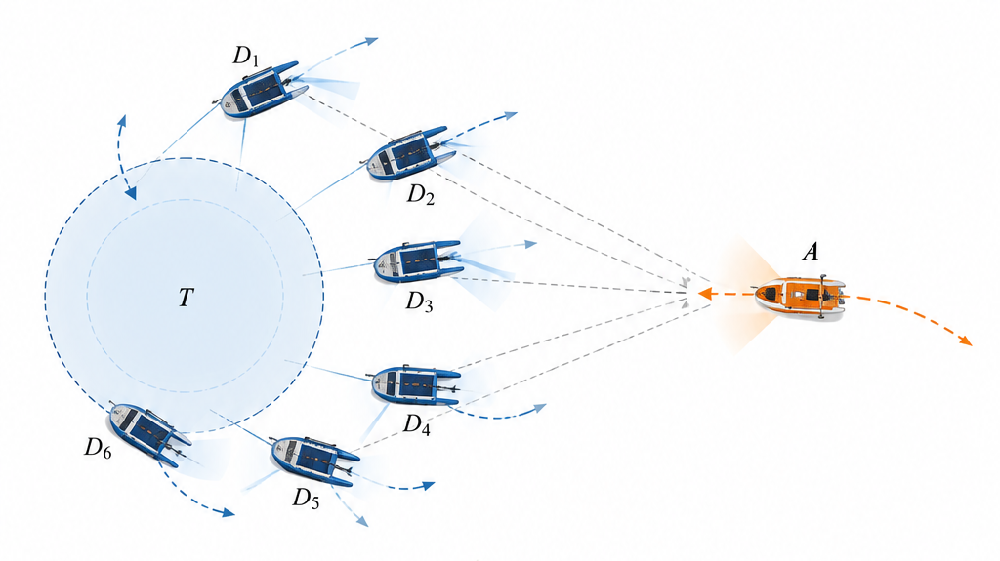
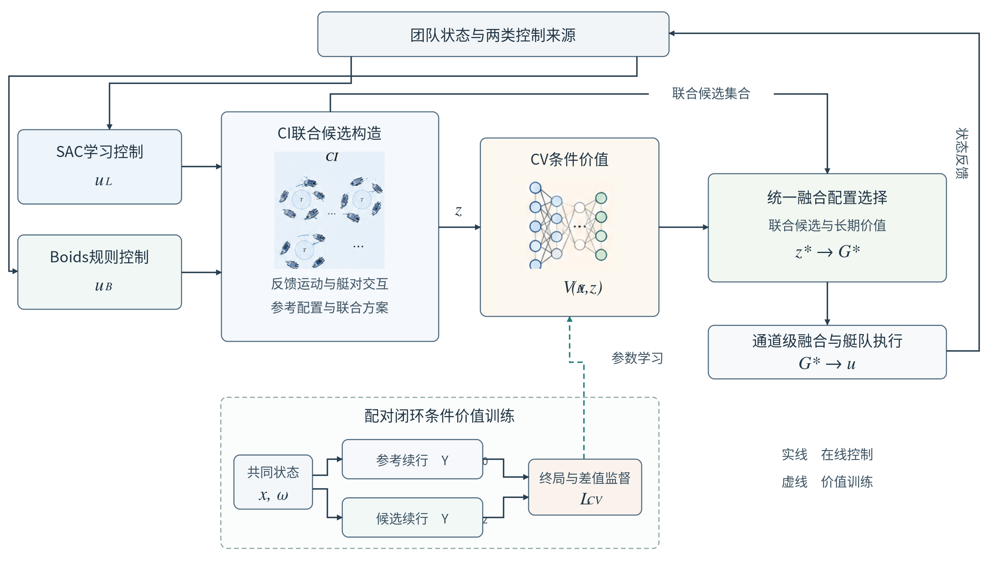
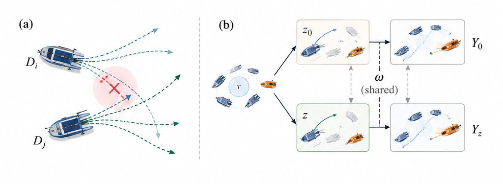

# 面向多无人艇目标防御的候选交互联合融合与条件价值学习

## 摘要

高机动攻击者条件下的多无人艇目标防御要求艇队在持续机动中协调局部控制选择，并保持有效的拦截关系。针对学习控制与规则控制并行参与时的联合融合决策问题，提出一种候选交互与条件价值协同残差强化学习方法CIV-RL。该方法以各艇推进器通道的融合系数为团队决策变量，通过预测不同候选控制的反馈运动响应，构建包含局部融合先验和艇对交互代价的联合配置模型。在此基础上，以完整融合方案为价值评价对象，利用相同初始状态与配对未来条件下的闭环终局结果，联合学习方案任务价值及局部组成变化的条件价值差。事实成功概率与条件挽救、损害概率共同刻画候选方案的相对收益，学习所得价值参与联合候选的最终选择。数值仿真与Gazebo VRX高保真试验围绕防御性能、机制消融、训练重复、攻击者机动性、艇队规模及对手策略适应开展评价。主要防御成功率、相对基线差值及高保真试验结果分别为［　］、［　］和［　］。

**关键词**　多无人艇　协同目标防御　残差强化学习　联合融合决策　条件价值学习

# 1 引言

多无人艇协同防御通过协调分布式水面平台的机动行为，阻止入侵目标进入受保护水域，是海上设施防护与水域监测的重要研究问题[1–3]。与单艇追踪相比，防御艇队需要同时维持目标接近、空间覆盖和艇间分离，并随攻击者的运动变化调整拦截位置。当攻击艇具有更高的加速、航速和转向能力时，局部追击方向与团队防御需求之间的差异更加突出。多艘艇在相近区域同时加速或转向，可能造成拦截方向重叠和艇间接近；保持分离的机动又可能改变后续捕获机会。高机动目标防御因而涉及局部控制选择、艇间动态交互与团队任务结果之间的共同协调。

现有协同防御与围捕方法主要包括几何控制、微分博弈和学习控制等路线。区域防守策略通过目标集与攻击者可达关系确定拦截条件，分布式追捕方法则将目标判断、协作规划与局部控制组织为连续的决策过程[2,3]。追逃博弈研究利用包围函数及运动能力关系刻画多追捕者对机动目标的限制作用[4,5]，船舶神经控制进一步将非线性动力学纳入追逃策略设计[6]。此类方法具有清晰的几何或动力学含义，其控制效果与模型、信息条件和可达性假设密切相关。群体规则利用分离、对齐、聚合等局部作用形成协调运动[7]，能够为多艇防御提供直接的控制先验，而复杂对抗中的策略选择仍需随任务态势调整。

深度强化学习通过环境交互建立观测与控制之间的映射，为多艇协同机动提供了数据驱动的策略表达。分布式多机器人追捕利用共享策略学习协同行为[8]，夏家伟等将合围态势表示、距离与方位解耦动作及任务奖励纳入MAPPO训练框架[9]。多无人艇自注意力学习和轨迹预测方法进一步利用艇间关系及目标运动信息改善追捕决策[10,11]。群体状态嵌入、联合价值分解和多智能体策略优化分别从输入表示、协作评价和训练组织等方面支持不同规模的协同行为[12–14]。协调图方法以成对效用刻画联合动作中的依赖关系[15]，通信选择与消息感知网络将交互信息引入多机器人路径决策[16,17]。这些研究为团队协作提供了多种表达形式，也表明控制选择的价值与同伴决策及其执行后果紧密相关。

规则控制与学习策略的组合能够将先验机动能力和任务适应能力纳入同一控制过程。残差强化学习在基准控制上学习修正量[18]，贝叶斯控制器融合依据控制分布协调先验与学习输出[19]，模型预测控制与强化学习的结合则利用物理预测和数据驱动修正共同生成控制指令[20]。面向多无人艇目标防御，ARBoids通过状态相关权重融合SAC动作与Boids动作，并利用价值反馈训练权重生成模块[21]。这类方法确立了异质控制来源的动态组合关系。在多艇同时实施融合控制时，同一局部融合比例对应的运动效果还随队友候选变化而改变，融合决策因而进一步涉及整队控制组成的联合配置。

联合配置的评价同时包含候选运动的相容性与后续任务价值。预测距离能够描述局部接近风险，完整防御结果则取决于该次机动对后续拦截过程的影响。反事实多智能体学习通过固定其他决策构造个体动作的条件优势[22]，多智能体滚动评价利用基准策略下的后续执行比较候选控制[23]，模型辅助价值估计将预测转移引入长期回报学习[24]。对于规则与学习控制的融合问题，局部组成变化可以在保持其他当前选择一致的条件下形成配对闭环轨迹。由这些轨迹获得的终局结果，为联合方案价值与局部价值差提供了相互对应的监督信息。

本文提出候选交互与条件价值协同残差强化学习方法CIV-RL，将多艇融合配置的运动交互和长期任务评价纳入统一决策。候选交互模块CI根据学习控制与规则控制的反馈运动响应建立联合配置模型，条件价值模块CV以完整候选方案为对象，学习其闭环任务结果及局部组成变化的相对价值。CI提供联合候选结构与参考配置，CV在同一候选空间内形成长期价值排序，最终由统一选择确定各艇的融合控制。

本文的主要贡献包括三个方面。首先，提出面向多无人艇目标防御的候选交互联合融合模型，将推进器通道的控制组成作为团队决策变量，以局部融合先验和艇对运动响应共同评价整队配置。其次，提出面向联合融合决策的配对闭环条件价值学习方法，通过共享任务价值函数关联完整方案结果与单艇组成变化，并依据事实结果条件下的收益关系确定最终控制选择。最后，建立包含竞争算法、关键消融、同信息决策比较、同数据价值学习比较以及任务条件变化的实验体系，在数值环境与高保真海上仿真中评价完整方法。

# 2 问题建模

## 2.1 无人艇运动模型

考虑由$n$艘同构防御艇组成的艇队，以及一艘机动能力更强的攻击艇。以保护区域中心为地固坐标系原点，防御艇$i$的位置与艏向记为$\boldsymbol\eta_i=[x_i,y_i,\psi_i]^\mathsf T$，艇体坐标系速度记为$\boldsymbol\nu_i=[v_{x,i},v_{y,i},r_i]^\mathsf T$。平面运动模型采用纵荡、横荡与艏摇三个自由度[25]，满足

$$
\dot{\boldsymbol\eta}_i=\boldsymbol R(\psi_i)\boldsymbol\nu_i,
\qquad
\boldsymbol M\dot{\boldsymbol\nu}_i+
\boldsymbol C(\boldsymbol\nu_i)\boldsymbol\nu_i+
\boldsymbol D(\boldsymbol\nu_i)\boldsymbol\nu_i
=\boldsymbol\tau_i .
\tag{1}
$$

其中$\boldsymbol M$为惯性矩阵，$\boldsymbol C$为科氏与向心项矩阵，$\boldsymbol D$为水动力阻尼矩阵，$\boldsymbol R(\psi_i)$为艇体坐标系到地固坐标系的旋转矩阵。控制量为左右推进器推力$\boldsymbol u_i=[u_{i,1},u_{i,2}]^\mathsf T$，由推进器安装位置所确定的输入映射产生广义力$\boldsymbol\tau_i$。两侧推进器沿艇体纵轴作用，通过推力合量与差动形成推进和转向。

防御艇的单推进器推力满足$u_{i,a}\in[u_D^{\min},u_D^{\max}]$，其中$a\in\{1,2\}$。攻击艇采用相同形式的动力学，推力边界通过机动系数$L_{\mathrm{agi}}$缩放，定义为

$$
L_{\mathrm{agi}}=
\frac{u_A^{\min}}{u_D^{\min}}
=
\frac{u_A^{\max}}{u_D^{\max}},
\qquad L_{\mathrm{agi}}>1 .
\tag{2}
$$

数值环境采用水平面动力学积分，高保真验证使用Gazebo VRX中的无人艇模型[26]。两类环境分别保留各自的动力学状态，控制接口均为双推进器推力。本文采用无显式风浪外力的任务配置，攻击者的较高机动能力由式（2）的推进约束体现。

## 2.2 协同目标防御任务

记防御艇位置为$\boldsymbol p_i$，攻击艇位置为$\boldsymbol p_A$，保护区域为$\mathcal T=\{\boldsymbol p\mid\|\boldsymbol p\|\leq r_T\}$。防御艇与攻击艇的距离为$d_{iA}=\|\boldsymbol p_i-\boldsymbol p_A\|$，艇间距离为$d_{ij}=\|\boldsymbol p_i-\boldsymbol p_j\|$。艇队在攻击艇到达保护区域之前实施拦截，并在任务过程中维持艇间安全距离。图1给出六艇目标防御场景及其相对几何关系。

捕获事件由$\min_i d_{iA}\leq r_{\mathrm{cap}}$确定，艇间碰撞事件由$\min_{i<j}d_{ij}\leq r_{\mathrm{col}}$确定，物理突破事件由$\boldsymbol p_A\in\mathcal T$确定。任务同时采用径向失守判据，当攻击艇到目标中心的距离小于全部防御艇的径向距离时，任务进入失守终止状态。相应集合写为

$$
\begin{aligned}
\mathcal F_{\mathrm{rad}}
&=\left\{x\,\middle|\,\|\boldsymbol p_A\|<\min_i\|\boldsymbol p_i\|\right\},\\
\mathcal F_{\mathrm{col}}
&=\left\{x\,\middle|\,\min_{i<j}d_{ij}\leq r_{\mathrm{col}}\right\},\\
\mathcal C
&=\left\{x\,\middle|\,\min_i d_{iA}\leq r_{\mathrm{cap}}\right\}.
\end{aligned}
\tag{3}
$$

每个控制时刻依次检查物理突破或径向失守、艇间碰撞、目标捕获以及时间终止。任务在先前未进入失败状态的条件下完成捕获，或持续至时限$T$，均记为防御成功。以$Y\in\{0,1\}$表示终局防御结果，协同控制目标为

$$
\pi^\star\in\arg\max_\pi
\mathbb E_{x_0,\omega,\pi_A}\left[Y\mid\pi\right],
\qquad
\boldsymbol u_i(t)\in
[u_D^{\min},u_D^{\max}]^2 .
\tag{4}
$$

式中$x_0$为初始任务状态，$\omega$表示观测与环境中的随机因素，$\pi_A$为攻击策略。数值评价分别统计物理突破与径向失守。控制器使用当前艇位、速度、相对几何及学习控制与规则控制的候选输出；攻击者的未来动作由环境中的实际策略产生。各防御艇的当前信息汇集用于联合融合计算，统一选择后分别执行对应的推进器指令。

# 3 CIV-RL方法

## 3.1 统一协同融合策略

CIV-RL以多艇融合配置为共同决策对象。设学习控制与Boids控制分别产生$\boldsymbol u_i^{\mathrm L}$和$\boldsymbol u_i^{\mathrm B}$，艇$i$的融合变量为$\boldsymbol g_i=[g_{i,1},g_{i,2}]^\mathsf T\in[0,1]^2$。实际推进器指令由通道级凸组合给出

$$
\boldsymbol u_i(x,\boldsymbol g_i)
=\boldsymbol g_i\odot\boldsymbol u_i^{\mathrm L}(x)
+(\boldsymbol 1-\boldsymbol g_i)\odot\boldsymbol u_i^{\mathrm B}(x).
\tag{5}
$$

其中$\odot$为逐元素乘积。左右通道分别调节两类控制的参与程度，整个艇队的融合配置记为$\boldsymbol G=(\boldsymbol g_1,\ldots,\boldsymbol g_n)$。两类源指令满足相同推力边界时，式（5）给出的指令保持在各通道的允许区间内。对通道$a$有

$$
\frac{\partial u_{i,a}}{\partial g_{i,a}}
=u_{i,a}^{\mathrm L}-u_{i,a}^{\mathrm B},
\qquad
u_{i,a}\in
\operatorname{co}\{u_{i,a}^{\mathrm L},u_{i,a}^{\mathrm B}\} .
\tag{6}
$$

CI利用局部候选与艇对运动关系构造联合配置空间，并给出融合参考策略$\pi_0$。CV在这一空间内评价完整方案的长期任务价值。方案$z$规定融合配置及其执行区间，$z_0$对应参考策略的连续执行。最终策略从包含$z_0$的候选集合中选择$z_\theta^\star$，再依据式（5）生成唯一的整队控制输出。图2展示候选交互建模、配对价值训练与在线融合选择之间的关系。

## 3.2 状态表示与基础控制

学习控制源采用参数共享的SAC策略[27]。防御艇局部观测包含攻击艇和保护区域的相对方位与距离、其他防御艇的相对状态，以及Boids计算形成的群体特征。队友观测经过共享映射后聚合为定长表示[12]，与本艇和目标特征共同输入动作网络。以$\boldsymbol o_{ij}$表示艇$i$获得的队友$j$信息，状态表示为

$$
\boldsymbol e_i^{\mathrm D}
=\frac{1}{|\mathcal N_i|}
\sum_{j\in\mathcal N_i}f_{\mathrm D}(\boldsymbol o_{ij}),
\qquad
\boldsymbol h_i
=f_{\mathrm s}\!\begin{pmatrix}
\boldsymbol o_i^{\mathrm{AT}},
\boldsymbol e_i^{\mathrm D},
\boldsymbol o_i^{\mathrm B}
\end{pmatrix} .
\tag{7}
$$

式中$\mathcal N_i$为可用队友集合，$\boldsymbol o_i^{\mathrm{AT}}$包含攻击艇及保护区域信息，$\boldsymbol o_i^{\mathrm B}$包含群体规则特征。源策略的局部融合映射读取动作网络特征及两类候选指令，形成标量融合偏好，经有界映射得到候选中心$\bar g_i$。源动作与局部融合偏好在预训练阶段共同参与任务回报优化，后续CI和CV使用冻结的源策略参数。

SAC在预训练阶段优化熵正则化目标

$$
J_{\mathrm{src}}(\psi)
=\mathbb E\!\left[
\sum_{t=0}^{T}\gamma^t
\left(r_t+\alpha\mathcal H\bigl(\pi_\psi(\cdot\mid o_t)\bigr)\right)
\right] .
\tag{8}
$$

其中$\gamma$为折扣因子，$\alpha$为熵温度参数。共享动作网络根据各艇局部观测产生学习候选，源价值网络结合当前动作与局部融合信息估计长期回报。基础策略的训练使用所有同构防御艇的交互数据。

Boids控制由分离、对齐、聚合与目标吸引四项组成[7,21]，其合力为

$$
\boldsymbol F_i
=\boldsymbol F_i^{\mathrm{sep}}
+\boldsymbol F_i^{\mathrm{ali}}
+\boldsymbol F_i^{\mathrm{coh}}
+\boldsymbol F_i^{\mathrm{att}} .
\tag{9}
$$

分离项根据相邻艇位置形成排斥作用，对齐项协调航行方向与速度，聚合项维持群体空间联系，吸引项使防御艇接近攻击目标。合力经艇体坐标变换与推进器映射得到$\boldsymbol u_i^{\mathrm B}$。学习控制、规则控制和局部融合偏好共同确定候选来源，艇间候选的联合评价由CI完成。

## 3.3 候选交互与联合融合配置

每艘防御艇从规则控制端点、学习控制端点和局部融合偏好构造有界候选集合。以$\mathcal G_i(x)=\{\boldsymbol g_i^1,\ldots,\boldsymbol g_i^{K_i}\}$表示艇$i$的候选，参考候选采用$\{0,\bar g_i,1\}^2$，相同系数组合合并处理。候选$k$的局部偏好代价定义为

$$
\phi_i(k;x)
=\frac12\sum_{a=1}^{2}
\left(\frac{g_{i,a}^{k}-\bar g_i}{\sigma_g}\right)^2 .
\tag{10}
$$

$\sigma_g$调节候选相对于局部融合先验的偏离尺度。该项与艇对交互共同参与配置评价。候选中心随当前源策略输出变化，同一候选编号对应的实际推力亦随观测反馈更新。

候选运动预测以当前公开状态为起点，在预测时域$H$内保持融合系数，按照预测观测重新计算学习指令与Boids指令。记名义状态转移为$\widehat F$，候选控制下的反馈响应满足

$$
\widehat x_{\ell+1}^{\,i,k}
=\widehat F\!\left(
\widehat x_{\ell}^{\,i,k},
\boldsymbol u_i\bigl(\widehat x_{\ell}^{\,i,k},\boldsymbol g_i^k\bigr)
\right),
\qquad
\widehat x_0^{\,i,k}=x .
\tag{11}
$$

候选轨迹分别计算，邻艇运动采用名义延续形成预测观测。由此得到各候选的位置序列$\widehat{\boldsymbol p}_i^k(t)$。对于艇$i$和$j$的候选组合$(k,\ell)$，最小预测间距与交互代价为

$$
d_{ij}^{k\ell}
=\min_{t\in[0,H]}
\left\|\widehat{\boldsymbol p}_i^k(t)
-\widehat{\boldsymbol p}_j^\ell(t)\right\|,
\qquad
\psi_{ij}(k,\ell;x)
=[r_s-d_{ij}^{k\ell}]_+^2 .
\tag{12}
$$

其中$[a]_+=\max(a,0)$，$r_s$为候选接近评价距离。艇对代价同时依赖两个候选，局部选择的优劣随队友组成变化。图3(a)给出候选运动响应及艇对条件交互的几何表示。

整队配置由候选索引$\boldsymbol k=(k_1,\ldots,k_n)$表征，联合目标及参考配置写为

$$
\begin{aligned}
E_{\mathrm{CI}}(x,\boldsymbol k)
&=\sum_{i=1}^{n}\phi_i(k_i;x)
+\lambda\sum_{i<j}\psi_{ij}(k_i,k_j;x),\\
\boldsymbol k_0
&\in\arg\min_{\boldsymbol k\in\prod_i\{1,\ldots,K_i\}}
E_{\mathrm{CI}}(x,\boldsymbol k).
\end{aligned}
\tag{13}
$$

$\lambda$为交互权重，$\boldsymbol G_0$为$\boldsymbol k_0$对应的参考融合配置。固定其余艇的候选，将艇$i$的选择由$k$改为$k'$时，目标变化为

$$
\begin{aligned}
\delta E_i
={}&\phi_i(k';x)-\phi_i(k;x)\\
&+\lambda\sum_{j\ne i}
\bigl[\psi_{ij}(k',k_j;x)-\psi_{ij}(k,k_j;x)\bigr] .
\end{aligned}
\tag{14}
$$

式（14）将局部先验偏离与队友候选所引起的运动变化纳入同一比较。联合求解采用候选束搜索与坐标细化，在有限候选空间中获得参考配置，并保留用于长期价值评价的完整联合方案。各方案均以整队配置计算艇对关系，最终候选空间记为$\mathcal Z_{\mathrm{CI}}(x)$。

## 3.4 配对闭环条件价值

联合融合方案记为$z=(\boldsymbol c,d,\tau)$。其中$\boldsymbol c$给出各艇的候选融合组成，$d$为执行延迟，$\tau$为持续时长，二者以控制周期计量。保持参考控制的分量采用保留编码，其余分量采用指定融合系数。延迟区间与方案结束后执行冻结参考策略$\pi_0$；作用区间内，指定系数保持不变，学习动作与规则动作仍随各分支当前状态更新。未改变的艇通过同一参考策略作反馈响应。参考方案$z_0$在整个续行过程中执行$\pi_0$。

设$x$为根状态，$\omega$为共享的未来随机条件，方案$z$的终局结果与条件任务价值定义为

$$
Y(x,z,\omega)=\mathbb I\{\text{闭环续行满足防御成功条件}\},
\qquad
V^{\pi_0}(x,z)=\mathbb E_\omega[Y(x,z,\omega)] .
\tag{15}
$$

两条配对分支共享根状态、随机未来与后续策略参数，各自根据到达的状态重新计算控制。若$z$与$z'$具有相同执行时序，且融合组成仅有一艘艇不同，则二者构成局部组成比较。利用$R$组配对未来，其经验价值差为

$$
\overline\Delta(x;z,z')
=\frac{\sum_{q=1}^{R}w_q
\left[Y(x,z',\omega_q)-Y(x,z,\omega_q)\right]}
{\sum_{q=1}^{R}w_q} .
\tag{16}
$$

其中$w_q$为样本权重。完整终局标签给出方案的团队结果，局部比较保留了其他当前组成及执行时序所提供的条件。图3(b)中的参考分支与候选分支共同形成条件价值监督。

CV以共享函数$V_\theta(x,z)$表达完整方案价值，局部价值差由同一函数计算

$$
\Delta_\theta(x;z,z')
=V_\theta(x,z')-V_\theta(x,z) .
\tag{17}
$$

因此，对给定根状态，反向比较具有相反符号，闭合比较路径满足

$$
\Delta_\theta(x;z,z')=-\Delta_\theta(x;z',z),
\qquad
\sum_{q=0}^{m-1}\Delta_\theta(x;z_q,z_{q+1})=0,
\quad z_m=z_0 .
\tag{18}
$$

完整方案与局部差值由统一价值基准联系，训练中的单艇组成变化能够进入整队候选评价。候选方案可包含多艘艇的组成选择，单艇变化构成配对监督中的局部比较关系。

进一步令$Y_0=Y(x,z_0,\omega)$、$Y_z=Y(x,z,\omega)$，事实成功概率及条件挽救、损害概率为

$$
\begin{aligned}
p_0(x)&=\Pr(Y_0=1\mid x),\\
r_\theta(x,z)&=\Pr(Y_z=1\mid Y_0=0,x),\\
h_\theta(x,z)&=\Pr(Y_z=0\mid Y_0=1,x).
\end{aligned}
\tag{19}
$$

对于非参考方案，其价值及相对于事实策略的收益由条件分解得到

$$
\begin{aligned}
V_\theta(x,z)
&=[1-p_0(x)]r_\theta(x,z)
+p_0(x)[1-h_\theta(x,z)],\\
\Delta_\theta(x;z_0,z)
&=[1-p_0(x)]r_\theta(x,z)-p_0(x)h_\theta(x,z),
\qquad V_\theta(x,z_0)=p_0(x).
\end{aligned}
\tag{20}
$$

式（20）在事实策略的成功水平下评价候选组成的净任务后果。两种条件结果及其发生概率共同形成方案价值，最终融合选择依据该价值在联合候选之间进行比较。

## 3.5 条件价值网络与监督训练

条件价值模型采用候选条件化的关系网络。艇节点特征包含当前位置、航向与速度、两类源控制、参考指令、候选组成及其实际推力差。候选运动描述记录多个预测时刻的位置、速度、艏向以及相对于参考运动的变化。艇对消息同时读取相对几何、预测间距与双方候选特征，经共享映射和艇队聚合形成完整方案表示。执行延迟与持续时间作为方案级特征参与最终价值输出。

记节点特征为$\boldsymbol\xi_i(x,z)$，相对关系为$\boldsymbol\rho_{ij}(x,z)$，关系编码可表示为

$$
\begin{aligned}
\boldsymbol h_i&=f_\theta\bigl(\boldsymbol\xi_i(x,z)\bigr),\\
\boldsymbol m_i&=\operatorname{Agg}_{j\ne i}
q_\theta\bigl(\boldsymbol h_i,\boldsymbol h_j,
\boldsymbol\rho_{ij}(x,z)\bigr),\\
\boldsymbol h_{\mathcal D}
&=\operatorname{Pool}_{i}
\bigl[\boldsymbol h_i,\boldsymbol m_i\bigr],\\
\boldsymbol v_\theta(x,z)
&=f_{\mathrm{out},\theta}
\bigl(\boldsymbol h_{\mathcal D},d,\tau\bigr).
\end{aligned}
\tag{21}
$$

聚合在当前有效艇集合上执行，网络参数在各艇之间共享。候选状态表示保留可观测艇标识及控制对应关系，输出经概率映射形成事实价值和条件结果估计。式（20）据此得到完整方案价值，式（17）给出局部变化的条件差值。

训练样本由根状态、候选方案、共享未来及终局结果组成。完整结果采用二元交叉熵监督，配对差值采用平方误差监督。记$\ell_{\mathrm{BCE}}(p,y)=-y\log p-(1-y)\log(1-p)$，相应目标为

$$
\begin{aligned}
\mathcal L_Y
&=\mathbb E_{(x,z,\omega)}
\ell_{\mathrm{BCE}}\bigl(V_\theta(x,z),Y(x,z,\omega)\bigr),\\
\mathcal L_{\mathrm{local}}
&=\mathbb E_{(x,z,z',\omega)\in\mathcal D_{\mathrm{local}}}
\left[\Delta_\theta(x;z,z')-
\bigl(Y_{z'}-Y_z\bigr)\right]^2,\\
\mathcal L_{\mathrm{factual}\Delta}
&=\mathbb E_{(x,z_0,z,\omega)\in\mathcal D_{\mathrm{ref}}}
\left[\Delta_\theta(x;z_0,z)-
\bigl(Y_z-Y_0\bigr)\right]^2 .
\end{aligned}
\tag{22}
$$

其中$\mathcal D_{\mathrm{local}}$为单艇变化配对集合，$\mathcal D_{\mathrm{ref}}$为候选与事实方案的配对集合，各期望按训练样本权重计算。事实标签同时用于根状态校准与完整事实轨迹中的状态监督。排序项对终局结果不同的候选对施加相对顺序监督，结果相同的候选对保留在比较总体的归一化中。条件结果项分别学习事实失败时的候选成功与事实成功时的候选损害，写为

$$
\mathcal L_{\mathrm{stratum}}
=\mathbb E\!\left[
(1-Y_0)\ell_{\mathrm{BCE}}(r_\theta,Y_z)
+Y_0\ell_{\mathrm{BCE}}(h_\theta,1-Y_z)
\right] .
\tag{23}
$$

完整训练目标为

$$
\begin{aligned}
\mathcal L_{\mathrm{CV}}
={}&\mathcal L_Y
+\lambda_{\mathrm{loc}}\mathcal L_{\mathrm{local}}
+\lambda_{\mathrm{ref}}\mathcal L_{\mathrm{factual}\Delta}
+\lambda_{\mathrm{rank}}\mathcal L_{\mathrm{rank}}\\
&+\lambda_{\mathrm{fact}}\mathcal L_{\mathrm{factual}}
+\lambda_{\mathrm{bank}}\mathcal L_{\mathrm{bank}}
+\lambda_{\mathrm{str}}\mathcal L_{\mathrm{stratum}} .
\end{aligned}
\tag{24}
$$

$\mathcal L_{\mathrm{factual}}$拟合根状态事实结果，$\mathcal L_{\mathrm{bank}}$拟合事实轨迹中附加状态的终局标签。各项分别约束完整结果、局部相对后果、候选排序和事实条件概率。价值网络通过式（24）更新，源策略参数在条件价值训练阶段保持固定。

事实概率采用布局分组校准，同一布局的配对未来与轨迹状态归入同一数据划分。多模型估计与事实观测共同形成参考成功概率，局部已观测配对残差用于校正相对价值。CV训练所使用的候选定义、队友反馈和执行时序与在线联合候选保持一致。源策略或参考续行策略改变时，训练数据按对应闭环重新生成。

## 3.6 条件价值引导的最终融合选择

CI依据当前候选响应形成联合配置及其交互评价，CV读取相同方案及当前状态估计长期任务价值。具有可执行定义与数据支持的联合方案组成$\mathcal Z_{\mathrm{CI,supp}}(x)$，其中包含事实参考$z_0$。模型间预测分歧、配对后果统计及局部数据支持共同形成候选置信项$U_\theta(x,z)$，其权重为$\beta$。以$\varepsilon\geq0$表示价值增益接受阈值，最终决策分数定义为

$$
S_\theta(x,z)=
\begin{cases}
0, & z=z_0,\\
\widehat\Delta_\theta(x;z_0,z)-\beta U_\theta(x,z)-\varepsilon,
& z\ne z_0,
\end{cases}
\qquad
z_\theta^\star(x)\in
\arg\max_{z\in\mathcal Z_{\mathrm{CI,supp}}(x)}S_\theta(x,z) .
\tag{25}
$$

当最大分数为零时保留$z_0$。候选组成、时序与反馈定义确定所选方案的控制映射$\boldsymbol g_i(t;z_\theta^\star)$，实际输出为

$$
\boldsymbol u_i(t)=
\boldsymbol g_i(t;z_\theta^\star)\odot\boldsymbol u_i^{\mathrm L}(x_t)
+\bigl[\boldsymbol 1-\boldsymbol g_i(t;z_\theta^\star)\bigr]
\odot\boldsymbol u_i^{\mathrm B}(x_t) .
\tag{26}
$$

式（13）确定候选之间的联合运动关系，式（20）评价其长期任务后果，式（25）在同一候选空间中完成最终选择。参考方案保留CI建立的融合配置，非参考方案在达到价值接受条件时参与执行。接受方案后，控制源持续读取当前观测，推进指令按照方案规定的融合系数生成。

延迟候选的执行机会由事实续行的存活时间表征。记参考终止时刻为$T_0$，则$\Pr(T_0>d\mid Y_0=0,x)$与$\Pr(T_0>d\mid Y_0=1,x)$分别约束事实失败和事实成功条件下的可执行机会。经验校准与机会评价均作用于候选价值，统一选择始终保留参考方案。在线观测、联合候选评价及方案执行采用固定的控制时钟，单回合的方案接受次数由共同执行协议限定。

## 3.7 奖励函数与课程训练

基础控制训练采用任务奖励、队形奖励与碰撞惩罚之和[21]，对防御艇$i$有

$$
r_i=r_i^{\mathrm{task}}+r_i^{\mathrm{form}}+r_i^{\mathrm{col}} .
\tag{27}
$$

任务奖励依据防御成败与捕获协作确定。攻击艇进入保护区域时施加失败惩罚，完成捕获的艇获得捕获奖励，位于捕获邻域内的协助艇获得协作奖励。队形奖励利用各艇相对于攻击者的单位方向，结合攻击者与保护区域的相对方位刻画拦截分布。记

$$
\widehat{\boldsymbol d}_{iA}
=\frac{\boldsymbol p_A-\boldsymbol p_i}
{\|\boldsymbol p_A-\boldsymbol p_i\|},
\qquad
\boldsymbol d_{DA}=\sum_i\widehat{\boldsymbol d}_{iA},
\qquad
\widehat{\boldsymbol d}_{TA}
=\frac{\boldsymbol p_A}{\|\boldsymbol p_A\|},
\tag{28}
$$

则队形项为

$$
r_i^{\mathrm{form}}
=0.5\,\widehat{\boldsymbol d}_{TA}^{\mathsf T}
\frac{\boldsymbol d_{DA}}{\|\boldsymbol d_{DA}\|}
-\frac{\|\boldsymbol d_{DA}\|}{n} .
\tag{29}
$$

碰撞惩罚根据艇间距离阈值施加，主任务奖励与碰撞惩罚共同决定基础策略的防御导向。CV使用完整任务终局结果训练条件价值，两类训练信号在源动作学习与融合方案评价中分别发挥作用。

训练任务的攻击者机动性采用课程式调度[28]。每回合按

$$
L_{\mathrm{agi}}
\sim\mathcal U\bigl(\overline L_{\mathrm{agi}}-0.5,
\overline L_{\mathrm{agi}}+0.5\bigr)
\tag{30}
$$

采样，平均机动系数随源策略训练推进逐步提高。完成基础策略训练后，冻结控制来源，形成CI参考及联合候选，采集相应配对闭环结果并训练CV。训练后的条件价值网络通过式（25）参与统一融合选择。各阶段分别记录环境交互、配对续行和价值更新的训练量。

# 4 实验与分析

## 4.1 实验设置

数值试验采用六艘防御艇对单艘攻击艇的区域防御任务。保护区域半径为15 m，数值环境的捕获距离与艇间碰撞距离均为5 m，任务时限为80 s。动力学积分周期为0.05 s，推进器指令更新周期为0.2 s，防御艇单推进器推力区间为$[-500,1000]$ N。攻击艇采用改进人工势场策略，根据保护区域吸引与防御艇排斥形成运动指令。学习型攻击者在第4.6节单独设置。初始位置、航向和观测扰动在共同任务分布中采样，各方法使用配对场景开展评价。

基础学习算法使用相同的数值环境与任务判据，按各自控制结构设置输入与训练过程。CIV-RL的源策略在六艇任务中训练，CI和CV读取该次运行获得的控制来源。CV配对数据按冻结参考策略采集，候选比较共享初始状态和未来随机条件。训练、模型选择与正式评价按初始几何划分，同一布局的多次随机未来归入相同划分。完整算法与各学习型对照采用五次独立训练，结果按训练运行汇总均值和标准差，逐任务配对差值按布局统计。主要实验参数见表1。

**表1　任务模型与学习参数**

| 参数 | 符号 | 设置 |
|:---|:---:|:---:|
| 主任务防御艇数量 | $n$ | 6 |
| 数值任务时限 | $T$ | 80 s |
| 控制周期 | $\Delta t$ | 0.2 s |
| 动力学积分周期 | $\Delta t_{\mathrm{int}}$ | 0.05 s |
| 保护区域半径 | $r_T$ | 15 m |
| 数值捕获距离 | $r_{\mathrm{cap}}$ | 5 m |
| 艇间碰撞距离 | $r_{\mathrm{col}}$ | 5 m |
| 防御艇推力区间 | $[u_D^{\min},u_D^{\max}]$ | $[-500,1000]$ N |
| CI预测时域 | $H$ | 3.2 s |
| CI预测步长 | $\Delta t_{\mathrm{pred}}$ | 0.1 s |
| 候选接近评价距离 | $r_s$ | 7 m |
| 局部先验尺度 | $\sigma_g$ | 0.4 |
| 交互权重 | $\lambda$ | 32 |
| 源策略训练环境步数 | $N_{\mathrm{src}}$ | $10^6$ |
| 独立训练次数 | $N_{\mathrm{run}}$ | 5 |
| CV配对根状态数 | $N_{\mathrm{root}}$ | ［　］ |
| CV终局监督样本数 | $N_{\mathrm{term}}$ | ［　］ |
| CV训练更新次数 | $N_{\mathrm{upd}}$ | ［　］ |
| 正式数值评价场景数 | $N_{\mathrm{test}}$ | ［　］ |
| 候选置信权重 | $\beta$ | ［　］ |
| 价值接受阈值 | $\varepsilon$ | ［　］ |
| 计算平台 |  | ［　］ |

防御成功率、捕获率、艇间碰撞率和物理突破率分别记为$\mathrm{SR}$、$\mathrm{CR}$、$\mathrm{Col}$和$\mathrm{BR}$。任务终止原因按第2.2节的优先级统计，径向失守单独记录。成功捕获时间在捕获回合内计算，在线计算时间覆盖候选运动预测、联合配置求解与价值选择。对于同一批$N$个配对任务，方法$\pi$相对于参考$\pi_b$的成功率差为

$$
\widehat{\delta\mathrm{SR}}(\pi,\pi_b)
=\frac1N\sum_{e=1}^{N}
\left(Y_e^\pi-Y_e^{\pi_b}\right)
=\frac{N_{\mathrm R}-N_{\mathrm H}}{N},
\tag{31}
$$

其中$N_{\mathrm R}$为参考失败而候选成功的任务数，$N_{\mathrm H}$为参考成功而候选失败的任务数。该配对统计与整体成功率共同描述融合方案改变的闭环后果。各方法的训练量分别记录源策略环境交互、完整闭环续行及网络更新，控制时延按相同硬件条件测量。

## 4.2 高保真闭环防御

高保真试验在Gazebo VRX水面环境中运行完整防御策略，使用WAM-V无人艇模型及双推进器控制接口[26]。六艘防御艇围绕保护区域部署，攻击艇从规定方位范围内进入防御水域。实验设置100组共同初始场景，比较CIV-RL、仅采用CI的控制器及ARBoids。场景中的攻击者机动系数、任务时限与捕获阈值分别为［　］、［　］s和［　］m，各方法共享相同的状态获取、控制周期和任务判据。

图4记录一次完整防御过程中的艇位、航向和轨迹。关键时刻分别为$t_1=\text{［　］}$ s、$t_2=\text{［　］}$ s、$t_3=\text{［　］}$ s和$t_4=\text{［　］}$ s，相应的拦截队形变化为［　　　　　　　　　　　　　　　　　］。候选交互评价对应的最小艇间距离为［　］m，最终选择方案的价值增益为［　］，攻击艇进入捕获邻域的时刻为［　］s。

**图4　CIV-RL的VRX闭环防御过程。各子图对应关键时刻的艇体姿态与平面轨迹，标示保护区域、攻击艇及六艘防御艇的位置。**

100次共同场景中的防御成功数分别为［　］、［　］和［　］，捕获数分别为［　］、［　］和［　］。CIV-RL的艇间碰撞、物理突破及径向失守次数分别为［　］、［　］和［　］。相对于仅CI，配对救回和损害任务数为［　］和［　］，成功率差为［　］个百分点。完整算法的平均决策时间为［　］ms，95%分位决策时间为［　］ms，超过控制周期的比例为［　］。轨迹中的协同机动与批量任务结果的对应关系为［　　　　　　　　　　　　　　　　　］。

## 4.3 基线比较与机制分析

### 4.3.1 对照算法与学习过程

竞争性比较包含Boids、SAC、传统残差策略RP、自适应残差方法ARBoids以及MAPPO[14,18,21,27]。Boids直接执行群体规则输出，SAC学习连续推进控制，RP采用规则动作与学习残差的叠加，ARBoids通过状态相关适配权重形成融合指令，MAPPO以集中式价值训练与分布式策略执行学习多艇协作。各方法依据自身结构训练，并在相同初始任务、攻击策略和动力学约束下评价。

完整CIV-RL设置两项主要消融。w/o CI移除候选交互联合配置及CI专属评价，恢复预先定义的局部融合方式，CV按该控制条件重新采集配对结果并训练。w/o CV保留CI候选、交互评价和联合求解，直接执行参考配置$\boldsymbol G_0$。完整方法、两项消融及五种已有算法共同构成八项主比较。

图5(a)给出学习过程中实际防御成功率的变化。源策略阶段以环境交互步数为横轴，条件价值阶段以CV参数更新次数为横轴，并记录相应的配对闭环样本量。CV学习曲线使用各次运行的固定CI参考，展示完整CIV-RL随价值模型训练推进的闭环性能。图5(b)给出冻结模型的最终评价与独立运行波动，主要性能汇总于表2。

**图5　完整算法、主要基线与核心消融的性能比较。（a）源策略学习及CV条件价值学习的分阶段成功率曲线，各阶段分别标注环境交互步数与价值更新次数。（b）八种方法的最终防御成功率，统计独立训练运行的均值与标准差。**

在$N_{\mathrm{test}}=\text{［　］}$个正式任务中，CIV-RL的平均成功率为［　］，训练运行标准差为［　］个百分点。相对于ARBoids、RP、SAC、Boids及MAPPO的成功率差依次为［　］、［　］、［　］、［　］和［　］个百分点。w/o CI与w/o CV的成功率分别为［　］和［　］，对应完整方法的配对差值为［　］和［　］个百分点。捕获率、碰撞率和物理突破率的变化分别为［　　　　　　　　　　　　　　　　　］。

条件价值阶段在［　］次更新时达到［　］的验证成功率，训练结束时相对于冻结CI的平均任务增益为［　］个百分点。同期配对救回与损害次数分别为［　］和［　］，独立运行中的净收益变化为［　　　　　　　　　　　　　　　　　］。基础策略学习与条件价值学习所对应的任务表现分别呈现于各自训练横轴下。

**表2　主要算法性能与直接机制比较**

| 方法 | 成功率／% | 捕获率／% | 碰撞率／% | 物理突破率／% | 捕获时间／s |
|:---|:---:|:---:|:---:|:---:|:---:|
| CIV-RL | ［　］ | ［　］ | ［　］ | ［　］ | ［　］ |
| w/o CI | ［　］ | ［　］ | ［　］ | ［　］ | ［　］ |
| w/o CV | ［　］ | ［　］ | ［　］ | ［　］ | ［　］ |
| ARBoids | ［　］ | ［　］ | ［　］ | ［　］ | ［　］ |
| RP | ［　］ | ［　］ | ［　］ | ［　］ | ［　］ |
| SAC | ［　］ | ［　］ | ［　］ | ［　］ | ［　］ |
| Boids | ［　］ | ［　］ | ［　］ | ［　］ | ［　］ |
| MAPPO | ［　］ | ［　］ | ［　］ | ［　］ | ［　］ |

| 直接比较 | 成功率差／百分点 | 救回数 | 损害数 | 碰撞率差／百分点 |
|:---|:---:|:---:|:---:|:---:|
| CI联合选择相对独立选择 | ［　］ | ［　］ | ［　］ | ［　］ |
| CIV-RL相对仅CI | ［　］ | ［　］ | ［　］ | ［　］ |
| CV相对普通价值学习 | ［　］ | ［　］ | ［　］ | ［　］ |

### 4.3.2 联合融合决策

联合与独立选择使用同一源策略、候选集合、局部偏好和预测艇对代价。独立选择器按队友候选的局部偏好分布计算期望交互代价，各艇分别选择融合组成并同时执行。令

$$
\rho_j(\ell\mid x)
=\frac{\exp[-\phi_j(\ell;x)]}
{\sum_{q=1}^{K_j}\exp[-\phi_j(q;x)]},
\tag{32}
$$

则独立选择为

$$
k_i^{\mathrm{ind}}\in\arg\min_k
\left[
\phi_i(k;x)+\lambda\sum_{j\ne i}
\sum_{\ell=1}^{K_j}\rho_j(\ell\mid x)\psi_{ij}(k,\ell;x)
\right] .
\tag{33}
$$

两种选择器共享候选运动信息，分别通过式（13）和式（33）形成整队指令。联合求解的计算时间与候选预测时间分别记录。正式任务中，联合选择与独立选择的成功率为［　］和［　］，成功率差为［　］个百分点，配对救回与损害次数为［　］和［　］。两种方法的碰撞率为［　］和［　］，最小艇间距离的差异为［　］m。共同状态下的候选组合及其实际运动变化为［　　　　　　　　　　　　　　　　　］。

### 4.3.3 条件价值学习

条件价值学习与普通终局价值学习使用同一CI参考、根状态集合、完整方案、终局观测和训练预算。普通价值模型以方案成功标签进行监督，候选支持条件与阈值选择采用相同开发验证协议。条件模型采用式（24），并通过式（20）形成候选价值。两类价值估计均输入同一最终选择接口，接受方案后采用相同闭环执行方式。

候选评价使用未参与拟合的根状态及共享未来，记录相对收益误差与有信息候选对上的排序一致率。设$\mathcal P_\ne$为经验价值不同的候选对集合，则排序一致率为

$$
A_{\mathrm{ord}}
=\frac{1}{|\mathcal P_\ne|}
\sum_{(x,z,z')\in\mathcal P_\ne}
\mathbb I\!\left[
\Delta_\theta(x;z,z')\,
\overline\Delta(x;z,z')>0
\right] .
\tag{34}
$$

CV与普通价值模型的排序一致率分别为［　］和［　］，相对收益均方误差分别为［　］和［　］。在完整闭环任务中，两类模型的成功率为［　］和［　］，对应配对救回与损害任务数为［　］和［　］。完整CIV-RL相对于仅CI的净成功增量为［　］，接受方案的触发比例为［　］。条件价值估计与实际控制后果的对应关系为［　　　　　　　　　　　　　　　　　］。

### 4.3.4 关键参数

CI交互权重采用$0$、$0.5\lambda_0$、$\lambda_0$和$2\lambda_0$四个代表值，固定源策略、候选构造和预测条件，评价成功率、碰撞率与决策时延。交互权重分析针对CI联合选择器开展。CV接受阈值采用覆盖较积极与较保守选择的若干代表点，固定价值网络与联合候选，记录触发率、救回、损害及净成功增量。参数选择基于开发验证任务，最终性能使用冻结配置。敏感性结果列于补充表S1，交互权重和接受阈值的有效取值范围分别为［　］和［　］。

## 4.4 攻击者机动性

固定防御艇数量、源策略及条件价值模型，改变攻击艇机动系数$L_{\mathrm{agi}}$。测试等级覆盖训练分布内外的机动能力，各等级使用共同初始位置、航向和随机扰动。完整CIV-RL与ARBoids、RP、SAC、Boids及MAPPO在相同条件下评价。图6(a)给出防御成功率随攻击者机动能力的变化，并结合捕获和碰撞统计描述任务结果。

在机动系数［　］、［　］、［　］和［　］下，CIV-RL的成功率分别为［　］、［　］、［　］和［　］。最高机动条件下，相对于主要对照方法的成功率差为［　］个百分点，碰撞率与物理突破率分别为［　］和［　］。由各机动等级得到的性能变化趋势为［　　　　　　　　　　　　　　　　　］。

## 4.5 未见艇队规模

规模评价使用六艇训练完成的冻结模型。CI在当前艇集合上构造候选交互，CV采用共享节点映射和艇队聚合评价对应完整方案，候选组成与实际艇标识保持一致。各测试规模使用相同的源策略参数、价值网络和接受规则。图6(b)记录不同艇数下的防御成功率，并统计候选数量与控制计算时间随规模的变化。

**图6　攻击者机动性与艇队规模评价。（a）固定防御艇数量时的攻击者机动系数变化。（b）六艇训练完成的冻结完整策略在不同艇数下的防御成功率。**

测试艇数为［　］时，CIV-RL的成功率分别为［　　　　　　　　　　　　　　　　　］，对应碰撞率为［　　　　　　　　　　　　　　　　　］。与主要基线的成功率差为［　　　　　　　　　　　　　　　　　］。各规模中CV实际参与候选选择的比例为［　］，平均决策时延为［　］ms。艇数变化下的拦截覆盖、艇间接近及价值选择表现为［　　　　　　　　　　　　　　　　　］。

## 4.6 学习型攻击者

对手适应试验采用攻防交替学习。攻击阶段冻结防御策略，以SAC更新攻击者的推进控制，使其在接近保护区域与规避防御艇之间形成策略选择。防御阶段固定攻击者，更新相应防御学习组件，并按新的参考策略采集配对闭环结果训练CV。每阶段使用共同评价任务，记录防御成功率、攻击成功率和艇间碰撞率。训练阶段数为［　］，攻击与防御阶段的训练预算分别为［　］和［　］。

图7展示攻防策略变化及其后的学习过程。攻击者更新后，完整CIV-RL的防御成功率由［　］变化为［　］；对应防御学习阶段结束后，成功率为［　］。各阶段的碰撞率变化为［　　　　　　　　　　　　　　　　　］。最终防御策略在原人工势场攻击者下的成功率为［　］，与适应训练之前的差值为［　］个百分点。不同对手下的适应与任务保持结果为［　　　　　　　　　　　　　　　　　］。

**图7　学习型攻击者条件下的攻防交替训练。分别标示攻击策略更新与防御策略更新阶段，给出防御成功率、攻击成功率及艇间碰撞率。**

# 5 结论

本文围绕高机动攻击者条件下的多无人艇目标防御，提出候选交互与条件价值协同残差强化学习方法CIV-RL。该方法以推进器通道的融合组成为团队决策变量，通过局部融合先验与候选艇对运动响应建立联合配置模型；以完整融合方案为条件价值对象，利用配对闭环结果关联终局任务价值与局部组成变化，并将学习所得价值用于同一候选空间的最终选择。CI的联合配置结构与CV的长期任务评价共同形成整队融合控制。

正式评价中的主要防御成功率为［　］，相对于最强已有方法的差值为［　］个百分点。联合与独立选择的成功率差为［　］个百分点，条件价值学习相对于仅CI的任务增量为［　］个百分点。高保真试验的成功率为［　］，攻击者机动性、艇队规模和学习型对手条件下的主要实验发现为［　　　　　　　　　　　　　　　　　］。

# 参考文献

[1] Qiao Y, Yin J, Wang W, et al. Survey of deep learning for autonomous surface vehicles in marine environments. IEEE Transactions on Intelligent Transportation Systems, 2023, 24(4), 3678–3701. DOI 10.1109/TITS.2023.3235911.

[2] Fu H, Liu H H T. Guarding a territory against an intelligent intruder. Strategy design and experimental verification. IEEE/ASME Transactions on Mechatronics, 2020, 25(4), 1765–1772. DOI 10.1109/TMECH.2020.2996901.

[3] Chen Y, Wu Y, Yang H, et al. A distributed pipeline for collaborative pursuit in the target guarding problem. IEEE Robotics and Automation Letters, 2024, 9(3), 2064–2071. DOI 10.1109/LRA.2024.3349977.

[4] Yan R, Duan X, Zou R, et al. Multiplayer homicidal chauffeur reach-avoid games. A pursuit enclosure function approach. Automatica, 2024, 167, 111770. DOI 10.1016/j.automatica.2024.111770.

[5] Fang X, Wang C, Xie L, Chen J. Cooperative pursuit with multi-pursuer and one faster free-moving evader. IEEE Transactions on Cybernetics, 2022, 52(3), 1405–1414. DOI 10.1109/TCYB.2019.2958548.

[6] Guo X, Cui R, Yan W. Pursuit-evasion games of marine surface vessels using neural network-based control. IEEE Transactions on Systems, Man, and Cybernetics. Systems, 2025, 55(1), 18–27. DOI 10.1109/TSMC.2023.3347044.

[7] Reynolds C W. Flocks, herds and schools. A distributed behavioral model. Computer Graphics, 1987, 21(4), 25–34. DOI 10.1145/37402.37406.

[8] de Souza C, Newbury R, Cosgun A, et al. Decentralized multi-agent pursuit using deep reinforcement learning. IEEE Robotics and Automation Letters, 2021, 6(3), 4552–4559. DOI 10.1109/LRA.2021.3068952.

[9] 夏家伟，朱旭芳，张建强，罗亚松，刘忠. 基于多智能体强化学习的无人艇协同围捕方法. 控制与决策，2023，38(5)，1438–1447. DOI 10.13195/j.kzyjc.2022.0564.

[10] Xue S, Zhao N, Wang L, et al. Multi-agent self-attention reinforcement learning for multi-USV hunting target. Neural Networks, 2025, 189, 107574. DOI 10.1016/j.neunet.2025.107574.

[11] Yu J, et al. A cooperative hunting method for multi-USVs based on trajectory prediction by OR-LSTM. IEEE Transactions on Vehicular Technology, 2024, 73(12), 18087–18101. DOI 10.1109/TVT.2024.3432739.

[12] Hüttenrauch M, Šošić A, Neumann G. Deep reinforcement learning for swarm systems. Journal of Machine Learning Research, 2019, 20(54), 1–31.

[13] Rashid T, Samvelyan M, de Witt C S, et al. Monotonic value function factorisation for deep multi-agent reinforcement learning. Journal of Machine Learning Research, 2020, 21(178), 1–51.

[14] Yu C, Velu A, Vinitsky E, et al. The surprising effectiveness of PPO in cooperative multi-agent games. Advances in Neural Information Processing Systems, 2022, 35, 24611–24624.

[15] Boehmer W, Kurin V, Whiteson S. Deep coordination graphs. Proceedings of the 37th International Conference on Machine Learning, 2020, 119, 980–991.

[16] Ma Z, Luo Y, Pan J. Learning selective communication for multi-agent path finding. IEEE Robotics and Automation Letters, 2022, 7(2), 1455–1462. DOI 10.1109/LRA.2021.3139145.

[17] Li Q, Lin W, Liu Z, Prorok A. Message-aware graph attention networks for large-scale multi-robot path planning. IEEE Robotics and Automation Letters, 2021, 6(3), 5533–5540. DOI 10.1109/LRA.2021.3077863.

[18] Johannink T, Bahl S, Nair A, et al. Residual reinforcement learning for robot control. Proceedings of the IEEE International Conference on Robotics and Automation, 2019, 6023–6029. DOI 10.1109/ICRA.2019.8794127.

[19] Rana K, et al. Bayesian controller fusion. Leveraging control priors in deep reinforcement learning for robotics. The International Journal of Robotics Research, 2023, 42(3), 123–146. DOI 10.1177/02783649231167210.

[20] Jeon S H, Lee H J, Hong S, Kim S. Residual MPC. Blending reinforcement learning with GPU-parallelized model predictive control. arXiv, 2025, 2510.12717.

[21] Tao J, Shen T, Zhao D, Zhang F. ARBoids. Adaptive residual reinforcement learning with Boids model for cooperative multi-USV target defense. IEEE Robotics and Automation Letters, 2026, 11(3), 3637–3644. DOI 10.1109/LRA.2026.3662620.

[22] Foerster J, Farquhar G, Afouras T, et al. Counterfactual multi-agent policy gradients. Proceedings of the AAAI Conference on Artificial Intelligence, 2018, 32(1), 2974–2982. DOI 10.1609/aaai.v32i1.11794.

[23] Bhattacharya S, Kailas S, Badyal S, Gil S, Bertsekas D. Multiagent reinforcement learning. Rollout and policy iteration for POMDP with application to multirobot problems. IEEE Transactions on Robotics, 2024, 40, 2003–2023. DOI 10.1109/TRO.2023.3347128.

[24] Feinberg V, Wan A, Stoica I, Jordan M I, Gonzalez J E, Levine S. Model-based value estimation for efficient model-free reinforcement learning. arXiv, 2018, 1803.00101.

[25] Fossen T I. Handbook of Marine Craft Hydrodynamics and Motion Control. Chichester, Wiley, 2011.

[26] Bingham B, Aguero C, McCarrin M, et al. Toward maritime robotic simulation in Gazebo. Proceedings of the MTS/IEEE OCEANS Conference, 2019, 1–10. DOI 10.23919/OCEANS40490.2019.8962725.

[27] Haarnoja T, Zhou A, Abbeel P, Levine S. Soft actor-critic. Off-policy maximum entropy deep reinforcement learning with a stochastic actor. Proceedings of the 35th International Conference on Machine Learning, 2018, 80, 1861–1870.

[28] Bengio Y, Louradour J, Collobert R, Weston J. Curriculum learning. Proceedings of the 26th Annual International Conference on Machine Learning, 2009, 41–48. DOI 10.1145/1553374.1553380.

# 补充材料

## S1 关键参数敏感性

交互权重与接受阈值分别对应候选运动关系和条件价值选择。各组使用相同任务分布及公共控制来源。交互权重试验针对CI联合选择器，保持候选和预测参数固定；接受阈值试验保持价值模型与候选集合固定。参数结果按整体任务表现和配对后果共同统计。

**表S1　交互权重与接受阈值的敏感性**

| 参数 | 取值 | 成功率／% | 碰撞率／% | 触发率／% | 救回数 | 损害数 | 决策时间／ms |
|:---|:---:|:---:|:---:|:---:|:---:|:---:|:---:|
| $\lambda$ | $0$ | ［　］ | ［　］ | ［　］ | ［　］ | ［　］ | ［　］ |
| $\lambda$ | $0.5\lambda_0$ | ［　］ | ［　］ | ［　］ | ［　］ | ［　］ | ［　］ |
| $\lambda$ | $\lambda_0$ | ［　］ | ［　］ | ［　］ | ［　］ | ［　］ | ［　］ |
| $\lambda$ | $2\lambda_0$ | ［　］ | ［　］ | ［　］ | ［　］ | ［　］ | ［　］ |
| $\varepsilon$ | ［　］ | ［　］ | ［　］ | ［　］ | ［　］ | ［　］ | ［　］ |
| $\varepsilon$ | ［　］ | ［　］ | ［　］ | ［　］ | ［　］ | ［　］ | ［　］ |
| $\varepsilon$ | ［　］ | ［　］ | ［　］ | ［　］ | ［　］ | ［　］ | ［　］ |
| $\varepsilon$ | ［　］ | ［　］ | ［　］ | ［　］ | ［　］ | ［　］ | ［　］ |
