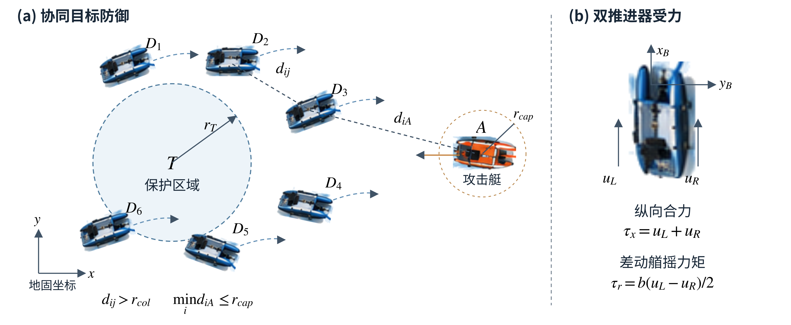
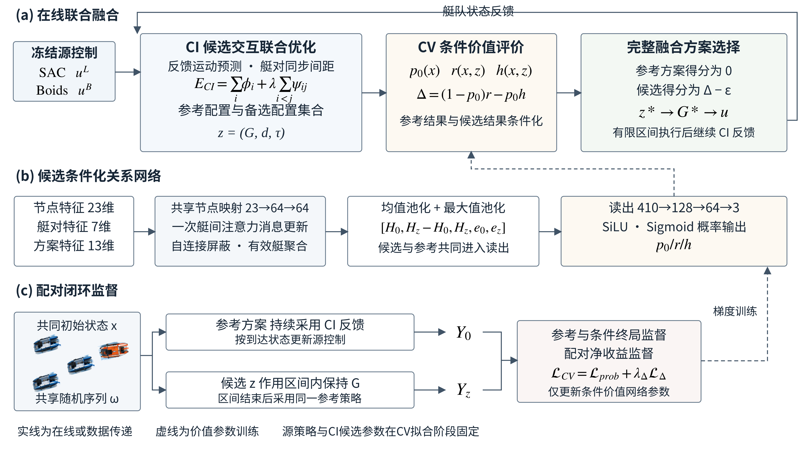
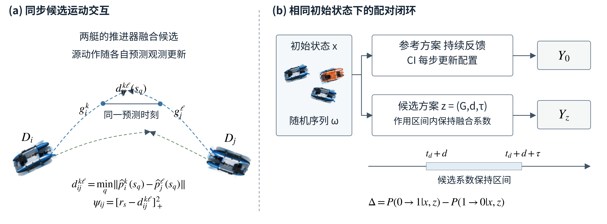
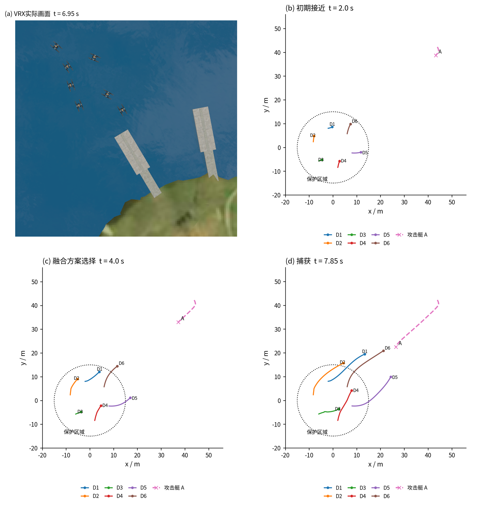
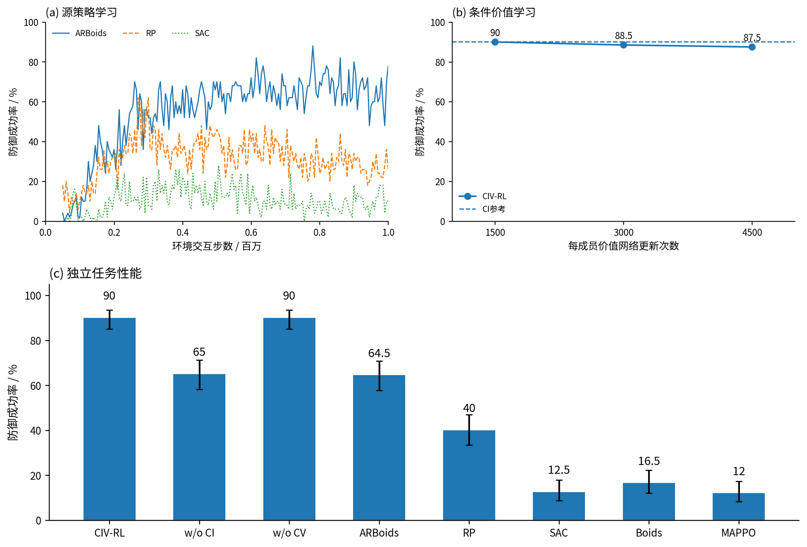
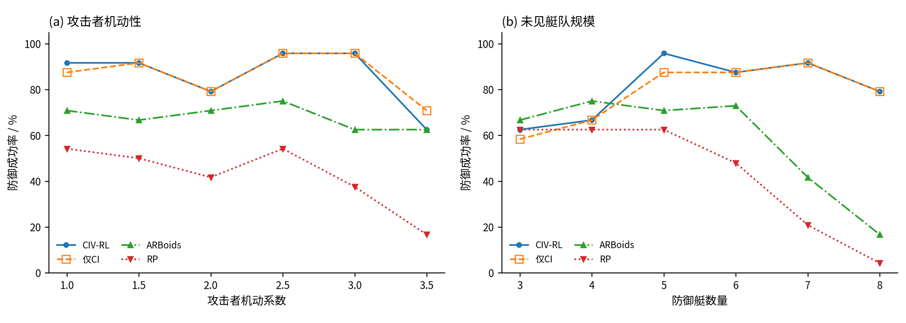
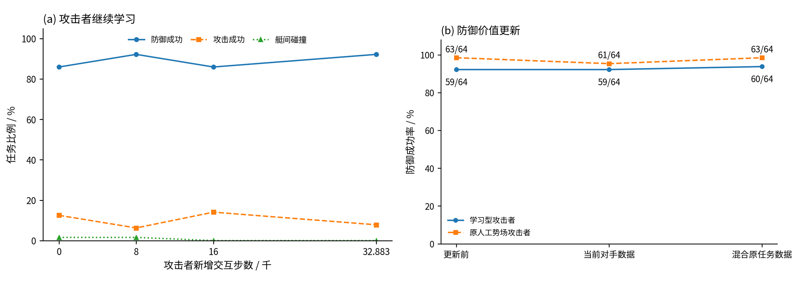

# 基于候选交互与条件价值学习的多无人艇协同目标防御方法

## 摘要

针对高机动攻击艇条件下多无人艇学习控制与规则控制的协同融合问题，提出候选交互与条件价值驱动的协同残差强化学习方法CIV-RL。以各艇左右推进器的融合系数为联合决策变量，在源策略融合偏好的基础上预测候选控制的反馈运动，依据同步预测间距构建艇对交互代价，并在艇队配置空间中联合选择融合控制。进一步利用相同初始状态与共同随机条件下的配对闭环结果，分别估计参考策略失败时的候选成功概率及参考策略成功时的候选失败概率，以两类成败转化的净收益确定最终执行方案。六艇数值试验中，所提方法在200个独立任务上取得90.0%的防御成功率，较自适应残差基线提高25.5个百分点。共享候选集合与预测信息时，联合选择较独立选择提高8.5个百分点，任务失败率相对下降45.9%，艇间碰撞率由5.0%降至2.5%。条件价值参与后，完整方法与CI参考策略保持相同的防御成功率，在两者共同捕获的176个任务中，平均捕获时间缩短0.83 s。Gazebo VRX高保真仿真中的12组共同场景均完成捕获。

**关键词**　多无人艇　协同目标防御　联合融合控制　候选运动交互　条件价值学习

## 1 引言

多无人艇协同目标防御通过协调多个水面平台的机动，阻止攻击艇进入受保护水域，在海上设施防护与自主水面系统协作中具有重要应用价值[1,2,3]。当攻击艇具有更强的加速、航速和转向能力时，防御艇需要在有限推力与运动响应约束下持续调整接近方向，同时维持拦截位置和艇间分离。多艘防御艇向同一目标汇聚时，各艇独立选择的有利机动可能形成近距交会，继而改变目标接近过程与后续捕获机会。此时，单艇控制的任务效果同时取决于自身运动响应和队友正在执行的控制，防御策略需要对整队机动进行协调。

区域防御与协同追捕研究主要从拦截几何、对抗策略和艇体动力学三个层面描述上述任务。区域防守方法依据攻击者的可达关系与保护区边界确定防御机动，分布式追捕方法将目标判断、任务规划和局部控制连接为连续决策过程[2,3]。追逃博弈利用包围函数及双方运动能力刻画可捕获条件[4,5]，神经控制方法进一步将船舶非线性动力学纳入对抗策略求解[6]。群体规则则通过分离、对齐与聚合等局部作用生成协调运动[7]，为多艇接近与空间分布提供控制先验。几何关系、动力学响应和局部群体作用分别描述了协同防御的不同方面，机动目标条件下的控制选择还需适应持续变化的对抗状态。

深度强化学习通过环境交互学习观测到控制的映射，为多艇动态机动提供了数据驱动的策略表示。分布式多机器人追捕利用共享策略形成协作行为[8]，夏家伟等将合围态势表示、距离与方位解耦动作以及协同奖励统一纳入多智能体近端策略优化框架[9]。自注意力与轨迹预测分别用于提取艇间关系和目标运动信息[10,11]，群体嵌入通过共享特征映射与聚合处理可变规模观测[12]，选择性通信与消息感知网络进一步组织与当前决策有关的队友信息[16,17]。在联合决策方面，价值分解与多智能体策略优化利用团队反馈学习协作[13,14]，深度协调图通过个体效用和成对收益表示联合动作价值，并求解相互依赖的动作组合[15]。这些研究分别从状态表示和联合价值建模支持团队决策。对于由多个控制来源共同生成的推进指令，融合系数还会改变候选运动本身，艇间交互需要结合具体控制响应进行评价。

规则控制与学习控制的融合兼顾已有机动先验和任务适应能力。残差强化学习在基准控制上学习动作修正[18]，贝叶斯控制器融合依据控制分布协调先验与学习输出[19]，强化学习与模型预测控制的结合则将预测指令和学习调整用于同一执行动作[20]。ARBoids以状态相关权重组合SAC与Boids指令，并通过动作价值反馈训练融合权重生成器，实现多无人艇自适应目标防御[21]。在双推进器无人艇中，两侧融合系数分别改变学习指令与规则指令的参与程度，其合成推力和差动力矩随当前源指令共同变化。当各艇同时调节融合系数时，艇间交会位置及接近距离取决于实际执行的候选组合。本文以推进器融合系数为联合决策变量，通过候选反馈轨迹构建运动交互代价，将源策略偏好与艇间同步接近关系纳入同一配置优化。

融合配置的任务评价还涉及短时运动关系与终局防御结果。交互代价相近的候选可能产生不同的后续拦截过程，缓解当前交会的机动也会改变防御艇与攻击艇的相对位置。反事实多智能体策略梯度固定其他智能体的当前动作，并构造单个智能体动作的反事实基准，以评价局部选择的团队贡献[22]。多智能体滚动评价在共同后续策略下比较候选动作[23]，模型辅助价值估计通过预测转移补充长期回报信息[24]。本文进一步评价具有规定作用区间的融合方案，在相同初始状态和共同随机条件下分别执行参考策略与候选方案，利用配对终局结果学习配置改变的条件收益。其中，参考失败转为成功与参考成功转为失败对应两类相反的任务变化，其概率差可直接用于候选方案排序。

基于上述联合控制与任务评价，本文提出候选交互与条件价值协同残差强化学习方法（Candidate-Interaction and Conditional-Value Guided Residual Reinforcement Learning，CIV-RL）。候选交互模块（candidate interaction，CI）在推进器通道级构建融合候选，根据反馈预测轨迹形成艇对交互项，并在整队配置中联合确定控制组合。条件价值模块（conditional value，CV）学习参考成功与失败事件下的候选终局结果，以成败转化的净收益选择CI给出的可执行方案。本文的主要贡献体现在三个方面。首先，建立由源策略融合偏好和候选运动交互共同确定的联合配置模型，使各艇的融合选择显式依赖于队友实际选定的候选。其次，构建面向融合方案的配对闭环条件价值学习方法，将参考结果监督、条件结果监督和配对收益监督用于同一候选评价。最后，通过基线比较、两项核心消融及同信息决策对照分析联合融合的任务作用，并在高保真环境、不同攻击者机动性、未见艇队规模和学习型对手下评价控制性能。

## 2 问题建模

### 2.1 无人艇运动模型

考虑由$n$艘同构防御艇与一艘攻击艇组成的目标防御系统。以保护区域中心为地固坐标系原点，防御艇$i$的位置与艏向记为$\boldsymbol\eta_i=[x_i,y_i,\psi_i]^{\mathsf T}$，艇体坐标系速度记为$\boldsymbol\nu_i=[v_{x,i},v_{y,i},r_i]^{\mathsf T}$。水平面运动采用纵荡、横荡和艏摇三自由度模型[25]

$$
\dot{\boldsymbol\eta}_i=R(\psi_i)\boldsymbol\nu_i,
\qquad
M\dot{\boldsymbol\nu}_i+C(\boldsymbol\nu_i)\boldsymbol\nu_i+D(\boldsymbol\nu_i)\boldsymbol\nu_i=\boldsymbol\tau_i.
\tag{1}
$$

其中，$M$为包含附加质量的惯性矩阵，$C$和$D$分别为科氏与向心项矩阵及水动力阻尼矩阵，$R(\psi_i)$将艇体速度转换至地固坐标系。艇体纵轴沿艇首方向，横轴指向右舷，艏向角与平面坐标采用一致的正向约定。两侧推进器的轴线沿艇体纵向固定，横向间距为$b$，数值模型取$b=2.5$ m。推进器输入$\boldsymbol u_i=[u_{i,L},u_{i,R}]^{\mathsf T}$通过下式产生纵向合力与艏摇力矩

$$
\begin{aligned}
\boldsymbol\tau_i&=B\boldsymbol u_i,\qquad
B=\begin{bmatrix}1&1\\0&0\\b/2&-b/2\end{bmatrix},\\
\tau_{x,i}&=u_{i,L}+u_{i,R},\qquad
\tau_{r,i}=\frac b2(u_{i,L}-u_{i,R}).
\end{aligned}
\tag{2}
$$

左右推进器的推力合量控制纵向推进，差动推力控制艏摇响应。每个通道满足$u_{i,a}\in[u_D^{\min},u_D^{\max}]$，$a\in\{L,R\}$。攻击艇采用相同形式的运动模型，并以机动系数$L_{\mathrm{agi}}$缩放推进器推力边界

$$
L_{\mathrm{agi}}=\frac{u_A^{\min}}{u_D^{\min}}
=\frac{u_A^{\max}}{u_D^{\max}}.
\tag{3}
$$

当$L_{\mathrm{agi}}>1$时，攻击艇具有更大的正向与反向推力范围。数值训练和候选预测采用水平面动力学模型，高保真评价采用Gazebo VRX中的WAM-V动力学环境，并执行双推进器指令[26]。各环境保留相应的积分和坐标变换，试验中不施加显式风浪载荷。后续融合控制以式（2）的推进器输入为作用对象，通过改变两侧推力调节艇体纵向运动与转向。

### 2.2 协同目标防御任务

保护区域为$\mathcal T=\{\boldsymbol p\mid\|\boldsymbol p\|\leq r_T\}$。设防御艇与攻击艇的位置分别为$\boldsymbol p_i$和$\boldsymbol p_A$，相对距离记为$d_{iA}=\|\boldsymbol p_i-\boldsymbol p_A\|$及$d_{ij}=\|\boldsymbol p_i-\boldsymbol p_j\|$。防御艇从保护区域附近出发，在攻击艇进入目标水域之前实施拦截，并在接近过程中保持艇间分离。图1给出六艇任务的相对几何和推进器受力关系。捕获邻域、艇间分离距离和区域边界共同规定接近与防御条件。

捕获、艇间碰撞、物理突破与径向失守分别定义为

$$
\begin{aligned}
\mathcal C&=\{x\mid\min_i d_{iA}\leq r_{\mathrm{cap}}\},&
\mathcal F_{\mathrm{col}}&=\{x\mid\min_{i<j}d_{ij}\leq r_{\mathrm{col}}\},\\
\mathcal F_{\mathrm{br}}&=\{x\mid\|\boldsymbol p_A\|\leq r_T\},&
\mathcal F_{\mathrm{rad}}&=\{x\mid\|\boldsymbol p_A\|<\min_i\|\boldsymbol p_i\|\}.
\end{aligned}
\tag{4}
$$

径向失守表示攻击艇到保护区中心的距离小于所有防御艇的径向距离。每个控制时刻依次判定物理突破或径向失守、艇间碰撞、目标捕获以及时间终止。在此前未发生失败事件的条件下，完成捕获或持续防御至任务时限$T_{\max}$均记为成功。以$Y\in\{0,1\}$表示终局防御结果，控制目标为在推力约束下最大化任务成功概率

$$
\pi^\star\in\arg\max_\pi
\mathbb E_{x_0,\omega,\pi_A}[Y\mid\pi],
\qquad
\boldsymbol u_i(t)\in[u_D^{\min},u_D^{\max}]^2.
\tag{5}
$$

其中，$x_0$为任务初始状态，$\omega$为环境随机条件，$\pi_A$为攻击策略。决策状态$x_t$包含艇队与攻击艇的位置、艏向和速度、当前源控制指令以及任务时间$t$，剩余时限为$T_{\max}-t$。源学习策略根据各艇局部观测生成动作，联合控制器汇集艇队状态与源指令，集中求解融合配置，各艇执行相应的推进器输入。攻击艇依据到达状态重新生成对抗动作。物理突破与径向失守按各自判据记录，任务结局采用上述终止顺序归类。

## 3 候选交互与条件价值协同融合方法

### 3.1 推进器通道级联合融合

CIV-RL在整队推进器融合配置上协调学习控制与规则控制。设防御艇$i$的两类源指令分别为$\boldsymbol u_i^L(x)$和$\boldsymbol u_i^B(x)$，左右推进器的融合系数为$\boldsymbol g_i=[g_{i,L},g_{i,R}]^{\mathsf T}\in[0,1]^2$，推力输出定义为

$$
\boldsymbol u_i(x,\boldsymbol g_i)
=\boldsymbol g_i\odot\boldsymbol u_i^L(x)
+(\boldsymbol 1-\boldsymbol g_i)\odot\boldsymbol u_i^B(x).
\tag{6}
$$

其中，$\odot$表示逐元素乘积，整队融合配置记为$\boldsymbol G=(\boldsymbol g_1,\ldots,\boldsymbol g_n)$。两侧推进器分别组合当前学习指令与规则指令，通道输入位于相应源指令构成的凸包内。当两类源指令满足相同推力边界时，融合输入保持有界。固定当前状态及源指令，融合系数变化与推进器输入、广义力变化之间满足

$$
\begin{aligned}
u_{i,a}&\in\operatorname{co}\{u_{i,a}^L,u_{i,a}^B\},\\
\delta\boldsymbol u_i
&=\operatorname{diag}(\boldsymbol u_i^L-\boldsymbol u_i^B)\,\delta\boldsymbol g_i,\\
\delta\boldsymbol\tau_i
&=B\operatorname{diag}(\boldsymbol u_i^L-\boldsymbol u_i^B)\,\delta\boldsymbol g_i.
\end{aligned}
\tag{7}
$$

式（7）表明，融合系数的作用由当前学习指令与规则指令之差确定。左右通道的指令差共同影响纵向合力和艏摇力矩，艇体惯性与水动力阻尼进一步决定其反馈运动。同一融合系数在不同源指令下产生的机动响应随之改变，多艇同时执行时的交会关系因而依赖于整组候选。CI根据这些响应构建局部偏好与艇对交互代价，在每个控制周期更新参考配置，并保留可供比较的备选配置。CV在规定决策时刻评价各方案的终局收益，从参考反馈策略与有限作用候选中确定一次执行选择。候选作用区间内保持融合系数，学习指令和规则指令仍随实时状态更新，区间结束后继续采用CI反馈控制。图2给出这一联合融合过程及相应的价值训练关系。

### 3.2 状态表示与源控制策略

学习控制源采用参数共享的软演员评论家算法（soft actor-critic，SAC）[27]。各防御艇的局部观测包含任务特征$o_i^{AT}$、群体规则特征$o_i^B$和队友观测集合$\{o_{ij}\}_{j\ne i}$。任务特征由保护区与攻击艇的相对距离和方位、攻击艇速度的模与相对方向组成，共6维。队友观测由相对距离与方位构成，方位以本艇艏向为参考并取值于$[-\pi,\pi)$，距离使用米制量纲。群体规则特征包含分离、对齐和聚合作用的模与方位，以及两个归一化推进器输出，共8维。队友信息经共享映射与均值聚合得到定长表示，并与任务及规则特征共同形成策略输入[12]

$$
\boldsymbol e_i^D=\frac1{|\mathcal N_i|}\sum_{j\in\mathcal N_i}f_D(o_{ij}),
\qquad
\boldsymbol h_i=f_s(o_i^{AT},\boldsymbol e_i^D,o_i^B).
\tag{8}
$$

动作网络根据$\boldsymbol h_i$生成学习指令，局部融合映射综合隐藏特征与两类源动作，输出标量融合偏好。源策略采用自适应融合训练形式[21]，动作网络和局部融合映射在任务回报下共同优化。SAC采用熵正则化目标

$$
J_{\mathrm{src}}(\psi)
=\mathbb E\!\left[\sum_{k=0}^{K_T}\gamma^k
\bigl(r_k+\alpha\mathcal H(\pi_\psi(\cdot\mid o_k))\bigr)\right].
\tag{9}
$$

其中，$K_T$为回合控制步数，$\gamma$为折扣因子，$\alpha$为熵温度。防御艇共享策略参数，并共同提供环境交互样本。连续动作经过双曲正切约束后映射至推进器推力范围，局部融合输出经过有界变换得到中心值$\bar g_i(x)$，两侧通道采用同一候选中心。规则控制由Boids模型的分离、对齐、聚合及目标吸引作用组成[7,21]。利用当前艇位与地固速度，各作用写为

$$
\begin{aligned}
\boldsymbol F_i^{\mathrm{sep}}&=
 k_{\mathrm{sep}}\sum_{j\in\mathcal N_i^s}
 \frac{\boldsymbol p_i-\boldsymbol p_j}{\max(d_{ij}-r_b,\epsilon_b)^2},\\
\boldsymbol F_i^{\mathrm{ali}}&=\frac{k_{\mathrm{ali}}}{n}\sum_j\boldsymbol v_j,
\qquad
\boldsymbol F_i^{\mathrm{coh}}=k_{\mathrm{coh}}\left(\frac1n\sum_j\boldsymbol p_j-\boldsymbol p_i\right),\\
\boldsymbol F_i^{\mathrm{att}}&=k_{\mathrm{att}}(\boldsymbol p_A-\boldsymbol p_i),
\qquad
\boldsymbol F_i=\boldsymbol F_i^{\mathrm{sep}}+\boldsymbol F_i^{\mathrm{ali}}+
\boldsymbol F_i^{\mathrm{coh}}+\boldsymbol F_i^{\mathrm{att}}.
\end{aligned}
\tag{10}
$$

其中，$\mathcal N_i^s=\{j\ne i\mid d_{ij}<15\,\mathrm m\}$，$r_b=3.5\,\mathrm m$，$\epsilon_b=0.01\,\mathrm m$，四项作用的权重依次为10、0.1、0.1和0.5。合力单位方向转换至艇体坐标后记为$\boldsymbol f_i=[f_{x,i},f_{y,i}]^{\mathsf T}$，其方向角为$\chi_i=\operatorname{atan2}(f_{y,i},f_{x,i})$。规则推进指令定义为

$$
\boldsymbol u_i^B=
\operatorname{clip}_{[u_D^{\min},u_D^{\max}]^2}
\left\{u_D^{\max}
\begin{bmatrix} f_{x,i}+0.75\chi_i\\ f_{x,i}-0.75\chi_i\end{bmatrix}\right\}
\tag{11}
$$

源策略训练完成后，动作网络与局部融合映射保持固定。学习指令和规则指令确定融合候选的两个端点，标量偏好确定通道候选的中心。CI在这些候选之间进行整队配置选择，CV评价相应执行方案的团队任务结果。

### 3.3 候选反馈响应与联合配置优化

由规则端点、学习端点与源策略偏好生成防御艇$i$的通道候选$\mathcal G_i(x)=\{\boldsymbol g_i^1,\ldots,\boldsymbol g_i^{K_i}\}$。候选取自$\{0,\bar g_i(x),1\}^2$，合并重合系数组合后，每艇至多保留9个不同候选。候选$k$相对于源策略融合偏好的偏离代价为

$$
\phi_i(k;x)=\frac12\sum_{a\in\{L,R\}}
\left(\frac{g_{i,a}^{k}-\bar g_i(x)}{\sigma_g}\right)^2.
\tag{12}
$$

其中，$\sigma_g$为偏离尺度。局部代价在源策略输出附近保留已学习的任务机动偏好，艇对交互则由候选实际诱导的运动响应确定。预测从当前艇队状态出发，在时域$H$内保持被评价的融合系数，其他防御艇和攻击艇按当前地固速度进行名义运动延续

$$
\widehat{\boldsymbol p}^{\mathrm{nom}}_j(s)
=\boldsymbol p_j+s\boldsymbol v_j,
\qquad
\widehat{\boldsymbol p}^{\mathrm{nom}}_A(s)
=\boldsymbol p_A+s\boldsymbol v_A,
\qquad s\in[0,H].
\tag{13}
$$

各候选使用相同的名义邻艇和攻击艇轨迹。设$\widehat x_{i,q}^{k}$为艇$i$采用候选$k$时的预测状态，$\widehat o_{i,q}^{k}$为根据本艇预测状态与其他艇名义状态构造的局部观测，则反馈预测满足

$$
\begin{aligned}
\widehat o_{i,q}^{k}
&=\mathcal O_i\!\left(\widehat x_{i,q}^{k},
\widehat{\boldsymbol x}_{-i,q}^{\mathrm{nom}},\widehat x_{A,q}^{\mathrm{nom}}\right),\\
\widehat{\boldsymbol u}_{i,q}^{k}
&=\boldsymbol g_i^k\odot\pi_L(\widehat o_{i,q}^{k})
+(\boldsymbol1-\boldsymbol g_i^k)\odot\pi_B(\widehat o_{i,q}^{k}),\\
\widehat x_{i,q+1}^{k}
&=\widehat F\!\left(\widehat x_{i,q}^{k},\widehat{\boldsymbol u}_{i,q}^{k}\right),
\qquad \widehat x_{i,0}^{k}=x_i.
\end{aligned}
\tag{14}
$$

其中，$\mathcal O_i$沿用源策略观测定义，$\widehat F$为平面动力学离散转移。预测期间，名义邻艇状态参与局部观测与Boids规则计算，本艇学习指令和规则指令随预测观测重新生成。预测步长为0.1 s，源指令更新周期为0.2 s，时域为3.2 s。由此得到位置序列$\widehat{\boldsymbol p}_i^k(s_q)$，$s_q=q\Delta t_{\mathrm{pred}}$。对艇$i$和$j$的候选组合$(k,\ell)$，同步最小预测间距及交互势定义为

$$
\begin{aligned}
d_{ij}^{k\ell}(x)
&=\min_{q=1,\ldots,N_H}
\left\|\widehat{\boldsymbol p}_i^k(s_q)-\widehat{\boldsymbol p}_j^\ell(s_q)\right\|,\\
\psi_{ij}(k,\ell;x)&=\left[r_s-d_{ij}^{k\ell}(x)\right]_+^2,
\qquad N_H=H/\Delta t_{\mathrm{pred}}.
\end{aligned}
\tag{15}
$$

$r_s$为候选接近评价距离，$[a]_+=\max(a,0)$。式（15）比较同一预测时刻的两艇位置，对小于$r_s$的接近赋予平方代价。该代价由双方候选共同决定，既包含当前相对几何，也包含融合推力经反馈动力学产生的后续响应。不同队友候选会改变本艇同一候选的交互代价，图3(a)给出相应几何。以$\boldsymbol k=(k_1,\ldots,k_n)$表示艇队候选索引，联合融合目标为

$$
\begin{aligned}
E_{\mathrm{CI}}(x,\boldsymbol k)
&=\sum_{i=1}^{n}\phi_i(k_i;x)
+\lambda\sum_{i<j}\psi_{ij}(k_i,k_j;x),\\
\boldsymbol k^\star&\in\arg\min_{\boldsymbol k\in\prod_i\{1,\ldots,K_i\}}
E_{\mathrm{CI}}(x,\boldsymbol k).
\end{aligned}
\tag{16}
$$

$\lambda$为艇对交互权重，$\boldsymbol k^\star$为联合目标的最优索引。有限搜索得到参考索引$\boldsymbol k_0$及其融合配置$\boldsymbol G_0(x)$。局部项约束融合选择偏离源策略偏好的程度，艇对项评价各艇实际选定的候选共同执行时的同步接近。在其余艇选择不变时，将艇$i$的候选由$k_i$改为$k_i'$，目标变化为

$$
\delta E_i=
\phi_i(k_i';x)-\phi_i(k_i;x)
+\lambda\sum_{j\ne i}
\left[\psi_{ij}(k_i',k_j;x)-\psi_{ij}(k_i,k_j;x)\right].
\tag{17}
$$

式（17）中的交互增量显式依赖队友选定的$k_j$。同一局部调整可能降低与某艘艇的接近代价，同时增加与另一艘艇的交互代价，候选评价因而在完整配置上进行。联合求解同时考察偏好偏离与艇对接近，使推进和转向的选择与队友实际机动相协调。

联合配置采用束搜索与局部细化求解。束搜索依次加入各艇候选，并累计相应局部代价及其与已选候选的艇对代价，每轮保留能量较低的有限个部分配置。完整配置形成后执行三轮坐标更新，并对保留配置进行一次双艇块细化。细化结果在局部偏离总量和预测交互总量均不高于原参考配置时被采用。每艇至多9个候选时，组合空间包含$9^n$个配置，艇对代价最多为$81n(n-1)/2$项。有限束宽限制搜索规模，坐标与双艇更新复用已计算的交互代价。参考配置、保留的搜索结果及参考配置的单艇邻域组成候选池$\mathcal P(x)$，进一步按能量容差形成备选集合

$$
\mathcal C(x)=\{\boldsymbol G_0(x)\}\cup
\left\{\boldsymbol G\in\mathcal P(x)\ \middle|\
E_{\mathrm{CI}}(x,\boldsymbol G)
\leq E_{\mathrm{CI}}(x,\boldsymbol G_0)+n\rho\right\}.
\tag{18}
$$

其中，$\rho$为单位艇数的代价容差。备选集合合并重复配置，并按联合能量保留规定数量的候选。参考配置用于逐周期反馈控制，备选配置在同一运动评价约束下进入条件价值模型，形成后续终局评价的可选范围。

### 3.4 完整融合方案与配对条件价值

融合方案$z=(\boldsymbol G,d,\tau)$同时规定艇队配置、执行延迟和作用时长。参考方案$z_0$在整个任务中采用逐周期更新的CI策略$\pi_0$。候选方案在决策时刻$t_d$之后的区间$[t_d+d,t_d+d+\tau)$内保持指定融合系数，区间外沿用参考策略，其系数过程为

$$
\boldsymbol g_i(t;z)=
\begin{cases}
\boldsymbol g_i^z,&t_d+d\leq t<t_d+d+\tau,\\
\boldsymbol g_i^0(x_t),&\text{其余时刻}.
\end{cases}
\tag{19}
$$

两类源指令在各分支的到达状态上重新计算，保持融合系数期间仍执行状态反馈控制。以$\mathcal D$和$\mathcal T_\tau$分别表示可用延迟与作用时长集合，待评价方案集为

$$
\mathcal Z_{\mathrm{CI}}(x)=\{z_0\}\cup
\left\{(\boldsymbol G,d,\tau)\ \middle|\
\boldsymbol G\in\mathcal C(x)\setminus\{\boldsymbol G_0(x)\},\
d\in\mathcal D,\ \tau\in\mathcal T_\tau\right\}.
\tag{20}
$$

参考方案持续重求CI配置，非参考方案则在有限区间内保持给定系数。式（20）仅将非参考配置与时序参数组合，$\boldsymbol G_0(x)$通过持续反馈方案$z_0$参与比较。每个方案由此对应一个确定的闭环执行过程。设$x$为配对推演的初始状态，$\omega$为共同随机序列，在相同参考策略参数下定义方案终局结果与条件价值

$$
Y(x,z,\omega)=\mathbb I\{\text{闭环防御成功}\},
\qquad
V^{\pi_0}(x,z)=\mathbb E_\omega[Y(x,z,\omega)].
\tag{21}
$$

参考与候选分支共享初始状态和随机序列，随后各自在到达状态上生成反馈控制。两个候选具有相同作用区间、且仅在一艘艇的融合系数上不同时，形成保持其余当前配置一致的局部比较。对每个初始状态使用$R_x$组共同随机序列执行至终局，经验条件价值差为

$$
\widehat\Delta(x;z,z')
=\frac1{R_x}\sum_{q=1}^{R_x}
\left[Y(x,z',\omega_q)-Y(x,z,\omega_q)\right].
\tag{22}
$$

每次续行均记录整个防御任务的终局结果，局部融合变化以其对团队成败的影响接受评价。CV采用共享函数$V_\theta(x,z)$表示方案价值，任意两个候选的预测差为

$$
\Delta_\theta(x;z,z')=V_\theta(x,z')-V_\theta(x,z).
\tag{23}
$$

记参考结果为$Y_0=Y(x,z_0,\omega)$，候选结果为$Y_z=Y(x,z,\omega)$。两个分支均成功或均失败时，任务成功数保持不变；相对参考的期望净收益由失败转成功与成功转失败的联合概率之差确定

$$
\Delta(x;z_0,z)
=\Pr(Y_0=0,Y_z=1\mid x,z)
-\Pr(Y_0=1,Y_z=0\mid x,z).
\tag{24}
$$

根据参考事件分别定义参考成功概率、参考失败条件下的候选成功概率，以及参考成功条件下的候选失败概率

$$
\begin{aligned}
p_{0,\theta}(x)&=\Pr(Y_0=1\mid x),\\
r_\theta(x,z)&=\Pr(Y_z=1\mid Y_0=0,x,z),\\
h_\theta(x,z)&=\Pr(Y_z=0\mid Y_0=1,x,z).
\end{aligned}
\tag{25}
$$

由上述条件概率得到候选的终局价值及相对参考收益

$$
\begin{aligned}
V_\theta(x,z)
&=[1-p_{0,\theta}(x)]r_\theta(x,z)
+p_{0,\theta}(x)[1-h_\theta(x,z)],\\
\Delta_\theta(x;z_0,z)
&=[1-p_{0,\theta}(x)]r_\theta(x,z)
-p_{0,\theta}(x)h_\theta(x,z),\\
V_\theta(x,z_0)&=p_{0,\theta}(x).
\end{aligned}
\tag{26}
$$

$r_\theta$评价参考失败时的成功恢复机会，$h_\theta$评价候选改变原有成功结果的概率，$p_{0,\theta}$确定两类参考事件的组合权重。候选价值由参考成功和失败条件下的结果共同组成，相对收益仍对应候选成功概率与参考成功概率之差。条件分解使配对数据中的两类成败转化分别进入监督，并将其净变化直接用于最终方案排序。局部变化与联合配置比较均采用式（23）的共享价值函数。

### 3.5 候选条件化的关系表示与监督训练

条件价值网络根据当前状态与候选方案构造关系表示。23维节点特征$\boldsymbol\xi_i(x,z)$包含本艇相对于攻击艇的位置与速度、艏向方向、角速度、两类源指令、参考及候选融合系数、系数差、预测位移和局部代价统计。7维艇对特征$\boldsymbol\rho_{ij}(x,z)$包含相对位置、相对速度、候选预测终点差和交互势。13维方案特征$\boldsymbol e_z$记录攻击艇到保护区的距离与运动方向、艇数、任务时间、联合代价、候选来源和作用区间。关系坐标以攻击艇指向保护区的方向为基轴，位置和速度分别按30 m和5 m/s缩放，地固方位保留在方案级输入中。不同候选改变融合系数及预测响应，从而在同一任务状态下形成不同的节点与艇对表示。共享节点映射之后进行一次艇间注意力聚合

$$
\begin{aligned}
\boldsymbol h_i&=f_n(\boldsymbol\xi_i),\\
a_{ij}&=\frac{\exp f_a(\boldsymbol h_i,\boldsymbol h_j,\boldsymbol\rho_{ij})}
{\sum_{k\ne i}\exp f_a(\boldsymbol h_i,\boldsymbol h_k,\boldsymbol\rho_{ik})},
\qquad j\ne i,\\
\boldsymbol h_i^+&=f_u\!\left(\boldsymbol h_i,
\sum_{j\ne i}a_{ij}f_m(\boldsymbol h_i,\boldsymbol h_j,\boldsymbol\rho_{ij})\right).
\end{aligned}
\tag{27}
$$

注意力屏蔽自连接，仅对当前有效艇计算消息。更新后的节点经均值与最大值池化形成方案表示$\boldsymbol H_z$，读出层同时接收参考表示、候选表示及二者之差

$$
\begin{aligned}
\boldsymbol H_z&=\left[\operatorname{Mean}_i\boldsymbol h_i^+,
\operatorname{Max}_i\boldsymbol h_i^+\right],\\
\boldsymbol\ell_\theta(x,z)
&=f_o\!\left(\boldsymbol H_{z_0},\boldsymbol H_z-\boldsymbol H_{z_0},
\boldsymbol H_z,\boldsymbol e_{z_0},\boldsymbol e_z\right).
\end{aligned}
\tag{28}
$$

节点映射由两层64维全连接网络组成，消息映射、注意力映射和节点更新分别采用$135\!\rightarrow\!64\!\rightarrow\!64$、$135\!\rightarrow\!32\!\rightarrow\!1$及$128\!\rightarrow\!64\!\rightarrow\!64$结构。均值与最大值池化得到128维方案表示，读出输入为410维，经128维和64维隐藏层输出三个标量。隐藏层使用SiLU激活，读出层训练时的随机失活率为0.04。参考方案的第一输出经Sigmoid变换得到$p_{0,\theta}$，候选方案的另外两个输出得到$r_\theta$与$h_\theta$。输入标准化参数由训练样本确定，并在验证和执行中固定。共享映射及有效艇集合上的聚合用于处理不同艇数，无效候选通过掩码排除。

训练目标由参考结果、条件结果和配对净收益三部分监督组成。设二元交叉熵为$\ell(p,y)=-y\log p-(1-y)\log(1-p)$，参考概率与两类条件概率的损失为

$$
\mathcal L_{\mathrm{prob}}
=\mathbb E_{\mathcal D}^{\iota}\ell(p_{0,\theta},Y_0)
+\frac12\mathbb E_{\mathcal D\mid Y_0=0}^{\iota,m}\ell(r_\theta,Y_z)
+\frac12\mathbb E_{\mathcal D\mid Y_0=1}^{\iota,m}\ell(h_\theta,1-Y_z).
\tag{29}
$$

其中，$\iota_x$为初始状态采样校正权重，$m_{xz}$为有效候选掩码。参考概率项按抽样批次加权平均，两类条件项分别在$Y_0=0$和$Y_0=1$的子集中按有效样本权重之和归一化。参考标签监督CI持续执行的成功概率，条件标签分别监督候选在参考失败与成功事件下的结果。对同一状态和候选，将配对终局差取平均，记为$\bar\delta_{xz}=R_x^{-1}\sum_q(Y_z^{(q)}-Y_0^{(q)})$。配对收益损失将参考概率作为梯度截断的组合权重

$$
\widetilde\Delta_\theta(x,z)
=[1-\operatorname{sg}(p_{0,\theta}(x))]r_\theta(x,z)
-\operatorname{sg}(p_{0,\theta}(x))h_\theta(x,z),
\tag{30}
$$

其中，$\operatorname{sg}$表示梯度截断。配对收益项与总损失为

$$
\begin{aligned}
\mathcal L_\Delta
&=\frac{\displaystyle\sum_{x,z\ne z_0}w_{xz}
[\widetilde\Delta_\theta(x,z)-\bar\delta_{xz}]^2}
{\displaystyle\sum_{x,z\ne z_0}w_{xz}},\\
w_{xz}&=\iota_xm_{xz}(1+3|\bar\delta_{xz}|),
\qquad
\mathcal L_{\mathrm{CV}}=\mathcal L_{\mathrm{prob}}+\lambda_\Delta\mathcal L_\Delta.
\end{aligned}
\tag{31}
$$

配对项约束用于候选排序的净收益估计，权重$w_{xz}$同时包含初始状态采样校正、候选有效性和经验差值幅度。其差值梯度通过条件概率分支传递，参考概率仍接受式（29）的终局监督。模型成员分别对初始状态进行自助重采样，并按实际采样概率校正权重。条件价值拟合期间，源策略和CI候选生成参数保持固定，在线评价取各成员预测净收益的平均值。

### 3.6 条件价值引导的融合方案选择

CV评价CI给出的联合配置及其作用时长，以零相对收益表示持续采用参考策略。设$\overline\Delta_\theta(x,z)$为模型成员的平均预测收益，$\varepsilon$为候选接受阈值，则方案评分与最终选择为

$$
S_\theta(x,z)=
\begin{cases}
0,&z=z_0,\\
\overline\Delta_\theta(x,z)-\varepsilon,&z\ne z_0,
\end{cases}
\qquad
z^\star\in\arg\max_{z\in\mathcal Z_{\mathrm{CI}}(x)}S_\theta(x,z).
\tag{32}
$$

当最高得分为零时选择$z_0$。正得分候选按式（19）执行，其融合系数作用于实时更新的源指令，得到

$$
\boldsymbol u_i(t)
=\boldsymbol g_i(t;z^\star)\odot\boldsymbol u_i^L(x_t)
+[\boldsymbol1-\boldsymbol g_i(t;z^\star)]\odot\boldsymbol u_i^B(x_t).
\tag{33}
$$

CI通过候选构造和能量筛选限定融合配置的运动交互范围，CV依据终局净收益确定其中的执行方案。候选作用期间保持所选系数，学习指令与规则指令随各艇状态反馈更新；作用区间结束后，恢复逐周期CI配置求解。配对训练和在线执行使用相同的系数保持区间与后续策略。由于三个概率输出均位于$[0,1]$，式（26）还给出单个模型成员的预测收益范围

$$
-p_{0,\theta}(x)\leq\Delta_\theta(x;z_0,z)\leq1-p_{0,\theta}(x).
\tag{34}
$$

模型成员取平均后，收益上界为$1-\bar p_0(x)$。在严格正得分接受规则下，$\bar p_0(x)\geq1-\varepsilon$时所有候选得分均不高于零，控制器保持参考策略。参考成功概率越高，候选可获得的预测增益上限越小。本文采用$\varepsilon=0.075$，相应界值为0.925，并在$t_d=4$ s进行一次方案选择，取$\mathcal D=\{0\}$和$\mathcal T_\tau=\{1\,\mathrm s,4\,\mathrm s\}$。CI以0.2 s控制周期持续更新，CV在规定时刻对有效候选排序，最终由选定方案生成艇队推进器输入。

### 3.7 奖励与训练过程

源策略与条件价值模型采用不同的任务反馈。源策略通过逐步奖励学习推进控制及局部融合偏好，CV通过配对终局标签学习候选方案的成功概率与相对收益。源训练的奖励由任务项、队形项和碰撞项组成[21]

$$
r_i=r_i^{\mathrm{task}}+r_i^{\mathrm{form}}+r_i^{\mathrm{col}}.
\tag{35}
$$

任务项在攻击艇物理突破或径向失守时给予失败反馈，在捕获时向捕获艇及其$3r_{\mathrm{cap}}$邻域内的协助艇提供奖励。碰撞项对发生近距接触的艇施加惩罚。队形奖励结合防御艇指向攻击艇的单位向量与保护区指向攻击艇的方向，描述艇队相对于威胁方向的拦截分布

$$
\begin{aligned}
\widehat{\boldsymbol d}_{iA}
&=\frac{\boldsymbol p_A-\boldsymbol p_i}{\|\boldsymbol p_A-\boldsymbol p_i\|},
\quad
\boldsymbol d_{DA}=\sum_i\widehat{\boldsymbol d}_{iA},
\quad
\widehat{\boldsymbol d}_{TA}=\frac{\boldsymbol p_A}{\|\boldsymbol p_A\|},\\
r_i^{\mathrm{form}}
&=0.5\widehat{\boldsymbol d}_{TA}^{\mathsf T}
\frac{\boldsymbol d_{DA}}{\|\boldsymbol d_{DA}\|}
-\frac{\|\boldsymbol d_{DA}\|}{n}.
\end{aligned}
\tag{36}
$$

零范数时对应方向项取零。方向项评价艇队相对于攻击方向的分布，合向量模长项调节接近方向的集中程度。源训练采用攻击者机动性课程[28]，平均难度随训练推进增加，各回合从以$\bar L_{\mathrm{agi}}(k)$为中心的区间采样

$$
L_{\mathrm{agi}}\sim\mathcal U\!\left(
\bar L_{\mathrm{agi}}(k)-\delta_L,
\bar L_{\mathrm{agi}}(k)+\delta_L\right).
\tag{37}
$$

其中，$k$为源策略环境交互步数，$K_c$为课程更新间隔，$L_0$、$\Delta L$与$\delta_L$分别为初始难度、增长量和采样半宽，参数见表1。训练先完成源策略学习，再固定控制来源采集配对闭环结果，最后按式（31）拟合条件价值。逐步回报决定源动作及融合偏好的学习方向，终局标签评价同一候选空间中的实际任务后果。

## 4 实验与分析

### 4.1 实验设置

数值试验采用六艘防御艇对抗单艘攻击艇的区域防御任务。保护区半径为15 m，捕获和艇间碰撞距离均为5 m，任务时限为80 s。动力学积分周期为0.05 s，推进器控制周期为0.2 s，单推进器推力范围为$[-500,1000]$ N。攻击艇采用由保护区域吸引与防御艇排斥共同形成的人工势场策略。主评价包括$L_{\mathrm{agi}}=2.0$与2.5两种条件，各100个任务。防御艇初始位置位于距保护区中心7至8 m的圆周附近，采用随机起始方位和等间隔角度布设；各艇艏向在共同随机方向上叠加$[-\pi/3,\pi/3]$的偏差。攻击艇初始距离在60至65 m内采样，来向覆盖完整方位。各方法使用相同的初始位置、艏向、机动条件和随机序列进行配对评价，源指令根据各自实际到达的状态计算。

CI预测时域为3.2 s，步长为0.1 s，局部偏好尺度为0.4，交互权重为32，候选接近评价距离为7 m。联合搜索束宽取128，参考与备选配置总数上限为6，单位艇数能量容差为0.5。CV在4 s处进行一次决策，延迟为零，候选作用时长为1 s或4 s，包含参考方案在内至多评价11个有效方案。接受阈值在开发任务中选定为0.075，随后固定用于独立评价。

源学习策略在六艇环境中完成$10^6$步交互。条件价值训练和验证分别包含772个与206个配对初始状态，同一场景及其共同随机续行归入相同数据划分，采集条件覆盖机动系数2.0、2.5、3.0和3.5。每个状态使用1、2、5或6组配对随机条件，训练集与验证集分别包含16 544条和3 575条有效终局观测。三个关系网络成员独立进行初始状态自助采样，单成员可训练参数为96 420个。每成员最多更新4 500次，CV与普通价值模型分别选用1 500次和4 500次更新的模型。两者共享控制源、关系网络、候选方案、训练样本及最大更新预算，并采用相同的开发验证规则。优化器为AdamW，学习率为$3\times10^{-4}$，批量大小为48，权重衰减为$10^{-4}$。主要设置列于表1。

**表1　任务、控制与学习参数**

| 参数 | 符号 | 设置 |
|---|---|---|
| 主任务防御艇数量 | $n$ | 6 |
| 任务时限 | $T_{\max}$ | 80 s |
| 控制周期与积分周期 | $\Delta t,\Delta t_{\mathrm{int}}$ | 0.2 s，0.05 s |
| 保护区域半径 | $r_T$ | 15 m |
| 数值捕获与碰撞阈值 | $r_{\mathrm{cap}},r_{\mathrm{col}}$ | 5 m，5 m |
| 单推进器推力范围 | $[u_D^{\min},u_D^{\max}]$ | $[-500,1000]$ N |
| CI预测时域与步长 | $H,\Delta t_{\mathrm{pred}}$ | 3.2 s，0.1 s |
| 候选接近评价距离 | $r_s$ | 7 m |
| 源策略偏好尺度与交互权重 | $\sigma_g,\lambda$ | 0.4，32 |
| 联合搜索束宽 | $B_s$ | 128 |
| 配置数上限与代价容差 | $K_G,\rho$ | 6，0.5 |
| CV决策时刻与执行延迟 | $t_d,d$ | 4 s，0 s |
| 候选作用时长与接受阈值 | $\tau,\varepsilon$ | 1 s或4 s，0.075 |
| 训练与验证初始状态数 | $N_{\mathrm{tr}},N_{\mathrm{val}}$ | 772，206 |
| 训练与验证终局观测数 |  | 16 544，3 575 |
| 节点、艇对与方案特征维数 |  | 23，7，13 |
| 隐藏维数与消息更新次数 |  | 64，1 |
| 价值网络成员数与单成员参数数 |  | 3，96 420 |
| 最大更新次数与选定CV更新次数 |  | 4 500，1 500，均按成员计 |
| 配对收益权重 | $\lambda_\Delta$ | 2 |
| 源策略环境交互步数 | $N_{\mathrm{src}}$ | $10^6$ |
| 源奖励系数 |  | 待补 |
| 课程起点、增长量及更新间隔 | $L_0,\Delta L,K_c$ | 待补 |
| 机动性采样半宽 | $\delta_L$ | 待补 |
| 数值主评价任务数 | $N$ | 200 |
| 推理设备 |  | NVIDIA GeForce RTX 4090 |

主评价对各方法一次训练所得的冻结模型开展200任务测试，成功比例采用Wilson 95%置信区间。独立完整训练的汇总位置见补充表S2。对于相同的$N$个任务，方法$\pi$相对于参考$\pi_b$的配对成功率差为

$$
\widehat\delta_{\mathrm{SR}}(\pi,\pi_b)
=\frac1N\sum_{e=1}^N\left(Y_e^\pi-Y_e^{\pi_b}\right)
=\frac{N_{01}-N_{10}}N.
\tag{38}
$$

$N_{01}$与$N_{10}$分别为参考失败转成功及参考成功转失败的任务数。任务级差异按共同场景配对，训练运行间差异按完整训练流程汇总。捕获时间以成功捕获回合为总体，两种方法共同捕获的任务另行计算配对时间差。实验同时记录艇间碰撞、径向失守、物理突破与时间终止，在线时延覆盖源动作计算、候选预测、联合求解和价值选择。源策略交互、配对闭环采集及价值拟合按各自训练阶段记录。

### 4.2 高保真闭环防御

高保真试验在Gazebo VRX水面环境中运行WAM-V防御艇与攻击艇，比较完整CIV-RL、仅CI和ARBoids。三种方法共享初始位置、双推进器控制形式及0.2 s控制周期，任务时限为80 s，保护区半径为15 m，艇间碰撞阈值为5 m，捕获阈值为5.5 m。12组共同场景共形成36次有效闭环任务。图4给出首个配对场景的仿真画面，以及同一任务在接近、方案选择和捕获时刻的轨迹。

攻击艇从保护区域东北侧进入，防御艇沿不同方向接近目标。约2.6 s时，D3与D4形成该回合最小艇间距离7.15 m，之后间距增大。D6持续接近攻击艇，D1和D5从其两侧跟进；7.0 s时D6与攻击艇相距9.72 m，并于7.85 s进入5.5 m捕获邻域。整个过程中的最小艇间距离高于碰撞阈值，接近方向的调整与艇间分离在同一拦截过程中保持。12组共同场景中，CIV-RL与仅CI均完成捕获，ARBoids完成11次捕获，另1次因艇间碰撞终止。三种方法在各自捕获回合内的平均时间分别为8.88 s、8.80 s和7.85 s，结果见表2。

CIV-RL的平均控制计算时间为119.09 ms，95%分位为169.61 ms，仅CI对应为118.25 ms与165.39 ms。CV在4 s处触发方案评价，该控制周期的完整计算均值为286.94 ms，95%分位为362.20 ms。按全部有效控制周期统计，CIV-RL与仅CI的超期比例分别为2.22%和2.62%。周期级统计与方案选择时刻的单独统计分别描述持续联合求解和条件价值调用的计算负荷。

**表2　VRX配对任务与在线控制时延**

| 方法 | 捕获数 | 碰撞数 | 平均捕获时间/s | 平均时延/ms | 95%分位/ms | 超期比例/% |
|---|---|---|---|---|---|---|
| CIV-RL | 12/12 | 0 | 8.88 | 119.09 | 169.61 | 2.22 |
| 仅CI | 12/12 | 0 | 8.80 | 118.25 | 165.39 | 2.62 |
| ARBoids | 11/12 | 1 | 7.85 | 3.50 | 4.37 | 0.00 |

### 4.3 基线比较与机制分析

#### 4.3.1 整体防御性能与学习过程

基线方法包括Boids、SAC、传统残差策略RP、自适应残差方法ARBoids和MAPPO[14,18,21,27]。Boids直接执行群体规则，SAC学习连续推进控制，RP在规则动作上叠加学习残差，ARBoids通过状态相关权重融合两类源动作，MAPPO采用集中式价值训练与分布式策略执行。各学习基线按照自身结构在六艇任务中训练，环境交互预算均为$10^6$步，并采用相同的终止判据与评价场景。

完整方法设置两项核心消融。w/o CI保留源控制与局部融合偏好，以局部代价生成配置，移除艇对交互及联合优化，并针对新的参考控制重新采集配对数据训练CV。w/o CV保留候选预测、交互代价和联合求解，直接执行CI参考配置。w/o CI使用对应参考策略到达的可行动状态，训练与验证初始状态数分别为158和31，网络结构与完整方法一致，每成员更新4 500次。两项消融、完整方法和五种控制基线构成表3的八项比较。

图5按实际训练阶段呈现学习过程与最终性能。图5(a)使用源策略环境交互步数，记录学习动作及局部融合偏好的训练表现。图5(b)在源控制和CI参数固定时，以每成员价值网络更新次数表示CV训练进度，并通过各检查点的闭环成功率评价融合方案选择，CI以固定参考线给出。图5(c)汇总八种方法在200个共同任务上的成功比例及Wilson 95%区间。源策略训练、价值拟合和任务评价分别对应各自的统计对象。

CIV-RL在200个共同任务中完成180次防御，成功率为90.0%，95%置信区间为85.06%至93.43%。相对于ARBoids，成功任务增加51次，成功率提高25.5个百分点，艇间碰撞由70次减少至5次；相对于RP，成功率提高50.0个百分点，碰撞由115次减少至5次。完整方法的180次成功均由捕获完成，另外20次任务分别因5次碰撞和15次径向失守终止。较高的任务完成水平与较低的艇间碰撞同时出现，体现了联合融合在六艇接近过程中对控制组合的协调作用。

**表3　200个统一任务中的算法性能**

| 方法 | 成功率/% | 捕获率/% | 碰撞率/% | 物理突破率/% | 径向失守率/% | 捕获时间/s |
|---|---|---|---|---|---|---|
| CIV-RL | 90.0 | 90.0 | 2.5 | 0.0 | 7.5 | 24.02 |
| w/o CI | 65.0 | 65.0 | 34.0 | 0.0 | 1.0 | 18.78 |
| w/o CV | 90.0 | 90.0 | 2.5 | 0.0 | 7.5 | 24.84 |
| ARBoids | 64.5 | 64.5 | 35.0 | 0.0 | 0.5 | 18.86 |
| RP | 40.0 | 40.0 | 57.5 | 0.0 | 2.5 | 14.57 |
| SAC | 12.5 | 12.5 | 37.5 | 16.5 | 33.5 | 16.80 |
| Boids | 16.5 | 16.5 | 83.5 | 0.0 | 0.0 | 9.13 |
| MAPPO | 12.0 | 7.5 | 36.5 | 42.0 | 9.5 | 14.81 |

移除CI后成功率为65.0%，完整方法较其增加50次成功。仅CI与完整方法均取得90.0%的成功率和5次碰撞，主要成功率差异由候选交互与联合配置引入。条件价值参与后保持相同的总体成功数，其具体成败转化和时间变化见第4.3.3节。CV在1 500、3 000和4 500次更新时的闭环成功率依次为90.0%、88.5%和87.5%，最终采用开发阶段选定的1 500次更新模型。图5(b)据此呈现价值拟合进度与实际控制结果的对应，独立完整训练的汇总结果见补充表S2。

#### 4.3.2 候选交互的联合选择作用

联合选择与独立选择共享源策略、融合候选、局部代价及预测艇对交互势。独立选择按照队友候选的局部偏好构造分布

$$
\varrho_j(\ell\mid x)
=\frac{\exp[-\phi_j(\ell;x)]}
{\sum_{q=1}^{K_j}\exp[-\phi_j(q;x)]},
\tag{39}
$$

并分别最小化各艇的期望交互代价

$$
k_i^{\mathrm{ind}}\in\arg\min_k
\left[\phi_i(k;x)+\lambda\sum_{j\ne i}\sum_{\ell=1}^{K_j}
\varrho_j(\ell\mid x)\psi_{ij}(k,\ell;x)\right].
\tag{40}
$$

在200个共同任务中，独立选择完成163次防御，CI完成180次，成功率由81.5%提高至90.0%，艇间碰撞由10次减少至5次。任务失败数由37次降至20次，失败率从18.5%降至10.0%，相对下降45.9%。逐任务配对包括26次失败转成功与9次成功转失败，净增17次成功，对应8.5个百分点的成功率增益，配对95%区间为3.0至14.5个百分点。结果见表4。

独立选择将队友候选按局部偏好取期望，各艇分别求得的最小值对应其边际评价；联合选择则直接评价所有选定候选共同执行的组合。按照式（17），本艇候选的交互增量随队友实际选择而改变，联合求解将这种条件关系保留在最终配置中。配对终局记录进一步显示，26次失败转成功中，21次对应独立选择的径向失守，5次对应艇间碰撞；9次成功转失败均为径向失守。联合配置的收益因此同时表现为碰撞减少与径向防守结局的改善。在同一候选信息下，这些差异对应整队组合的求解方式，具体的推进器变化、同步间距及拦截位置分析待补。

**表4　候选交互与条件价值的直接比较**

| 配对比较 | 成功数 | 失败转成功 | 成功转失败 | 成功率差/百分点 | 配对95%区间 |
|---|---|---|---|---|---|
| CI相对独立选择 | 180/163 | 26 | 9 | 8.5 | [3.0, 14.5] |
| CIV-RL相对仅CI | 180/180 | 4 | 4 | 0.0 | [−3.0, 2.5] |
| CV相对普通价值 | 180/179 | 4 | 3 | 0.5 | [−2.0, 3.0] |

#### 4.3.3 条件价值与完整融合选择

条件价值模型与普通终局价值模型使用相同CI参考、配对初始状态、联合候选和关系网络。普通模型依据方案成功标签拟合终局结果，条件模型采用式（29）至式（31），分别学习参考事件下的候选后果并约束相对净收益。两者采用相同候选接受规则及开发验证协议，所选融合方案通过相同反馈控制过程执行。

CIV-RL在200个任务中接受38次候选方案，相对于仅CI产生4次失败转成功与4次成功转失败，两种方法均完成180次防御。普通价值模型完成179次防御，CV相对其产生4次失败转成功和3次成功转失败，净增加1次成功。在完整方法与仅CI共同捕获的176个任务中，19个任务提前捕获，8个任务捕获时间增加，149个任务时间相同，平均配对捕获时间缩短0.83 s。两种方法各自捕获回合的平均时间分别为24.02 s和24.84 s。条件价值选择在保持总体防御成功率的同时改变了部分任务的拦截时序，时间统计反映了这些实际执行差异。

价值辨识采用未参与拟合的配对初始状态，以候选的闭环终局差作为评价依据。设$\mathcal P_{\ne}$为经验价值存在差异的候选对集合，排序一致率与净收益均方误差定义为

$$
\begin{aligned}
A_{\mathrm{ord}}
&=\frac1{|\mathcal P_{\ne}|}
\sum_{(x,z,z')\in\mathcal P_{\ne}}
\mathbb I\!\left[\Delta_\theta(x;z,z')\widehat\Delta(x;z,z')>0\right],\\
E_\Delta&=\mathbb E\!\left[
\bigl(\Delta_\theta(x;z,z')-\widehat\Delta(x;z,z')\bigr)^2\right].
\end{aligned}
\tag{41}
$$

CV与普通价值模型的排序一致率分别为待补和待补，净收益均方误差分别为待补和待补。排序一致率评价候选优劣次序，收益误差评价价值差的数值拟合，两者与表4的实际选择结果共同对应条件价值辨识和闭环控制两个层面。

#### 4.3.4 交互权重与接受阈值

参数分析使用100个共同开发任务。交互权重$\lambda$取0、16、32和64时，CI成功率依次为66.0%、91.0%、91.0%和89.0%，碰撞次数依次为34、2、3和4。零交互权重时配置由局部偏好决定，加入艇对项后，成功率与碰撞结果均有改善。在16至64的范围内，成功率维持在89.0%至91.0%，联合选择在名义权重附近保持相近的任务完成水平。

固定价值网络与候选空间后，接受阈值$\varepsilon$取0、0.025、0.075和0.15时，成功率依次为95.0%、95.0%、95.0%和92.0%，候选接受次数为71、49、16和2。阈值由0提高至0.075，接受次数减少55次，成功率保持95.0%，配对结果由6次失败转成功和2次成功转失败，变为4次失败转成功且无成功转失败。较高阈值减少了低预测增益候选的执行，阈值进一步提高至0.15时，接受数降至2次，净成功增量相应减小。补充表S1给出两组参数的配对参考与全部结果，主评价固定采用$\lambda=32$和$\varepsilon=0.075$。

### 4.4 攻击者机动性

机动性试验固定六艘防御艇及源策略、CI参数和条件价值模型，攻击机动系数取1.0、1.5、2.0、2.5、3.0和3.5，每个等级评价24个任务。同一等级内，各方法共享初始几何和随机条件。图6(a)比较完整方法、仅CI、ARBoids与RP的防御成功率。

CIV-RL在六个机动等级分别完成22、22、19、23、23和15次防御，成功率依次为91.67%、91.67%、79.17%、95.83%、95.83%和62.50%。在$L_{\mathrm{agi}}=2.5$与3.0时，完整方法均完成23次防御且未发生艇间碰撞，ARBoids分别完成18次和15次，RP分别完成13次和9次。最高测试等级3.5下，CIV-RL与ARBoids均完成15次防御，碰撞次数分别为3次和9次。成功率随等级变化呈非单调分布，而中高机动等级中的碰撞差异持续反映两种方法在艇间交会处理上的不同。各等级结果按其共同任务分别统计，联合融合在2.5和3.0等级下同时取得较高捕获水平与较低碰撞。

### 4.5 未见艇队规模

跨规模评价固定六艇训练所得源策略与条件价值模型，测试3、4、5、7和8艘防御艇，各使用24个配对任务。六艇参考点由机动系数2.0与2.5下的48个任务组成。CI根据当前艇队建立候选交互，CV通过共享节点映射与聚合读取相应方案，各规模采用相同参数及接受规则。图6(b)给出完整冻结控制器的任务表现。

在5、7和8艘艇条件下，CIV-RL分别完成23/24、22/24和19/24次防御，ARBoids分别完成17/24、10/24和4/24次，碰撞次数分别为0、0、4和5、14、20。较大艇队中，完整方法的成功率优势与艇间碰撞减少同时出现，联合候选评价在更多同时运动关系下保持了较好的分离。在3艇和4艇条件下，CIV-RL分别完成15/24与16/24次防御，ARBoids分别完成16/24与18/24次，所提方法的优势主要集中于较大艇队。相对于仅CI，CV在3艇与5艇条件下分别增加1次和2次成功，其余测试规模成功数一致。

CI在所有不同艇对上计算交互项，无向交互边数为$n(n-1)/2$，由3艇时的3条增加至8艇时的28条，交互权重保持固定。共享特征映射与艇队聚合使CV保持相同参数维数，候选预测及联合搜索的计算规模则随有效艇数和保留候选数变化。上述冻结评价同时考察了变长艇队表示与联合配置选择的使用效果，跨规模计算时延统计待补。

### 4.6 学习型攻击者与条件价值更新

对手试验先冻结CIV-RL，使已训练的SAC攻击者继续与其交互，再固定更新后的攻击者，利用新配对结果更新条件价值模型。攻击阶段新增32 883步环境交互，并在新增0、8 000、16 000及32 883步时使用相同64个任务评价。完整方法分别完成55、59、55和59次防御，碰撞次数依次为1、1、0和0，成功率位于85.94%至92.19%。图7(a)按新增交互步数给出攻击者学习期间的任务结果。

防御价值更新从当前攻击策略下的192个任务中取得190个可行动初始状态，各使用两组共同随机序列，共形成4 180条闭环分支。CI保持固定，CV先根据当前对手的终局结果继续拟合，再将原人工势场任务的参考与候选观测加入训练。两阶段分别评价对当前对手的适应和原任务保持，结果见图7(b)。

在学习型攻击者下，更新前、仅使用当前对手数据更新后以及混合原任务数据后，CIV-RL分别完成59/64、59/64和60/64次防御；在原人工势场攻击者下，对应为63/64、61/64和63/64次。混合训练后两类任务成功率分别为93.75%和98.44%，均未发生艇间碰撞。与仅使用当前对手数据相比，加入原任务观测恢复了原人工势场任务的成功数，并增加1次对学习型攻击者的防御成功。条件价值更新在保持联合融合模型不变的条件下调整候选评价，混合数据训练保留了两类对手下的任务表现。

## 5 结论

本文针对多无人艇目标防御中的融合控制耦合，提出候选交互与条件价值协同控制方法CIV-RL。该方法以左右推进器融合系数为整队决策变量，根据候选反馈运动构建艇对交互代价，在源策略融合偏好与同步接近关系下联合选择配置。配对闭环学习分别估计参考成功和失败事件下的候选后果，将成败转化的净收益用于同一候选空间的最终选择，形成由运动交互评价与任务价值评价共同决定的融合控制。

六艇数值试验取得90.0%的防御成功率，较ARBoids提高25.5个百分点，艇间碰撞率由35.0%降至2.5%。共享候选与预测信息的联合选择比较取得8.5个百分点的增益，失败率相对下降45.9%，说明整队配置求解能够减少局部选择组合后的任务失败。条件价值参与后保持相同成功率，在176个共同捕获任务中平均提前0.83 s完成捕获。12组VRX共同场景均完成防御，跨规模结果中的优势主要表现于较大艇队，学习型对手试验则给出了固定联合融合结构下的价值更新结果。

## 参考文献

[1] Qiao Y, Yin J, Wang W, et al. Survey of deep learning for autonomous surface vehicles in marine environments. IEEE Transactions on Intelligent Transportation Systems, 2023, 24(4), 3678-3701. DOI 10.1109/TITS.2023.3235911.

[2] Fu H, Liu H H T. Guarding a territory against an intelligent intruder: Strategy design and experimental verification. IEEE/ASME Transactions on Mechatronics, 2020, 25(4), 1765-1772. DOI 10.1109/TMECH.2020.2996901.

[3] Chen Y, Wu Y, Yang H, et al. A distributed pipeline for collaborative pursuit in the target guarding problem. IEEE Robotics and Automation Letters, 2024, 9(3), 2064-2071. DOI 10.1109/LRA.2024.3349977.

[4] Yan R, Duan X, Zou R, et al. Multiplayer homicidal chauffeur reach-avoid games: A pursuit enclosure function approach. Automatica, 2024, 167, 111770. DOI 10.1016/j.automatica.2024.111770.

[5] Fang X, Wang C, Xie L, Chen J. Cooperative pursuit with multi-pursuer and one faster free-moving evader. IEEE Transactions on Cybernetics, 2022, 52(3), 1405-1414. DOI 10.1109/TCYB.2019.2958548.

[6] Guo X, Cui R, Yan W. Pursuit-evasion games of marine surface vessels using neural network-based control. IEEE Transactions on Systems, Man, and Cybernetics: Systems, 2025, 55(1), 18-27. DOI 10.1109/TSMC.2023.3347044.

[7] Reynolds C W. Flocks, herds and schools: A distributed behavioral model. Computer Graphics, 1987, 21(4), 25-34. DOI 10.1145/37402.37406.

[8] de Souza C, Newbury R, Cosgun A, et al. Decentralized multi-agent pursuit using deep reinforcement learning. IEEE Robotics and Automation Letters, 2021, 6(3), 4552-4559. DOI 10.1109/LRA.2021.3068952.

[9] 夏家伟，朱旭芳，张建强，罗亚松，刘忠. 基于多智能体强化学习的无人艇协同围捕方法. 控制与决策，2023，38(5)，1438-1447. DOI 10.13195/j.kzyjc.2022.0564.

[10] Xue S, Zhao N, Wang L, et al. Multi-agent self-attention reinforcement learning for multi-USV hunting target. Neural Networks, 2025, 189, 107574. DOI 10.1016/j.neunet.2025.107574.

[11] Yu J, et al. A cooperative hunting method for multi-USVs based on trajectory prediction by OR-LSTM. IEEE Transactions on Vehicular Technology, 2024, 73(12), 18087-18101. DOI 10.1109/TVT.2024.3432739.

[12] Hüttenrauch M, Šošić A, Neumann G. Deep reinforcement learning for swarm systems. Journal of Machine Learning Research, 2019, 20(54), 1-31.

[13] Rashid T, Samvelyan M, de Witt C S, et al. Monotonic value function factorisation for deep multi-agent reinforcement learning. Journal of Machine Learning Research, 2020, 21(178), 1-51.

[14] Yu C, Velu A, Vinitsky E, et al. The surprising effectiveness of PPO in cooperative multi-agent games. Advances in Neural Information Processing Systems, 2022, 35, 24611-24624.

[15] Boehmer W, Kurin V, Whiteson S. Deep coordination graphs. Proceedings of the 37th International Conference on Machine Learning, 2020, 119, 980-991.

[16] Ma Z, Luo Y, Pan J. Learning selective communication for multi-agent path finding. IEEE Robotics and Automation Letters, 2022, 7(2), 1455-1462. DOI 10.1109/LRA.2021.3139145.

[17] Li Q, Lin W, Liu Z, Prorok A. Message-aware graph attention networks for large-scale multi-robot path planning. IEEE Robotics and Automation Letters, 2021, 6(3), 5533-5540. DOI 10.1109/LRA.2021.3077863.

[18] Johannink T, Bahl S, Nair A, et al. Residual reinforcement learning for robot control. Proceedings of the IEEE International Conference on Robotics and Automation, 2019, 6023-6029. DOI 10.1109/ICRA.2019.8794127.

[19] Rana K, et al. Bayesian controller fusion: Leveraging control priors in deep reinforcement learning for robotics. The International Journal of Robotics Research, 2023, 42(3), 123-146. DOI 10.1177/02783649231167210.

[20] Jeon S H, Lee H J, Hong S, Kim S. Residual MPC: Blending reinforcement learning with GPU-parallelized model predictive control. arXiv, 2025, 2510.12717.

[21] Tao J, Shen T, Zhao D, Zhang F. ARBoids: Adaptive residual reinforcement learning with Boids model for cooperative multi-USV target defense. IEEE Robotics and Automation Letters, 2026, 11(3), 3637-3644. DOI 10.1109/LRA.2026.3662620.

[22] Foerster J, Farquhar G, Afouras T, et al. Counterfactual multi-agent policy gradients. Proceedings of the AAAI Conference on Artificial Intelligence, 2018, 32(1), 2974-2982. DOI 10.1609/aaai.v32i1.11794.

[23] Bhattacharya S, Kailas S, Badyal S, Gil S, Bertsekas D. Multiagent reinforcement learning: Rollout and policy iteration for POMDP with application to multirobot problems. IEEE Transactions on Robotics, 2024, 40, 2003-2023. DOI 10.1109/TRO.2023.3347128.

[24] Feinberg V, Wan A, Stoica I, Jordan M I, Gonzalez J E, Levine S. Model-based value estimation for efficient model-free reinforcement learning. arXiv, 2018, 1803.00101.

[25] Fossen T I. Handbook of Marine Craft Hydrodynamics and Motion Control. Chichester, Wiley, 2011.

[26] Bingham B, Aguero C, McCarrin M, et al. Toward maritime robotic simulation in Gazebo. Proceedings of the MTS/IEEE OCEANS Conference, 2019, 1-10. DOI 10.23919/OCEANS40490.2019.8962725.

[27] Haarnoja T, Zhou A, Abbeel P, Levine S. Soft actor-critic: Off-policy maximum entropy deep reinforcement learning with a stochastic actor. Proceedings of the 35th International Conference on Machine Learning, 2018, 80, 1861-1870.

[28] Bengio Y, Louradour J, Collobert R, Weston J. Curriculum learning. Proceedings of the 26th Annual International Conference on Machine Learning, 2009, 41-48. DOI 10.1145/1553374.1553380.

## 补充材料

### S1 关键参数与配对任务结果

交互权重试验固定源策略、候选集合与预测时域，在同一组100个开发任务中改变艇对权重，以$\lambda_0=32$的CI作为配对参考。接受阈值试验固定CI与CV模型，以名义CI参考策略计算成败转化。表S1的净增量按各自参考统计，候选接受次数用于记录CV的执行频率。

**表S1　交互权重与接受阈值敏感性**

| 参数 | 取值 | 成功率/% | 碰撞数 | 接受数 | 失败转成功 | 成功转失败 | 净增/百分点 |
|---|---|---|---|---|---|---|---|
| $\lambda/\lambda_0$ | 0.0 | 66.0 | 34 | 0 | 4 | 29 | −25.0 |
| $\lambda/\lambda_0$ | 0.5 | 91.0 | 2 | 0 | 6 | 6 | 0.0 |
| $\lambda/\lambda_0$ | 1.0 | 91.0 | 3 | 0 | 0 | 0 | 0.0 |
| $\lambda/\lambda_0$ | 2.0 | 89.0 | 4 | 0 | 4 | 6 | −2.0 |
| $\varepsilon$ | 0.000 | 95.0 | 3 | 71 | 6 | 2 | 4.0 |
| $\varepsilon$ | 0.025 | 95.0 | 3 | 49 | 6 | 2 | 4.0 |
| $\varepsilon$ | 0.075 | 95.0 | 3 | 16 | 4 | 0 | 4.0 |
| $\varepsilon$ | 0.150 | 92.0 | 3 | 2 | 1 | 0 | 1.0 |

### S2 独立完整训练统计

独立完整训练以源策略学习、相应CI配置及配对条件价值拟合为一个运行单元，按共同训练设置与任务分布汇总运行数、成功率均值、运行间标准差和相对参考的平均配对差。源策略与价值模型采用独立随机初始化，统计结果见表S2。

**表S2　独立完整训练结果**

| 统计量 | CIV-RL | w/o CI | w/o CV | ARBoids | RP | SAC | MAPPO |
|---|---|---|---|---|---|---|---|
| 完整训练运行数 | 待补 | 待补 | 待补 | 待补 | 待补 | 待补 | 待补 |
| 防御成功率均值 | 待补 | 待补 | 待补 | 待补 | 待补 | 待补 | 待补 |
| 运行间标准差 | 待补 | 待补 | 待补 | 待补 | 待补 | 待补 | 待补 |
| 相对参考的平均配对差 | 待补 | 待补 | 待补 | 待补 | 待补 | 待补 | 待补 |
